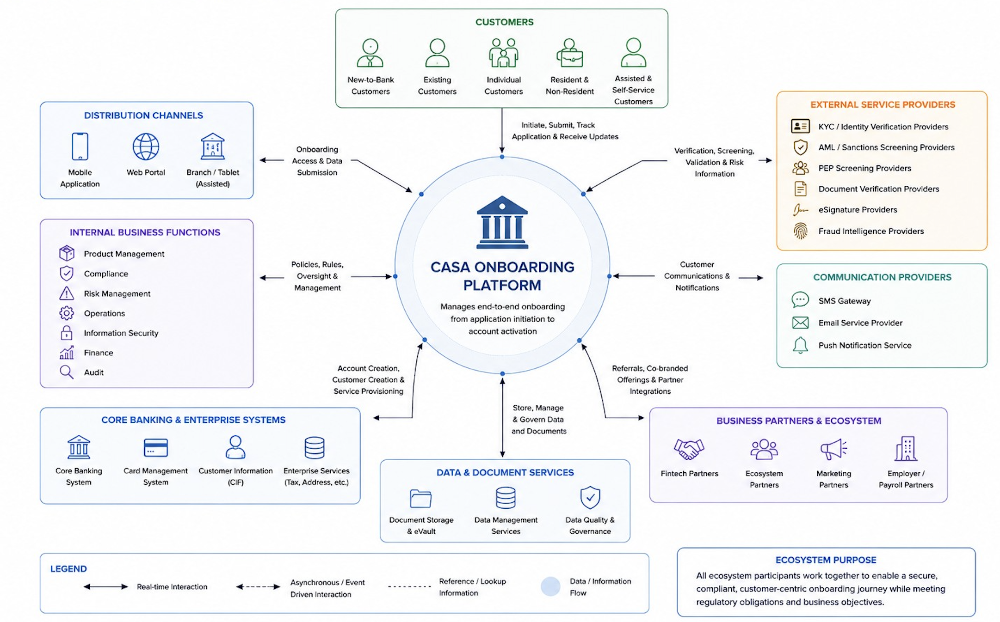

# 1. Overview

> Customer Onboarding — module 1 of 10. Exported from Development `customer-onboarding` v13.

[← Customer Onboarding](README.md) · [Next: Initiation & Eligibility](02-initiation-eligibility.md)

## Contents

- [1.1 Overview](#11-overview)
- [1.2 Business Context](#12-business-context)
- [1.3 Customer Domain](#13-customer-domain)
- [1.4 Customer Onboarding Journey](#14-customer-onboarding-journey)

## 1.1 Overview

Covers: Purpose · Business Objectives · In Scope · Out of Scope

> **Image (protected media, not exported):** retail-banking-orchestration 2.png

### Purpose

The CASA Onboarding domain covers the end-to-end business process of enrolling a new or existing customer into a Current Account or Savings Account (CASA) product. It encompasses every step from the moment a customer expresses interest in opening an account through to the point where the account is fully active and the customer is ready to transact.

The domain exists to ensure that the bank can:

- Acquire customers efficiently — through digital and branch-assisted channels with minimal friction.
- Remain compliant — by embedding identity verification, AML screening, and regulatory checks into every application.
- Deliver a consistent customer experience — regardless of which channel the customer uses to apply.
- Reduce manual effort — through a structured, rules-driven process that supports straight-through processing wherever possible.

### Business Objectives

| Objective | Description |
|---|---|
| Grow the Customer Base | Enable the bank to acquire new retail and corporate customers efficiently through both digital and branch channels. |
| Accelerate Time-to-Account | Reduce the time from application submission to account activation, targeting straight-through processing for eligible customers. |
| Ensure Regulatory Compliance | Embed KYC, AML, and sanctions screening into the onboarding flow to meet all applicable regulatory obligations. |
| Improve Customer Experience | Provide a simple, guided onboarding journey that customers can complete on their own without requiring branch visits. |
| Enable Cross-Selling | Use the onboarding moment to introduce relevant products such as debit cards, digital banking, and complementary accounts. |
| Reduce Operational Cost | Automate manual steps, minimise paper-based processes, and reduce the need for branch staff involvement in standard applications. |
| Maintain Data Integrity | Ensure all customer information captured during onboarding is accurate, complete, and consistent with core banking records. |

### In Scope

The following activities and capabilities are in scope for the CASA Onboarding domain:

- Customer application initiation across digital and branch channels
- Identity verification and eKYC processing
- Customer information collection (personal, contact, employment, tax)
- Compliance and risk screening (KYC, AML, PEP, Sanctions)
- Product selection and account configuration
- Consent and agreement capture (Terms & Conditions, Privacy, e-Signature)
- Customer authentication and fraud review
- Account creation and activation in core banking
- Debit card enrollment and PIN setup
- Digital banking credential setup and MFA enrollment
- Customer notifications throughout the onboarding journey
- Welcome dashboard and post-onboarding next steps
- Application save & resume capability
- Exception handling for failed verifications, compliance holds, and incomplete applications

### Out of Scope

The following are explicitly outside the boundary of the CASA Onboarding domain:

| Out of Scope Item | Reason / Where It Belongs |
|---|---|
| Ongoing account maintenance & servicing | Managed by the Account Servicing domain after onboarding is complete. |
| Loan or credit product origination | Covered by the Lending Origination domain. |
| Fixed Deposit / Time Deposit opening | Separate product onboarding process with different eligibility rules. |
| Credit card application | Covered by the Credit Card Origination domain. |
| Corporate banking onboarding | Corporate customers follow a separate, more complex onboarding workflow. |
| Branch infrastructure management | Physical branch operations are outside the scope of this domain. |
| Core banking system configuration | Managed by the Core Banking team; onboarding consumes but does not configure core banking. |
| Post-account transaction processing | Covered by the Payments and Transactions domain. |

## 1.2 Business Context

Covers: CASA Business Overview · Business Ecosystem · Business Value · Business Stakeholders · Business Actors

### CASA Business Overview

CASA stands for Current Account and Savings Account. These are the two most fundamental banking products offered to retail customers and serve as the primary transactional relationship between a customer and the bank.

| Account Type | Description |
|---|---|
| Current Account (CA) | A transactional account designed for frequent day-to-day use. Typically no restrictions on the number of withdrawals or deposits. May include an overdraft facility. |
| Savings Account (SA) | A deposit account that earns interest on the balance held. May have transaction limits per month. Designed for customers who want to save money while retaining easy access to funds. |

CASA accounts are strategically important to the bank because:

- Low-cost funding: Customer deposits in CASA accounts represent a low-cost source of funds for the bank compared to other forms of borrowing.
- Primary relationship anchor: A CASA account is typically the first product a customer holds with the bank and forms the foundation for cross-selling loans, cards, and investments.
- Transaction volume: CASA accounts generate high transaction volumes, driving fee income and payment processing revenue.
- Customer stickiness: Customers who hold a CASA account are significantly more likely to retain their banking relationship with the bank long-term.

### Business Ecosystem

The CASA Onboarding ecosystem represents all internal and external entities that participate in, influence, or support the end-to-end onboarding process. These entities interact with the onboarding platform to deliver a compliant, secure, and seamless customer experience.

At the centre is the CASA Onboarding Platform, which manages end-to-end onboarding from application initiation to account activation.

### Business Value

The CASA Onboarding capability delivers value across multiple dimensions of the business:

| Value Dimension | Impact | Beneficiary |
|---|---|---|
| Revenue Growth | Each new CASA customer represents recurring fee income, deposit balances, and cross-sell opportunity. | Business / Finance |
| Compliance Risk Reduction | Automated KYC and AML screening reduces the risk of regulatory breaches and associated fines. | Compliance / Risk |
| Operational Efficiency | Digital onboarding reduces branch workload and paper-based processing costs. | Operations |
| Customer Acquisition Speed | Faster onboarding reduces the window during which a prospect may switch to a competitor. | Sales / Retail Banking |
| Data Quality | Structured data capture at onboarding improves the quality of the bank's customer data, enabling better analytics and personalisation. | Analytics / Marketing |
| Audit Readiness | Full audit trails for every onboarding application supports regulatory examinations and internal audits. | Compliance / Audit |

### Business Stakeholders

(*) May vary depending on each bank's organizational structure

| Stakeholder | Interest & Involvement |
|---|---|
| Retail Banking | Accountable for customer acquisition targets and account growth. Sets product strategy and eligibility criteria for CASA products. |
| Compliance & Risk | Defines KYC, AML, PEP, and sanctions screening requirements. Reviews and approves exception handling rules. Accountable for regulatory adherence. |
| Operations | Manages manual review queues, exception cases, and day-to-day operational support for the onboarding process. |
| Digital Banking | Owns the mobile and web channel experience. Responsible for digital onboarding journeys, UX, and digital activation. |
| Branch Network | Manages assisted onboarding in branches. Staff are responsible for supporting customers who cannot or do not wish to self-serve digitally. |
| Technology / IT | Responsible for building, maintaining, and supporting the technical systems that deliver the onboarding capabilities. |
| Finance | Tracks account acquisition costs, the economics of new customer acquisition, and the revenue contribution of newly onboarded customers. |
| Legal | Reviews and approves Terms & Conditions, consent language, and the legal validity of e-Signatures used during onboarding. |
| Marketing | Uses onboarding as a cross-sell opportunity. Designs welcome communications and post-onboarding engagement campaigns. |
| Internal Audit | Reviews onboarding processes and controls to ensure compliance with policies and regulatory requirements. |

### Business Actors

| Actor | Type | Role in Onboarding |
|---|---|---|
| Customer | External | The individual applying to open a CASA account. The primary actor whose journey the entire domain is designed to serve. |
| Relationship Manager (RM) | Internal | Bank staff who assist customers with account opening, particularly for high-value or complex applications. May initiate applications on behalf of customers in branch. |
| Branch Officer | Internal | Front-line bank staff who verify physical documents, assist walk-in customers, and support assisted onboarding journeys. |
| Compliance Officer | Internal | Reviews applications flagged during AML, PEP, or sanctions screening. Makes manual compliance decisions on exception cases. |
| Operations Administrator | Internal | Manages application queues, resolves processing exceptions, and oversees the operational health of the onboarding process. |
| eKYC Provider | External System | Third-party service that performs identity verification, document authenticity checks, face matching, and liveness detection. |
| AML / Sanctions Screening Provider | External System | External service that screens applicants against AML watchlists, PEP databases, and international sanctions lists. |
| Core Banking System | Internal System | The bank's central system of record where customer profiles (CIF) and accounts are ultimately created and managed. |
| Communication Providers | External System | SMS, email, and push notification services that deliver communications to customers throughout the onboarding journey. |

## 1.3 Customer Domain

Covers: Customer Types · Customer Eligibility · Customer Information Categories

### Customer Types

The bank recognises two primary customer types within the CASA Onboarding domain, each with distinct onboarding requirements and process flows.

| Customer Type | Description |
|---|---|
| New-to-Bank (NTB) Customer | A customer who does not currently hold any product or account with the bank. They have no existing Customer Information File (CIF) in core banking. The full onboarding journey applies — including identity verification, compliance screening, information capture, and CIF creation. |
| Existing Customer (ETB — Existing-to-Bank) | A customer who already holds at least one product with the bank and has an existing CIF. When opening an additional CASA account, certain steps may be simplified or skipped, such as identity re-verification and full compliance re-screening, subject to the bank's re-KYC policy. |

Within these two types, customers may also be further categorised by the channel through which they apply:

| Channel Category | Description | Key Characteristic |
|---|---|---|
| Digital Self-Service | Customer applies independently via mobile app or web portal without staff assistance. | Full automation possible; higher drop-off risk at complex steps. |
| Assisted — Branch | Customer visits a branch and is supported by a Relationship Manager or Branch Officer. | Staff verify documents in person; suitable for customers less comfortable with digital. |
| Assisted — Remote | Customer is guided through the application by a bank representative via video or phone. | Hybrid model; document upload done by customer, identity reviewed by staff. |

### Customer Eligibility

(*) Not all individuals are eligible to open a CASA account. Eligibility requirements vary by country and financial institution, depending on local central bank regulations and specific internal bank policies.

Below are some of the most common requirements:

| Eligibility Criterion | Requirement |
|---|---|
| Age | Applicant must be at least 18 years of age. Minor accounts (below 18) are governed by a separate process and are out of scope for this domain. |
| Nationality / Residency | The bank accepts applications from nationals and eligible foreign nationals as defined by the bank's customer acceptance policy. Certain high-risk nationalities or non-resident statuses may require enhanced due diligence. |
| Identity Documentation | Applicant must be able to provide a valid government-issued identity document acceptable to the bank (e.g. national ID, passport, driving licence). |
| Compliance Clearance | Applicant must pass AML screening, sanctions checks, and PEP screening. Applicants who appear on watchlists or are deemed high-risk require manual review. |
| No Existing Adverse History | Applicants with a history of fraud, account misuse, or court orders related to banking may be declined subject to the bank's policies. |
| Tax Declaration | Applicant must provide a valid tax identification number (TIN) or equivalent and declare their tax residency, as required by applicable tax reporting regulations. |
| Minimum Initial Deposit | Certain CASA products may require a minimum initial deposit at account opening. This is product-specific and defined in the product configuration. |

### Customer Information Categories

During the onboarding process, the bank collects several categories of customer information. Each category serves a specific business purpose and is subject to data privacy and regulatory requirements.

| Information Category | What Is Collected | Business Purpose |
|---|---|---|
| Personal Information | Full legal name, date of birth, gender, nationality, country of birth. | Identity verification, CIF creation, and regulatory reporting. |
| Identity Information | Document type, document number, issuing country, expiry date, document images. | eKYC verification and ongoing identity management. |
| Contact Information | Residential address, mailing address, mobile number, email address. | Account correspondence, notifications, and statement delivery. |
| Employment & Financial Information | Employment status, employer name, occupation, source of funds, estimated annual income. | Risk assessment, product eligibility, and AML due diligence. |
| Tax Information | Tax Identification Number (TIN), country of tax residency, tax status declarations. | Compliance with tax reporting regulations (e.g. CRS, FATCA). |
| Consent & Agreement Records | Date and time of consent, specific consents given (T&C, Privacy, Marketing), e-Signature data. | Legal evidence of customer acceptance and regulatory consent requirements. |
| Authentication Information | Preferred login credentials, security questions, MFA method, device registration. | Digital banking access and fraud prevention. |
| Communication Preferences | Preferred channel (SMS, email, push), language preference, marketing opt-in/opt-out. | Customer communication and marketing compliance. |

All customer information collected during onboarding is subject to the bank's Data Privacy Policy and applicable data protection regulations. Information must only be collected for stated purposes and retained for no longer than required by law or policy.

## 1.4 Customer Onboarding Journey

Covers: Journey Overview · Customer Entry Points · End-to-End Journey · Journey Stages · Journey Outcomes

### Journey Overview

The CASA Onboarding Journey is the structured sequence of steps a customer passes through to open a Current or Savings Account.

Diagram: image-20260626-032041.png (see the Confluence page)
https://datumhq.atlassian.net/wiki/download/attachments/1698070534/image-20260626-032041.png?version=1&modificationDate=1782444043903&cacheVersion=1&api=v2

### Customer Entry Points

The onboarding journey can be initiated by four distinct types of actors, each triggering a different entry point. All entry points feed into the same underlying onboarding process and business rules, but differ in how the journey begins and how the channel context is established.

| Actor | Entry Point | Description |
|---|---|---|
| Customer | Direct — Mobile App | Customer manually starts onboarding via the bank's mobile app. Selects 'Open an Account' and proceeds through full self-service. Supports eKYC via device camera. This is the primary digital acquisition channel. |
| Customer | Direct — Web Portal | Customer visits the bank's website and initiates an application online. Functionally equivalent to mobile; document upload replaces camera-based capture on some devices. |
| Customer | Direct — Existing Customer (ETB) | An existing bank customer applies to open an additional CASA account. Their existing CIF data is pre-populated and certain verification steps may be simplified based on re-KYC policy. |
| Campaign | Campaign Onboarding | Customer enters via a targeted marketing link, QR code, or email campaign. The system captures the campaign ID and entry source for attribution tracking. Product selection may be pre-set based on the campaign offer. |
| Bank Staff | Assisted Onboarding | A Relationship Manager or Branch Officer initiates the onboarding on behalf of the customer — either in-branch or remotely. Staff complete the application using a bank-facing interface. Physical document verification may be done in person. |
| E-commerce / Partner | Embedded Onboarding | Onboarding is triggered from a third-party partner platform (e.g. an e-commerce checkout, fintech partner, or embedded banking integration). The customer does not start from the bank's own app or website. The partner passes the customer context and entry source to the bank's onboarding system, which identifies the channel and determines the appropriate journey path. |

| Channel | Device / Interface | Onboarding Entry Types Supported | Primary Actor |
|---|---|---|---|
| Mobile App | iOS / Android smartphone | Self-service, Campaign | Customer |
| Web Portal | Desktop or mobile browser | Self-service, Campaign, Assisted | Customer or Bank Staff |
| Branch Tablet | In-branch tablet / kiosk | Assisted, Embedded (partial) | Bank Staff + Customer |
| Embedded (E-commerce) | Partner website / checkout flow | Embedded | E-commerce / Partner System |

### End-to-End Journey

| Stage | What Happens | Outcome / Gate to Next Stage |
|---|---|---|
| 1. Initiate Onboarding | Customer chooses 'Open Account' via app, website, branch, or partner channel. The customer reviews key benefits and requirements before committing to begin the application. | Application initiated. Channel and entry source recorded. Customer proceeds to identity verification. |
| 2. eKYC & Identity Verification | Customer completes eKYC by submitting an identity document (ID proof) and a selfie or short video. The system validates the identity in real time using document authentication, face matching, and liveness detection. | Identity verified. Customer name and details pre-populated from verified document. Application advances to information capture. |
| 3. Customer Information Capture | Customer provides personal, contact, employment, and address details. Customer also selects their relationship type (e.g. individual, joint) and communication preferences. | All mandatory information fields completed and validated. Application ready for compliance assessment. |
| 4. Compliance & Risk Evaluation | Customer information is screened against AML watchlists, PEP databases, and sanctions lists. A risk assessment is completed based on the customer profile. PASS: Customer clears all checks and proceeds to Stage 5. FAIL: Customer is routed to Additional Review or Rejection. The customer is informed and assistance is provided. | PASS — Compliance cleared. Proceed to Account & Product Configuration. FAIL — Application placed under review or rejected. Customer notified and assisted. |
| 5. Account & Product Configuration | Customer selects their CASA account type (Savings or Current) and any available variants or packages. Customer also chooses any additional products or services to be bundled with the account. | Account type and product configuration confirmed. Application linked to selected product parameters. |
| 6. Digital Banking Enrollment | Customer registers for Mobile Banking and/or Internet Banking. Customer sets their username and configures communication preferences (e.g. preferred notification channel, language). | Digital banking profile created. Username and communication preferences recorded. |
| 7. Debit Card Enrollment | Customer selects their preferred debit card type and design (where options are available). Customer confirms their delivery address and any delivery preferences for the physical card. | Debit card type and delivery preferences confirmed. Card order queued for issuance. |
| 8. Consent & Agreement Capture | Customer reviews the bank's Terms & Conditions in full. Customer provides their electronic consent and affixes their digital signature to bind the agreement. | All mandatory consents accepted. Digital signature captured and stored with timestamp. Application has legal standing to proceed to authentication. |
| 9. Authentication & Fraud Check | Customer completes an additional authentication step (OTP verification or biometric check) to confirm their identity before account creation. Real-time fraud checks and device verification are performed. | Authentication passed. Fraud checks cleared. Device registered. Application cleared for account creation. |
| 10. Account Creation & Service Provisioning | The CASA account is created in core banking. Selected services and account limits are configured. The core banking system is updated with the new customer record (CIF) and account details. | CASA account created and active. Account number assigned. Services and limits configured. Core banking record updated. |
| 11. Notifications & Communication | The customer's account number and key account details are shared via their preferred channel (SMS, Email, or In-App). A welcome message and important onboarding information are delivered. | Confirmation notification sent and delivery status recorded. Customer is aware of their account number and next steps. |
| 12. Dashboard & Next Steps | Customer lands on their personalised onboarding dashboard showing a summary of what they have set up. Suggested next steps are presented (e.g. fund the account, explore features, access help & support). | Customer oriented on the dashboard. Onboarding journey complete. Customer is all set to bank. |

### Journey Stages

Each stage has defined entry criteria — what must be true before the stage begins — and exit criteria — what must be achieved before the customer can advance. The key customer activity at each stage is also described.

| Stage | Entry Criteria | Key Customer Activity & Exit Criteria |
|---|---|---|
| 1. Initiate Onboarding | Customer has accessed a valid onboarding channel (app, web, branch, or partner). Channel context and entry source are identifiable. | Customer selects 'Open Account' and acknowledges key product requirements. Exit: Application record created with unique reference. Channel and entry type recorded. |
| 2. eKYC & Identity Verification | Application record exists. Customer has a valid government-issued identity document available. | Customer submits ID document and completes selfie or video for liveness check. Exit: eKYC status = Verified. Face match passed. Identity details extracted and pre-populated. |
| 3. Customer Information Capture | eKYC verification passed. Identity details pre-populated into the application. | Customer reviews pre-filled details, completes remaining fields (contact, employment, address), and selects relationship type. Exit: All mandatory fields complete. No validation errors. Tax declarations provided. |
| 4. Compliance & Risk Evaluation | Customer information capture complete. All required fields submitted for screening. | System runs automated AML, PEP, and sanctions screening. Risk rating assigned. Exit (PASS): All checks cleared. Risk rating recorded. Proceed to Stage 5. Exit (FAIL): Compliance flag raised. Application routed to manual review or rejected. Customer informed. |
| 5. Account & Product Configuration | Compliance screening passed or manual review resolved with approval to proceed. | Customer selects CASA account type (Savings / Current), product variant, and any bundled services. Exit: Account type and product configuration confirmed. Eligibility rules validated. |
| 6. Digital Banking Enrollment | Account and product configuration confirmed. | Customer registers for Mobile / Internet Banking, sets username, and configures communication preferences. Exit: Digital banking profile created. Preferences saved. |
| 7. Debit Card Enrollment | Digital banking enrollment completed. | Customer selects debit card type and confirms delivery address and preferences. Exit: Card type and delivery preferences confirmed. Card order queued. |
| 8. Consent & Agreement Capture | Debit card enrollment completed. Current version of Terms & Conditions is available. | Customer reads Terms & Conditions, provides electronic consent, and affixes digital signature. Exit: All consents accepted. Digital signature captured and timestamped. Consent record stored. |
| 9. Authentication & Fraud Check | Consent and agreement captured. Customer has a valid mobile number or biometric enrolled. | Customer completes OTP or biometric authentication. System performs real-time fraud and device checks. Exit: Authentication passed. Fraud checks cleared. Device verified and registered. |
| 10. Account Creation & Service Provisioning | All prior stages complete. No outstanding blocks or compliance holds. | System creates CIF and CASA account in core banking. Configures selected services and limits. Exit: Account created. Account number assigned. Account status = Active. Core banking updated. |
| 11. Notifications & Communication | Account successfully created and active. Customer contact details available. | System sends account confirmation, account number, and welcome message via SMS, Email, or In-App. Exit: Notification delivered and delivery status recorded. Customer informed of account details. |
| 12. Dashboard & Next Steps | Account active. Welcome notification sent. | Customer views personalised dashboard with account summary and suggested next steps. Exit: Dashboard viewed. Onboarding status = Complete. Customer ready to transact. |

### Journey Outcomes

Every onboarding journey ends in one of the following defined outcomes. Each outcome has specific business implications, follow-up actions, and communication requirements.

| Outcome | Description | Follow-Up Action |
|---|---|---|
| Successful Account Opening | Customer completes all stages, passes all checks, and the account is opened and activated. This is the primary desired outcome. | Send confirmation notification. Trigger welcome communications. Hand off to CRM for relationship management. |
| Application Abandoned (Pre-Submit) | Customer started but did not complete the application within the expiry window. Application closes automatically. | Trigger re-engagement communication (if customer consented to marketing). Log drop-off stage for analytics. |
| Application Withdrawn | Customer voluntarily cancelled their in-progress application. | Send withdrawal confirmation. Offer option to reapply. Record withdrawal reason if provided. |
| Rejected — Identity Failure | Customer failed eKYC verification and was unable to pass identity checks within the permitted number of attempts. | Notify customer of outcome. Direct to branch for assisted verification if policy permits. Log for fraud monitoring. |
| Rejected — Compliance Hold | Customer was matched on AML, PEP, or sanctions watchlists and manual review resulted in a rejection decision. | Notify customer per the bank's adverse action communication policy. File Suspicious Activity Report (SAR) if required. No further onboarding permitted without senior compliance approval. |
| Rejected — Eligibility Failure | Customer did not meet the eligibility criteria (e.g. age, nationality, missing documentation). | Notify customer of the specific reason for ineligibility where permissible. Advise on alternative products if applicable. |
| Referred for Manual Processing | Application could not be processed automatically and has been routed to the Operations team for manual handling. | Operations team reviews and resolves within the defined SLA. Customer informed of delay and expected resolution timeframe. |

---

[← Customer Onboarding](README.md) · [Next: Initiation & Eligibility](02-initiation-eligibility.md)
