# 2. Initiation & Eligibility

> Customer Onboarding — module 2 of 10. Exported from Development `customer-onboarding` v13.

[← Customer Onboarding](README.md) · [Previous: Overview](01-overview.md) · [Next: Application Management](03-application-management.md)

## Contents

- [2.1 Purpose](#21-purpose)
- [2.2 General Business Process Flow](#22-general-business-process-flow)
- [2.3 Business Triggers](#23-business-triggers)
- [2.4 Preconditions](#24-preconditions)
- [2.5 Inputs](#25-inputs)
- [2.6 Business Process](#26-business-process)
- [2.7 Business Rules](#27-business-rules)
- [2.8 Validation Rules](#28-validation-rules)
- [2.9 Decision Points](#29-decision-points)
- [2.10 Outputs](#210-outputs)
- [2.11 Exceptions](#211-exceptions)
- [2.12 Responsibilities](#212-responsibilities)

## 2.1 Purpose

Establish the onboarding request, identify the customer/product/channel context, determine whether the request is within the bank's supported onboarding scope, and decide whether detailed onboarding may proceed.

## 2.2 General Business Process Flow

### Customer Onboarding – End-to-End General Business Process Flow

BPMN-aligned business workflow covering New-to-Bank customer onboarding from initiation and eligibility through customer data capture, consent, duplicate checking, identity verification, KYC/CDD, screening, risk assessment, review and approval, customer and account creation, activation, completion, rework, rejection and operational exceptions.

#### Scope

- **journey:** Customer Onboarding
- **customerContext:** New-to-Bank
- **supportedChannels:**
  - Digital self-service
  - Assisted / Relationship Manager / Branch
- **start:** Customer expresses intent to establish a banking relationship or apply for an eligible banking product.
- **successEnd:** Customer and requested account/product are successfully created and onboarding reaches the required active or ready-for-use state.
- **alternateOutcomes:**
  - Existing customer routed to applicable existing-customer journey
  - Ineligible
  - Rework required
  - Manual review
  - Rejected
  - Cancelled
  - Expired
  - Operational exception
- **outOfScope:**
  - Post-onboarding account servicing
  - Ongoing customer profile maintenance
  - Transaction servicing
  - Corporate KYB legal-entity onboarding unless separately modelled

#### Process flow

```mermaid
flowchart LR
  subgraph lane_customer["Customer"]
    start_onboarding(["Customer starts onboarding"])
    select_onboarding_context["Select product / onboarding context"]
    capture_customer_profile["Capture customer profile"]
    capture_consent_declarations["Capture consent & declarations"]
    customer_continues{"Customer continues onboarding?"}
    onboarding_cancelled_expired(["Cancelled / expired"])
    collect_identity_evidence["Provide identity evidence"]
    capture_kyc_information["Capture KYC / CDD information"]
    collect_edd_information["Collect enhanced due diligence information"]
    onboarding_completed(["Customer onboarding completed"])
  end
  subgraph lane_channel["Digital / Assisted Channel"]
    capture_initial_context["Capture initial customer context"]
    onboarding_ineligible(["Onboarding ineligible / redirected"])
    request_customer_rework["Request missing / corrected information"]
    existing_customer_route(["Route to existing-customer journey"])
    request_identity_retry["Request new / corrected identity evidence"]
    request_cdd_rework["Request additional KYC information"]
    notify_customer["Notify customer of completion"]
  end
  subgraph lane_onboarding_crm["Onboarding / CRM"]
    create_application["Create onboarding application"]
    evaluate_initial_eligibility["Evaluate initial eligibility"]
    eligibility_result{"Eligible to proceed?"}
    validate_customer_data["Validate customer data"]
    customer_data_complete{"Customer data complete & valid?"}
    check_existing_customer["Check existing / duplicate customer"]
    potential_existing_customer{"Existing / potential duplicate?"}
    assemble_decision_package["Assemble onboarding decision package"]
    approval_prerequisites_complete{"All approval prerequisites complete?"}
    manual_approval_required{"Manual approval required?"}
    automatic_approval["Apply permitted automated approval"]
    record_approved_decision["Record approved onboarding decision"]
    revalidate_before_creation["Revalidate creation prerequisites"]
    creation_prerequisites_valid{"Creation prerequisites valid?"}
    store_customer_reference["Store authoritative customer reference"]
    store_account_reference["Store authoritative account / product reference"]
    evaluate_activation["Evaluate activation prerequisites"]
    activation_ready{"Ready for activation / completion?"}
    finalize_onboarding["Finalize onboarding status & evidence"]
  end
  subgraph lane_identity_kyc["Identity & KYC Services"]
    validate_identity_evidence["Validate identity document / evidence"]
    perform_identity_verification["Perform identity verification"]
    identity_verified{"Identity verified?"}
    identity_retry_allowed{"Retry permitted?"}
    determine_cdd_requirements["Determine KYC / CDD requirements"]
    validate_cdd["Validate CDD completeness & consistency"]
    cdd_complete{"CDD complete?"}
    determine_edd{"Enhanced Due Diligence required?"}
  end
  subgraph lane_compliance_risk["Compliance / Risk"]
    perform_edd_review["Perform EDD review"]
    edd_satisfactory{"EDD satisfactory?"}
    edd_rejected(["EDD outcome rejected"])
    run_customer_screening["Run required customer screening"]
    screening_result{"Screening clear?"}
    review_screening_match["Review potential screening match"]
    screening_cleared{"Potential match cleared?"}
    screening_rejected(["Screening / compliance rejection"])
    assess_customer_risk["Assess customer risk"]
    enhanced_risk_route{"Enhanced risk route required?"}
    perform_enhanced_risk_review["Perform enhanced risk review"]
    enhanced_risk_acceptable{"Enhanced risk acceptable?"}
    risk_rejected(["Risk outcome rejected"])
  end
  subgraph lane_operations_approver["Operations / Authorized Approver"]
    resolve_customer_match["Resolve customer match"]
    confirmed_existing_customer{"Confirmed existing customer?"}
    manual_identity_review["Manual identity review"]
    manual_identity_cleared{"Identity manually cleared?"}
    identity_rejected(["Identity verification rejected"])
    route_approval_rework["Route case for required rework"]
    review_onboarding_application["Review onboarding application"]
    approval_decision{"Approval decision"}
    approval_rejected(["Onboarding rejected"])
    creation_prerequisite_rework["Resolve creation prerequisite"]
    reconcile_customer_creation["Reconcile customer creation result"]
    customer_exists_after_reconcile{"Customer successfully created / confirmed?"}
    retry_customer_creation{"Safe retry allowed?"}
    customer_creation_exception(["Customer creation exception"])
    reconcile_account_creation["Reconcile account creation result"]
    account_exists_after_reconcile{"Account / product successfully created / confirmed?"}
    retry_account_creation{"Safe account creation retry allowed?"}
    account_creation_exception(["Account creation exception"])
    resolve_activation_action["Complete pending activation action"]
  end
  subgraph lane_core_banking["Core Banking / System of Record"]
    create_customer_record["Create / update customer master"]
    customer_creation_result{"Customer creation successful?"}
    create_account_product["Create requested account / product"]
    account_creation_result{"Account / product creation successful?"}
    activate_relationship["Activate customer relationship / account"]
  end
  start_onboarding --> select_onboarding_context
  select_onboarding_context --> capture_initial_context
  capture_initial_context --> create_application
  create_application --> evaluate_initial_eligibility
  evaluate_initial_eligibility --> eligibility_result
  eligibility_result -->|"Yes"| capture_customer_profile
  eligibility_result -->|"No"| onboarding_ineligible
  capture_customer_profile --> capture_consent_declarations
  capture_consent_declarations --> validate_customer_data
  validate_customer_data --> customer_data_complete
  customer_data_complete -->|"Yes"| check_existing_customer
  customer_data_complete -->|"No"| request_customer_rework
  request_customer_rework --> customer_continues
  customer_continues -->|"Yes"| capture_customer_profile
  customer_continues -->|"No"| onboarding_cancelled_expired
  check_existing_customer --> potential_existing_customer
  potential_existing_customer -->|"No"| collect_identity_evidence
  potential_existing_customer -->|"Yes"| resolve_customer_match
  resolve_customer_match --> confirmed_existing_customer
  confirmed_existing_customer -->|"Yes"| existing_customer_route
  confirmed_existing_customer -->|"No / false positive"| collect_identity_evidence
  collect_identity_evidence --> validate_identity_evidence
  validate_identity_evidence --> perform_identity_verification
  perform_identity_verification --> identity_verified
  identity_verified -->|"Yes"| determine_cdd_requirements
  identity_verified -->|"No / inconclusive"| identity_retry_allowed
  identity_retry_allowed -->|"Yes"| request_identity_retry
  request_identity_retry --> collect_identity_evidence
  identity_retry_allowed -->|"No"| manual_identity_review
  manual_identity_review --> manual_identity_cleared
  manual_identity_cleared -->|"Yes"| determine_cdd_requirements
  manual_identity_cleared -->|"No"| identity_rejected
  determine_cdd_requirements --> capture_kyc_information
  capture_kyc_information --> validate_cdd
  validate_cdd --> cdd_complete
  cdd_complete -->|"Yes"| determine_edd
  cdd_complete -->|"No"| request_cdd_rework
  request_cdd_rework --> capture_kyc_information
  determine_edd -->|"No"| run_customer_screening
  determine_edd -->|"Yes"| collect_edd_information
  collect_edd_information --> perform_edd_review
  perform_edd_review --> edd_satisfactory
  edd_satisfactory -->|"Yes"| run_customer_screening
  edd_satisfactory -->|"No"| edd_rejected
  run_customer_screening --> screening_result
  screening_result -->|"Clear"| assess_customer_risk
  screening_result -->|"Potential / non-clear match"| review_screening_match
  review_screening_match --> screening_cleared
  screening_cleared -->|"Yes"| assess_customer_risk
  screening_cleared -->|"No"| screening_rejected
  assess_customer_risk --> enhanced_risk_route
  enhanced_risk_route -->|"No"| assemble_decision_package
  enhanced_risk_route -->|"Yes"| perform_enhanced_risk_review
  perform_enhanced_risk_review --> enhanced_risk_acceptable
  enhanced_risk_acceptable -->|"Yes"| assemble_decision_package
  enhanced_risk_acceptable -->|"No"| risk_rejected
  assemble_decision_package --> approval_prerequisites_complete
  approval_prerequisites_complete -->|"Yes"| manual_approval_required
  approval_prerequisites_complete -->|"No"| route_approval_rework
  route_approval_rework -->|"Return to responsible stage"| validate_customer_data
  manual_approval_required -->|"No / STP"| automatic_approval
  manual_approval_required -->|"Yes"| review_onboarding_application
  review_onboarding_application --> approval_decision
  approval_decision -->|"Approve"| record_approved_decision
  approval_decision -->|"Rework"| route_approval_rework
  approval_decision -->|"Reject"| approval_rejected
  automatic_approval --> record_approved_decision
  record_approved_decision --> revalidate_before_creation
  revalidate_before_creation --> creation_prerequisites_valid
  creation_prerequisites_valid -->|"Yes"| create_customer_record
  creation_prerequisites_valid -->|"No"| creation_prerequisite_rework
  creation_prerequisite_rework -->|"Re-assess / re-approve"| assemble_decision_package
  create_customer_record --> customer_creation_result
  customer_creation_result -->|"Yes"| store_customer_reference
  customer_creation_result -->|"No / uncertain"| reconcile_customer_creation
  reconcile_customer_creation --> customer_exists_after_reconcile
  customer_exists_after_reconcile -->|"Yes"| store_customer_reference
  customer_exists_after_reconcile -->|"No"| retry_customer_creation
  retry_customer_creation -->|"Yes"| create_customer_record
  retry_customer_creation -->|"No"| customer_creation_exception
  store_customer_reference --> create_account_product
  create_account_product --> account_creation_result
  account_creation_result -->|"Yes"| store_account_reference
  account_creation_result -->|"No / uncertain"| reconcile_account_creation
  reconcile_account_creation --> account_exists_after_reconcile
  account_exists_after_reconcile -->|"Yes"| store_account_reference
  account_exists_after_reconcile -->|"No"| retry_account_creation
  retry_account_creation -->|"Yes"| create_account_product
  retry_account_creation -->|"No"| account_creation_exception
  store_account_reference --> evaluate_activation
  evaluate_activation --> activation_ready
  activation_ready -->|"Yes"| activate_relationship
  activation_ready -->|"No"| resolve_activation_action
  resolve_activation_action --> evaluate_activation
  activate_relationship --> finalize_onboarding
  finalize_onboarding --> notify_customer
  notify_customer --> onboarding_completed
```

#### Process steps

| Step ID | Type | Lane | Activity |
|---|---|---|---|
| start-onboarding | start-event | Customer | Customer starts onboarding |
| select-onboarding-context | user-task | Customer | Select product / onboarding context |
| capture-initial-context | user-task | Digital / Assisted Channel | Capture initial customer context |
| create-application | service-task | Onboarding / CRM | Create onboarding application |
| evaluate-initial-eligibility | service-task | Onboarding / CRM | Evaluate initial eligibility |
| eligibility-result | decision-gateway | Onboarding / CRM | Eligible to proceed? |
| onboarding-ineligible | end-event | Digital / Assisted Channel | Onboarding ineligible / redirected |
| capture-customer-profile | user-task | Customer | Capture customer profile |
| capture-consent-declarations | user-task | Customer | Capture consent & declarations |
| validate-customer-data | service-task | Onboarding / CRM | Validate customer data |
| customer-data-complete | decision-gateway | Onboarding / CRM | Customer data complete & valid? |
| request-customer-rework | user-task | Digital / Assisted Channel | Request missing / corrected information |
| customer-continues | decision-gateway | Customer | Customer continues onboarding? |
| onboarding-cancelled-expired | end-event | Customer | Cancelled / expired |
| check-existing-customer | service-task | Onboarding / CRM | Check existing / duplicate customer |
| potential-existing-customer | decision-gateway | Onboarding / CRM | Existing / potential duplicate? |
| resolve-customer-match | user-task | Operations / Authorized Approver | Resolve customer match |
| confirmed-existing-customer | decision-gateway | Operations / Authorized Approver | Confirmed existing customer? |
| existing-customer-route | end-event | Digital / Assisted Channel | Route to existing-customer journey |
| collect-identity-evidence | user-task | Customer | Provide identity evidence |
| validate-identity-evidence | service-task | Identity & KYC Services | Validate identity document / evidence |
| perform-identity-verification | service-task | Identity & KYC Services | Perform identity verification |
| identity-verified | decision-gateway | Identity & KYC Services | Identity verified? |
| identity-retry-allowed | decision-gateway | Identity & KYC Services | Retry permitted? |
| request-identity-retry | user-task | Digital / Assisted Channel | Request new / corrected identity evidence |
| manual-identity-review | user-task | Operations / Authorized Approver | Manual identity review |
| manual-identity-cleared | decision-gateway | Operations / Authorized Approver | Identity manually cleared? |
| identity-rejected | end-event | Operations / Authorized Approver | Identity verification rejected |
| determine-cdd-requirements | service-task | Identity & KYC Services | Determine KYC / CDD requirements |
| capture-kyc-information | user-task | Customer | Capture KYC / CDD information |
| validate-cdd | service-task | Identity & KYC Services | Validate CDD completeness & consistency |
| cdd-complete | decision-gateway | Identity & KYC Services | CDD complete? |
| request-cdd-rework | user-task | Digital / Assisted Channel | Request additional KYC information |
| determine-edd | decision-gateway | Identity & KYC Services | Enhanced Due Diligence required? |
| collect-edd-information | user-task | Customer | Collect enhanced due diligence information |
| perform-edd-review | user-task | Compliance / Risk | Perform EDD review |
| edd-satisfactory | decision-gateway | Compliance / Risk | EDD satisfactory? |
| edd-rejected | end-event | Compliance / Risk | EDD outcome rejected |
| run-customer-screening | service-task | Compliance / Risk | Run required customer screening |
| screening-result | decision-gateway | Compliance / Risk | Screening clear? |
| review-screening-match | user-task | Compliance / Risk | Review potential screening match |
| screening-cleared | decision-gateway | Compliance / Risk | Potential match cleared? |
| screening-rejected | end-event | Compliance / Risk | Screening / compliance rejection |
| assess-customer-risk | service-task | Compliance / Risk | Assess customer risk |
| enhanced-risk-route | decision-gateway | Compliance / Risk | Enhanced risk route required? |
| perform-enhanced-risk-review | user-task | Compliance / Risk | Perform enhanced risk review |
| enhanced-risk-acceptable | decision-gateway | Compliance / Risk | Enhanced risk acceptable? |
| risk-rejected | end-event | Compliance / Risk | Risk outcome rejected |
| assemble-decision-package | service-task | Onboarding / CRM | Assemble onboarding decision package |
| approval-prerequisites-complete | decision-gateway | Onboarding / CRM | All approval prerequisites complete? |
| route-approval-rework | user-task | Operations / Authorized Approver | Route case for required rework |
| manual-approval-required | decision-gateway | Onboarding / CRM | Manual approval required? |
| automatic-approval | service-task | Onboarding / CRM | Apply permitted automated approval |
| review-onboarding-application | user-task | Operations / Authorized Approver | Review onboarding application |
| approval-decision | decision-gateway | Operations / Authorized Approver | Approval decision |
| approval-rejected | end-event | Operations / Authorized Approver | Onboarding rejected |
| record-approved-decision | service-task | Onboarding / CRM | Record approved onboarding decision |
| revalidate-before-creation | service-task | Onboarding / CRM | Revalidate creation prerequisites |
| creation-prerequisites-valid | decision-gateway | Onboarding / CRM | Creation prerequisites valid? |
| creation-prerequisite-rework | user-task | Operations / Authorized Approver | Resolve creation prerequisite |
| create-customer-record | service-task | Core Banking / System of Record | Create / update customer master |
| customer-creation-result | decision-gateway | Core Banking / System of Record | Customer creation successful? |
| reconcile-customer-creation | user-task | Operations / Authorized Approver | Reconcile customer creation result |
| customer-exists-after-reconcile | decision-gateway | Operations / Authorized Approver | Customer successfully created / confirmed? |
| retry-customer-creation | decision-gateway | Operations / Authorized Approver | Safe retry allowed? |
| customer-creation-exception | end-event | Operations / Authorized Approver | Customer creation exception |
| store-customer-reference | service-task | Onboarding / CRM | Store authoritative customer reference |
| create-account-product | service-task | Core Banking / System of Record | Create requested account / product |
| account-creation-result | decision-gateway | Core Banking / System of Record | Account / product creation successful? |
| reconcile-account-creation | user-task | Operations / Authorized Approver | Reconcile account creation result |
| account-exists-after-reconcile | decision-gateway | Operations / Authorized Approver | Account / product successfully created / confirmed? |
| retry-account-creation | decision-gateway | Operations / Authorized Approver | Safe account creation retry allowed? |
| account-creation-exception | end-event | Operations / Authorized Approver | Account creation exception |
| store-account-reference | service-task | Onboarding / CRM | Store authoritative account / product reference |
| evaluate-activation | service-task | Onboarding / CRM | Evaluate activation prerequisites |
| activation-ready | decision-gateway | Onboarding / CRM | Ready for activation / completion? |
| resolve-activation-action | user-task | Operations / Authorized Approver | Complete pending activation action |
| activate-relationship | service-task | Core Banking / System of Record | Activate customer relationship / account |
| finalize-onboarding | service-task | Onboarding / CRM | Finalize onboarding status & evidence |
| notify-customer | service-task | Digital / Assisted Channel | Notify customer of completion |
| onboarding-completed | end-event | Customer | Customer onboarding completed |

#### Business rules

| ID | Rule |
|---|---|
| OB-BPMN-R01 | Only an onboarding context supported by the applicable customer, product and channel policy may proceed. |
| OB-BPMN-R02 | A confirmed existing customer must not be unintentionally created as a duplicate customer master. |
| OB-BPMN-R03 | Required customer information and consent must be complete before dependent verification and due-diligence processing is finalized. |
| OB-BPMN-R04 | Only an accepted identity-verification outcome may proceed to final KYC/CDD and onboarding decision. |
| OB-BPMN-R05 | Required CDD, EDD, screening and customer-risk activities must reach the applicable resolved outcome before final approval. |
| OB-BPMN-R06 | Manual approval must be performed by an authorized role according to the applicable approval policy. |
| OB-BPMN-R07 | Customer and account creation must only occur after a valid onboarding approval. |
| OB-BPMN-R08 | Failed or uncertain creation responses must be reconciled before retry to prevent duplicate customer or account creation. |
| OB-BPMN-R09 | Onboarding must not be marked complete while required creation, activation or blocking exception conditions remain unresolved. |

#### Validation categories

- Eligibility
- Mandatory customer information
- Consent and declarations
- Cross-field consistency
- Duplicate / existing customer
- Identity evidence
- Identity verification
- CDD completeness
- EDD requirement
- Screening resolution
- Customer risk
- Approval prerequisites
- Approval authority
- Customer creation
- Account / product creation
- Retry safety
- Activation readiness
- Final completion

#### Success outcome

**ACTIVE** — Customer onboarding is successfully completed after the customer and requested account/product have been created, required activation conditions have been satisfied, authoritative references have been stored, and completion evidence and customer notification have been finalized.

## 2.3 Business Triggers

- Customer selects an eligible product or relationship.
- Relationship Manager / Branch Staff initiates assisted onboarding.
- A permitted incomplete application is resumed.

## 2.4 Preconditions

- Supported onboarding channel is available.
- Requested product/relationship is eligible for the selected channel.
- Enough initial customer information exists to perform eligibility and early matching.

## 2.5 Inputs

- Customer type / onboarding context
- Selected product or intended relationship
- Channel
- Basic identity attributes for early matching
- Policy-relevant eligibility attributes where applicable

## 2.6 Business Process

| Step | Business Activity | Primary Owner | Outcome |
|---|---|---|---|
| 1 | Create onboarding application and assign an application reference. | Onboarding Capability | INITIATED. |
| 2 | Capture onboarding context including channel and requested product/relationship. | Channel | Context established. |
| 3 | Evaluate initial eligibility. | Onboarding Capability | Eligible, ineligible or manual clarification. |
| 4 | Perform early existing/duplicate customer check. | Customer Management | New, existing or potential duplicate. |
| 5 | Route eligible application to detailed data capture. | Onboarding Capability | Proceed to Customer Data & Consent. |

## 2.7 Business Rules

| Rule | Business Requirement | Failure / Alternative Outcome |
|---|---|---|
| Supported Scope | Requested onboarding context must be supported by current customer/product/channel policy. | Stop, redirect or assisted handling. |
| Existing Customer | A confirmed existing customer must not be created again as a new customer without approved handling. | Reuse/update existing relationship or manual resolution. |
| Eligibility Evidence | Eligibility outcome must retain sufficient input and reason evidence. | Manual review or controlled rejection. |

## 2.8 Validation Rules

| Validation | Business Condition | Failure Outcome |
|---|---|---|
| Required initiation data | Minimum initiation data is present. | Do not create a processable application. |
| Supported channel | Selected channel is permitted. | Redirect or stop. |
| Supported product/context | Requested product/relationship is currently eligible. | Stop or offer permitted alternative. |
| Early duplicate check | No unresolved duplicate/existing-customer condition remains. | Manual resolution or existing-customer path. |

## 2.9 Decision Points

| Decision | Inputs | Possible Outcomes | Owner |
|---|---|---|---|
| Can onboarding proceed? | Customer/product/channel context and eligibility rules | Proceed / Stop / Manual clarification | Onboarding Capability |
| Is the customer already known? | Identity/customer matching data | New / Existing / Potential duplicate | Customer Management / Operations |

## 2.10 Outputs

- Onboarding application reference
- Eligibility outcome
- Customer/product/channel context
- Duplicate/existing-customer outcome
- Next allowed onboarding stage

## 2.11 Exceptions

| Exception | Business Action | Owner | Outcome |
|---|---|---|---|
| Unsupported context | Explain the unsupported context and route to a permitted alternative where available. | Channel / RM | Stopped or redirected. |
| Potential duplicate | Pause new-customer path and route for resolution. | Operations | Existing customer reused/updated or new-customer path confirmed. |
| Eligibility unclear | Collect clarification or route to manual review. | RM / Operations | Proceed or stop. |

## 2.12 Responsibilities

| Actor / Capability | Responsibility |
|---|---|
| Digital / Assisted Channel | Capture initial request and communicate eligibility outcome. |
| Onboarding Capability | Create application and evaluate eligibility. |
| Customer Management | Perform early matching. |
| Operations / RM | Resolve ambiguous eligibility or duplicate cases. |

---

[← Customer Onboarding](README.md) · [Previous: Overview](01-overview.md) · [Next: Application Management](03-application-management.md)
