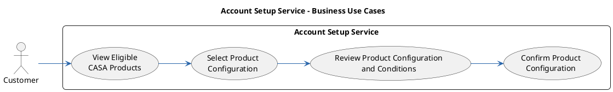
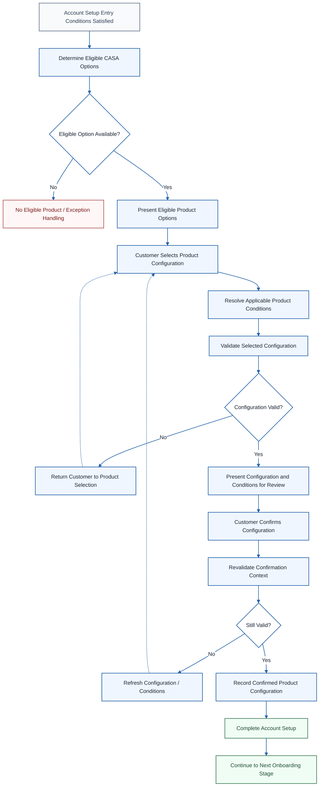
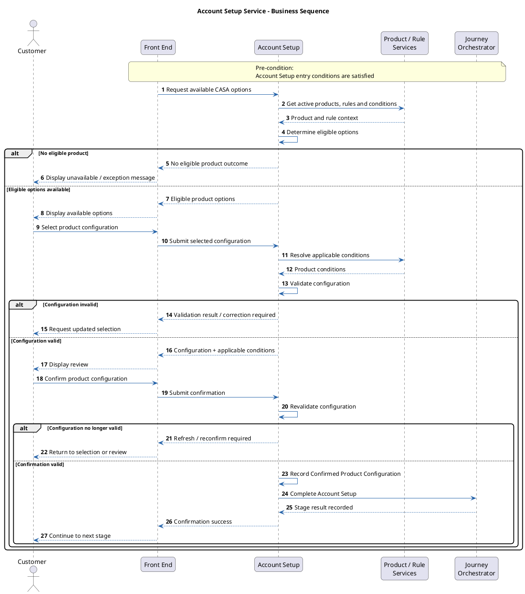

# 5. Account Setup Service

> Customer Onboarding — module 5 of 10. Exported from Development `customer-onboarding` v13.

[← Customer Onboarding](README.md) · [Previous: Customer Information Service](04-customer-information-service.md) · [Next: Digital Banking Enrollment Service](06-digital-banking-enrollment-service.md)

## Contents

- [5.1 Overview](#51-overview)
- [5.2 Key Concepts and Terminology](#52-key-concepts-and-terminology)
- [5.3 Entry and Completion Conditions](#53-entry-and-completion-conditions)
- [5.4 Business Capabilities and Responsibilities](#54-business-capabilities-and-responsibilities)
- [5.5 Relationships with Other Stages and Domains](#55-relationships-with-other-stages-and-domains)
- [5.6 Account Setup Information](#56-account-setup-information)
- [5.7 Business Use Cases](#57-business-use-cases)
- [5.8 Scope and Stage Boundaries](#58-scope-and-stage-boundaries)
- [5.9 Main Business Flow](#59-main-business-flow)
- [5.10 Business Rules](#510-business-rules)
- [5.11 Exception and Alternate Flows](#511-exception-and-alternate-flows)
- [5.12 Key Business Objects and Outcomes](#512-key-business-objects-and-outcomes)
- [5.13 Project Analysis and Decision Checklist](#513-project-analysis-and-decision-checklist)

## 5.1 Overview

Covers: Business Definition · Business Purpose · Capability vs. Physical Service · Selection Principle

### Business Definition

Account Setup is the onboarding capability that enables the customer to select, review, and confirm the CASA product configuration they intend to open.

The capability:

- determines the CASA products and configuration options available to the customer;
- presents eligible account types, packages, relationship options, and applicable service choices;
- captures the customer’s selections;
- determines and presents the applicable product conditions;
- validates the selected configuration;
- records the customer-confirmed product configuration for downstream onboarding stages.

The primary business outcome is a Confirmed Product Configuration.

Account Setup is a selection and confirmation stage. It does not create the actual CASA account, enroll the customer into Digital Banking or Debit Card services, provision account services, or update Core Banking.

Diagram: casa-onboarding-journey.png (see the Confluence page)
https://datumhq.atlassian.net/wiki/download/attachments/1753874441/casa-onboarding-journey.png?version=1&modificationDate=1783661795311&cacheVersion=1&api=v2

### Business Purpose

The purpose of the Account Setup Service is to ensure that the customer’s requested account and product configuration is suitable for opening and can be used consistently by subsequent onboarding stages.

| Business Purpose | Why It Matters |
|---|---|
| Present Eligible CASA Options | Ensures the customer only sees products available for the current customer and journey context. |
| Capture Customer Product Choice | Records the account and product configuration the customer intends to open. |
| Ensure Configuration Validity | Prevents unsupported combinations from progressing downstream. |
| Present Applicable Conditions | Allows the customer to understand the relevant product conditions before confirmation. |
| Produce Confirmed Product Configuration | Provides a consistent input for later enrollment, consent, authentication, and account creation stages. |
| Maintain Traceability | Records what configuration was confirmed and when. |

### Capability vs. Physical Service

In this knowledge base, Account Setup represents a logical business capability within the onboarding journey.

The capability may be implemented through multiple systems or services, for example:

- Product Catalogue / Product Configuration;
- Pricing / Fee services;
- eligibility or rule services;
- onboarding Front End and Back End;
- Application Management / Journey Orchestration.

The physical service decomposition and API ownership are project-specific.

### Selection Principle

Account Setup determines what the customer intends to open. Downstream stages determine how that confirmed choice is enrolled, consented, authenticated, created, linked, or provisioned.

Conceptually:

Customer and Journey Context
|
v
Determine Eligible CASA Options
|
v
Customer Selects Product Configuration
|
v
Validate Configuration
|
v
Present Product Conditions
|
v
Customer Confirms Configuration
|
v
Confirmed Product Configuration
|
v
Downstream Onboarding Stages

## 5.2 Key Concepts and Terminology

Covers: Eligible Product Option · Product Configuration · Product Conditions · Confirmed Product Configuration

### Eligible Product Option

A CASA product or configuration option that may be offered to the customer based on the applicable product, customer, channel, and journey rules.

### Product Configuration

The combination of account and product choices selected for the onboarding application.

It may include:

- account type;
- product / package / variant;
- currency where selectable;
- relationship type where applicable;
- associated service preferences where applicable.

### Product Conditions

The commercial or operational conditions applicable to the selected product configuration.

Examples may include:

- fees;
- interest conditions;
- minimum balance or maintenance requirements;
- supported currencies;
- product benefits;
- campaign conditions.

Account Setup presents or references these conditions; it does not define the underlying product pricing strategy.

### Confirmed Product Configuration

The customer-approved product configuration recorded at the successful completion of Account Setup.

It is the primary business output supplied to downstream onboarding stages.

## 5.3 Entry and Completion Conditions

| Condition | Description |
|---|---|
| Entry Condition | The onboarding application is permitted to proceed to product selection and the required customer/journey context is available. |
| Product Context | Active product definitions and applicable eligibility/availability rules are accessible. |
| Successful Completion | The customer has explicitly confirmed a valid product configuration and the result has been recorded successfully. |
| Completion Output | A Confirmed Product Configuration and confirmation context are available to downstream stages. |
| Next Stage | The journey proceeds to Digital Banking Enrollment or the next applicable onboarding stage. |

The exact entry stage and transition rules are project-specific.

## 5.4 Business Capabilities and Responsibilities

The capabilities below follow the typical Account Setup sequence.

Determine Eligible Products
↓
Present Available Options
↓
Capture Customer Selection
↓
Resolve Product Conditions
↓
Validate Configuration
↓
Present Review
↓
Confirm and Record Configuration

Reference code: BCA-AS-XX, where BCA = Business Capability / Responsibility and AS = Account Setup.

### Product Eligibility and Presentation

#### BCA-AS-01 – Determine Eligible Product Options

| BCA-AS-01 – Determine Eligible Product Options |
|---|
| Determine which CASA products and configuration options may be offered using the available customer, journey, channel, and product context. |
| Result: |
| A list of eligible product options is available for presentation. |

#### BCA-AS-02 – Present Product Options

| BCA-AS-02 – Present Product Options |
|---|
| Present the eligible account types, packages, variants, relationship options, and applicable associated-service choices. |
| The presentation should expose only options available for the current context. |
| Result: |
| The customer can review and select from the available CASA options. |

### Product Selection and Validation

#### BCA-AS-03 – Capture Product Configuration

| BCA-AS-03 – Capture Product Configuration |
|---|
| Capture the customer’s selected account and product configuration. |
| The configuration may include: |
| - account type; |
| - product / package / variant; |
| - relationship type where applicable; |
| - currency where applicable; |
| - associated service preferences where applicable. |
| Result: |
| A proposed Product Configuration is available for validation. |

#### BCA-AS-04 – Determine Applicable Product Conditions

| BCA-AS-04 – Determine Applicable Product Conditions |
|---|
| Retrieve or determine the product conditions applicable to the selected configuration. |
| Result: |
| The conditions required for customer review are available. |

#### BCA-AS-05 – Validate Product Configuration

| BCA-AS-05 – Validate Product Configuration |
|---|
| Confirm that the selected configuration remains eligible, available, and internally compatible before confirmation. |
| Result: |
| The configuration is either accepted for customer review or returned for correction. |

### Review and Confirmation

#### BCA-AS-06 – Present Configuration Review

| BCA-AS-06 – Present Configuration Review |
|---|
| Present the selected product configuration and applicable conditions before final confirmation. |
| Result: |
| The customer can review the intended configuration before proceeding. |

#### BCA-AS-07 – Confirm and Record Product Configuration

| BCA-AS-07 – Confirm and Record Product Configuration |
|---|
| Capture explicit customer confirmation, revalidate the configuration where required, and record the confirmed result against the onboarding application. |
| Result: |
| A Confirmed Product Configuration is available for downstream onboarding stages. |

## 5.5 Relationships with Other Stages and Domains

| Source / Target | Direction | Business Object / Information | Relationship |
|---|---|---|---|
| Customer Information Capture | Inbound | Customer profile and relationship context | Supplies information used for product eligibility where applicable. |
| Compliance / Risk | Inbound | Journey eligibility / control outcome | Confirms whether the application may continue to Account Setup where required by the journey. |
| Product Catalogue / Product Configuration | Inbound | Product definitions, options, availability and rules | Supplies the product information used to determine and present available options. |
| Pricing / Fee / Product Condition Services | Inbound | Applicable product conditions | Supplies or calculates conditions presented for the selected configuration. |
| Digital Banking Enrollment | Outbound | Confirmed Product Configuration | Provides product context used to determine applicable Digital Banking setup. |
| Debit Card Enrollment | Outbound | Confirmed Product Configuration | Provides product/account context used to determine applicable debit card options. |
| Consent & Agreement | Outbound | Product configuration and applicable terms | Provides the product context required for consent capture. |
| Authentication / Fraud | Outbound | Confirmed application/product context where required | Supports downstream controls where product context is relevant. |
| Account Creation & Service Provisioning | Outbound | Confirmed Product Configuration | Provides the approved account/product input used for actual account creation and provisioning. |
| Application Management / Journey Orchestrator | Inbound / Outbound | Application context and stage result | Supplies journey context and records Account Setup completion. |

## 5.6 Account Setup Information

This section describes the business information consumed, selected, determined, and produced during Account Setup.

### Input Context

| Information | Purpose |
|---|---|
| Onboarding Application Reference | Provides the journey context and traceability key. |
| Customer Reference / Profile Context | Supports product eligibility where applicable. |
| Journey / Channel Context | Determines which products and options may be available. |
| Product Catalogue / Configuration | Supplies active product definitions and selectable options. |
| Eligibility / Availability Rules | Determines which options may be offered. |

### Customer-Selected Information

| Information | Purpose |
|---|---|
| Account Type | Identifies the CASA account type the customer intends to open. |
| Product / Package / Variant | Identifies the selected product configuration. |
| Currency | Captures the selected account currency where customer-selectable. |
| Relationship Type | Captures Individual, Joint, or other supported relationship type where applicable. |
| Associated Service Preferences | Records service preferences offered as part of Account Setup, without completing downstream enrollment or provisioning. |

### System-Determined Information

| Information | Purpose |
|---|---|
| Eligible Product Options | Determines which products/configurations can be presented. |
| Product Availability | Confirms the product is active and available in the current context. |
| Configuration Compatibility | Confirms selected components form a supported configuration. |
| Applicable Product Conditions | Determines the conditions to be presented for review. |
| Validation Result | Determines whether the configuration may proceed to confirmation. |

### Confirmed Output Information

| Information | Purpose |
|---|---|
| Confirmed Product Configuration | Provides the approved product/account choice for downstream onboarding. |
| Confirmation Status | Indicates that the configuration was explicitly confirmed. |
| Confirmation Timestamp | Provides traceability for when confirmation occurred. |
| Stage Completion Status | Indicates whether Account Setup completed successfully. |

Exact field names and data structures are implementation-specific.

## 5.7 Business Use Cases

Covers: Use Case Overview · Use Case Diagram · Use Case Specifications · Use Case Summary

### Use Case Overview

The Account Setup Service supports the following customer-facing business use cases:

1. View Eligible CASA Products.
2. Select Product Configuration.
3. Review Product Configuration and Conditions.
4. Confirm Product Configuration.

The use cases describe the customer-facing business journey. Eligibility evaluation, configuration validation, condition determination, and confirmation-time revalidation are supporting system behaviours within these use cases rather than separate customer use cases.

### Use Case Diagram

Diagram: image-20260909-114132.png (see the Confluence page)
https://datumhq.atlassian.net/wiki/download/attachments/1753874441/image-20260909-114132.png?version=1&modificationDate=1788954096087&cacheVersion=1&api=v2

Use Case Diagram - PlantUML code

### Use Case Specifications

Reference code: UC-AS-XX, where UC = Use Case and AS = Account Setup.

#### UC-AS-01 – View Eligible CASA Products › Use Case Information

| UC-AS-01 – View Eligible CASA Products › Use Case Information |
|---|
| See the table below. |

#### Use Case Information

| Attribute | Description |
|---|---|
| Use Case ID | UC-AS-01 |
| Use Case Name | View Eligible CASA Products |
| Primary Actor | Customer |
| Trigger | The customer enters Account Setup and proceeds to view available CASA products. |
| Pre-conditions | Stage 4 has completed successfully. The onboarding application remains eligible to continue. Customer and product context required for eligibility evaluation is available. |
| Post-conditions | Eligible CASA product options are presented, or a clear no-eligible-product / exception outcome is returned. |

#### Main Flow

| Main Flow |
|---|
| See the table below. |

| Step | Actor | Activity | Description |
|---|---|---|---|
| 1 | Customer | Enter Account Setup | The customer proceeds to the Account Setup stage. |
| 2 | Account Setup | Determine eligible products | Evaluate applicable customer eligibility, product availability, channel, and product rules. |
| 3 | Account Setup | Resolve available options | Identify the CASA account types, product packages, variants, relationship options, and applicable service preferences that may be offered. |
| 4 | Customer | View eligible products | Eligible product options are presented for customer selection. |

#### Alternate / Exception Flow

| Alternate / Exception Flow |
|---|
| See the table below. |

| ID | Condition | Handling |
|---|---|---|
| AF-01 | No eligible CASA product is available. | Inform the customer and prevent progression through the normal Account Setup flow. |
| AF-02 | Product or eligibility information cannot be resolved. | Keep the stage incomplete and follow the applicable retry or exception process. |

#### UC-AS-02 – Select Product Configuration › Use Case Information

| UC-AS-02 – Select Product Configuration › Use Case Information |
|---|
| See the table below. |

#### Use Case Information

| Attribute | Description |
|---|---|
| Use Case ID | UC-AS-02 |
| Use Case Name | Select Product Configuration |
| Primary Actor | Customer |
| Trigger | Eligible CASA product options have been presented. |
| Pre-conditions | At least one eligible CASA product is available. |
| Post-conditions | A proposed product configuration is captured for validation and review. |

#### Main Flow

| Main Flow |
|---|
| See the table below. |

| Step | Actor | Activity | Description |
|---|---|---|---|
| 1 | Customer | Select CASA product | Select the preferred account type and product package or variant. |
| 2 | Customer | Select applicable options | Select relationship type and available associated service preferences where applicable. |
| 3 | Account Setup | Capture configuration | Record the proposed product configuration against the onboarding application. |
| 4 | Account Setup | Validate configuration | Validate product availability, eligibility, and compatibility between the selected components. |
| 5 | Account Setup | Determine applicable conditions | Resolve the product conditions applicable to the valid configuration. |

#### Alternate / Exception Flow

| Alternate / Exception Flow |
|---|
| See the table below. |

| ID | Condition | Handling |
|---|---|---|
| AF-01 | Selected components form an unsupported configuration. | Identify the invalid selection and require the customer to update the configuration. |
| AF-02 | Selected product is no longer available or eligible. | Refresh the available options and require another eligible selection. |
| AF-03 | Applicable product conditions cannot be determined. | Prevent progression to review until the required conditions are available. |

#### UC-AS-03 – Review Product Configuration and Conditions › Use Case Information

| UC-AS-03 – Review Product Configuration and Conditions › Use Case Information |
|---|
| See the table below. |

#### Use Case Information

| Attribute | Description |
|---|---|
| Use Case ID | UC-AS-03 |
| Use Case Name | Review Product Configuration and Conditions |
| Primary Actor | Customer |
| Trigger | A valid proposed product configuration and its applicable conditions are available. |
| Pre-conditions | The selected configuration has passed the required validation checks. Applicable product conditions are available. |
| Post-conditions | The customer has reviewed the proposed configuration and can confirm it or return to amend the selection. |

#### Main Flow

| Main Flow |
|---|
| See the table below. |

| Step | Actor | Activity | Description |
|---|---|---|---|
| 1 | Account Setup | Prepare configuration preview | Prepare the selected product configuration and applicable conditions for review. |
| 2 | Customer | Review configuration | Review the selected account type, package, relationship option, associated service preferences, and applicable conditions. |
| 3 | Customer | Decide whether to proceed | Continue to confirmation or return to update the selection. |

#### Alternate / Exception Flow

| Alternate / Exception Flow |
|---|
| See the table below. |

| ID | Condition | Handling |
|---|---|---|
| AF-01 | Customer changes the selected configuration. | Return to product selection and recalculate the applicable validation result and product conditions. |
| AF-02 | Product conditions change before confirmation. | Present the latest applicable conditions before confirmation is allowed. |

#### UC-AS-04 – Confirm Product Configuration › Use Case Information

| UC-AS-04 – Confirm Product Configuration › Use Case Information |
|---|
| See the table below. |

#### Use Case Information

| Attribute | Description |
|---|---|
| Use Case ID | UC-AS-04 |
| Use Case Name | Confirm Product Configuration |
| Primary Actor | Customer |
| Trigger | The customer chooses to confirm the reviewed product configuration. |
| Pre-conditions | A valid product configuration and applicable product conditions have been presented to the customer. |
| Post-conditions | A valid Confirmed Product Configuration is recorded and made available to downstream onboarding stages, or the customer is returned to the applicable correction flow. |

#### Main Flow

| Main Flow |
|---|
| See the table below. |

| Step | Actor | Activity | Description |
|---|---|---|---|
| 1 | Customer | Confirm configuration | Explicitly confirm the reviewed product configuration and applicable conditions. |
| 2 | Account Setup | Revalidate configuration | Confirm that product eligibility, availability, compatibility, and applicable conditions remain valid. |
| 3 | Account Setup | Record confirmation | Save the Confirmed Product Configuration and relevant confirmation information. |
| 4 | Account Setup | Complete Account Setup | Record successful Stage 5 completion and make the confirmed configuration available to downstream stages. |
| 5 | Customer | Continue onboarding | Proceed to the next applicable onboarding stage. |

#### Alternate / Exception Flow

| Alternate / Exception Flow |
|---|
| See the table below. |

| ID | Condition | Handling |
|---|---|---|
| AF-01 | Product eligibility or availability changed before confirmation. | Do not confirm the configuration. Refresh the eligible options and require the customer to review the updated selection. |
| AF-02 | Applicable product conditions changed before confirmation. | Present the updated conditions and require customer reconfirmation. |
| AF-03 | Confirmed configuration cannot be saved. | Keep Stage 5 incomplete and allow retry or the applicable recovery process without treating the configuration as confirmed. |
| AF-04 | Application is no longer eligible to continue. | Stop Account Setup and route the journey to the applicable onboarding exception process. |

### Use Case Summary

| Use Case ID | Use Case | Primary Actor | Outcome |
|---|---|---|---|
| UC-AS-01 | View Eligible CASA Products | Customer | Eligible CASA options are presented. |
| UC-AS-02 | Select Product Configuration | Customer | A valid proposed product configuration is captured. |
| UC-AS-03 | Review Product Configuration and Conditions | Customer | Configuration and applicable conditions are reviewed before confirmation. |
| UC-AS-04 | Confirm Product Configuration | Customer | Confirmed Product Configuration is recorded for downstream use. |

## 5.8 Scope and Stage Boundaries

Covers: In Scope · Out of Scope · Key Boundary Principles

### In Scope

- Product eligibility and availability determination
- Presentation of eligible CASA options
- Customer account/product selection
- Relationship and currency selection where applicable
- Associated service preference capture where applicable
- Product-condition presentation
- Product-configuration validation
- Customer review and confirmation
- Recording Confirmed Product Configuration
- Stage completion and traceability

### Out of Scope

| Out-of-Scope Activity | Responsible Stage / Domain |
|---|---|
| Product creation, pricing strategy, catalogue maintenance and lifecycle management | Product Management / Product Configuration |
| Compliance / AML / PEP / sanctions / risk assessment | Compliance / Risk |
| Digital Banking profile creation, reuse, credential setup or channel activation | Digital Banking Enrollment |
| Debit card product enrollment, card preferences, delivery or issuance | Debit Card Enrollment / Card Management |
| Legal consent and agreement capture | Consent & Agreement |
| Final authentication or fraud decision | Authentication / Fraud |
| CASA account creation and account number generation | Account Creation & Service Provisioning |
| Account configuration, limit application and account-level service provisioning | Account Creation & Service Provisioning |
| Core Banking account update | Account Creation & Service Provisioning / Core Banking |
| Post-onboarding product or account servicing | Account Servicing / Product Management |

### Key Boundary Principles

#### Product Management Boundary

| Product Management Boundary |
|---|
| Account Setup consumes product definitions, availability rules, eligibility rules, and applicable conditions. |
| It does not create, price, amend, activate, or retire products. |

#### Service Enrollment Boundary

| Service Enrollment Boundary |
|---|
| Account Setup may capture a customer preference for an associated service where that choice is part of the product configuration. |
| It does not complete the downstream enrollment, activation, or provisioning of that service. |

#### Account Creation Boundary

| Account Creation Boundary |
|---|
| Account Setup records what the customer intends to open. |
| Account Creation & Service Provisioning creates the actual CASA account, assigns or obtains the account number, applies approved configuration, and completes account-dependent provisioning. |

#### Confirmation Boundary

| Confirmation Boundary |
|---|
| Successful Account Setup means the product configuration has been confirmed and recorded. |
| It does not mean the CASA account has been opened successfully. |

## 5.9 Main Business Flow

Covers: Actors and Logical Components · Business Flow Overview · Business Sequence Diagram · Detailed Business Flow

### Actors and Logical Components

| Actor / Component | Role |
|---|---|
| Customer | Reviews available CASA options, selects the intended configuration, reviews conditions, and confirms the selection. |
| Front End | Presents product options and review information, captures customer selections and confirmation. |
| Account Setup / Back End | Determines eligible products, resolves conditions, validates the configuration, and records the confirmed result. |
| Product / Rule Services | Provide product definitions, availability, eligibility rules, and product conditions where managed separately. |
| Journey Orchestrator / Application Management | Provides journey context and records Account Setup completion. |

Pre-condition: The onboarding application is eligible to proceed to Account Setup and the required customer/product context is available.

### Business Flow Overview

The flow is intentionally limited to the Account Setup responsibility boundary: determine available choices, capture the customer decision, validate it, and produce a confirmed configuration.

Diagram: image-20260909-114725.png (see the Confluence page)
https://datumhq.atlassian.net/wiki/download/attachments/1753874441/image-20260909-114725.png?version=1&modificationDate=1788954449647&cacheVersion=1&api=v2

Business Flow Overview - Mermaid code

### Business Sequence Diagram

Diagram: image-20260909-131216.png (see the Confluence page)
https://datumhq.atlassian.net/wiki/download/attachments/1753874441/image-20260909-131216.png?version=1&modificationDate=1788959541148&cacheVersion=1&api=v2

Sequence Diagram - PlantUML code

### Detailed Business Flow

| Step | Activity | Description |
|---|---|---|
| 1 | Request available CASA options | The Front End requests available options for the current onboarding context. |
| 2 | Load product and rule context | Account Setup obtains the relevant active products, rules, and product-condition context. |
| 3 | Determine eligible options | Apply the applicable eligibility and availability rules. |
| 4 | Handle no eligible product | If no option is available, stop the normal selection path and return the configured exception outcome. |
| 5 | Present eligible options | Display the available CASA options to the customer. |
| 6 | Select product configuration | The customer selects the intended account/product configuration. |
| 7 | Resolve product conditions | Determine the conditions applicable to the selected configuration. |
| 8 | Validate configuration | Confirm that the selected components form a valid and supported configuration. |
| 9 | Correct invalid selection | If invalid, return the customer to selection with the applicable validation result. |
| 10 | Present review | Display the selected configuration and applicable conditions. |
| 11 | Confirm configuration | The customer explicitly confirms the configuration. |
| 12 | Revalidate confirmation context | Confirm that the selected product, configuration, and relevant conditions remain valid. |
| 13 | Refresh changed configuration | If no longer valid, require the customer to review or select again. |
| 14 | Record confirmed configuration | Record the confirmed product configuration against the onboarding application. |
| 15 | Complete Account Setup | Record successful stage completion and make the confirmed configuration available downstream. |

## 5.10 Business Rules

Covers: BR-AS-01 – Only Eligible and Available Products May Be Presented · BR-AS-02 – Selected Components Must Form a Supported Configuration · BR-AS-03 – Product Conditions Must Be Available Before Confirmation · BR-AS-04 – Customer Confirmation Must Be Explicit · BR-AS-05 – Confirmation Context Must Be Revalidated Where Required · BR-AS-06 – Confirmed Configuration Must Be Traceable · BR-AS-07 – Account Setup Must Not Perform Downstream Provisioning

### BR-AS-01 – Only Eligible and Available Products May Be Presented

The customer must only be offered products and configuration options that are available for the applicable customer, journey, channel, and product context.

### BR-AS-02 – Selected Components Must Form a Supported Configuration

The selected product, account type, currency, relationship type, and associated service preferences must form a supported combination.

### BR-AS-03 – Product Conditions Must Be Available Before Confirmation

Applicable product conditions required for customer review must be available before the configuration can be confirmed.

### BR-AS-04 – Customer Confirmation Must Be Explicit

A product configuration must not be recorded as confirmed without explicit customer confirmation.

### BR-AS-05 – Confirmation Context Must Be Revalidated Where Required

If product availability, configuration compatibility, or applicable conditions may change during the journey, the relevant context must be revalidated before the confirmed configuration is recorded.

Where material conditions have changed, the customer must review the updated information again.

### BR-AS-06 – Confirmed Configuration Must Be Traceable

The recorded result must be traceable to the onboarding application and should contain sufficient information to identify the confirmed product configuration and confirmation event.

### BR-AS-07 – Account Setup Must Not Perform Downstream Provisioning

Account Setup may capture the customer’s intended product and applicable service preferences, but must not treat those selections as successful account creation, service enrollment, activation, or provisioning.

## 5.11 Exception and Alternate Flows

This section describes the main scenarios in which Account Setup cannot follow the standard successful selection and confirmation path.

### No Eligible Product Available

#### Scenario

| Scenario |
|---|
| No CASA product is available for the current customer and journey context. |

#### Expected Handling

| Expected Handling |
|---|
| - Do not present an ineligible product as an alternative. |
| - Prevent normal Account Setup completion. |
| - Route to the configured exception, assisted, or journey-exit path. |

### Selected Configuration Is Invalid

#### Scenario

| Scenario |
|---|
| The selected components do not form a supported product configuration. |

#### Example

| Example |
|---|
| A selected package does not support the chosen relationship type or associated service. |

#### Expected Handling

| Expected Handling |
|---|
| - Identify the invalid or incompatible selection. |
| - Return the customer to product selection. |
| - Allow confirmation only after a valid configuration is selected. |

### Product Becomes Unavailable Before Confirmation

#### Scenario

| Scenario |
|---|
| A product or configuration was initially available but is no longer valid when the customer confirms it. |

#### Expected Handling

| Expected Handling |
|---|
| - Do not record the outdated configuration as confirmed. |
| - Refresh the available product options. |
| - Require the customer to select or review again. |

### Product Conditions Change Before Confirmation

#### Scenario

| Scenario |
|---|
| Applicable conditions change after the configuration was first presented. |

#### Expected Handling

| Expected Handling |
|---|
| - Present the updated conditions. |
| - Require customer review and reconfirmation. |
| - Do not rely on the previous confirmation. |

### Product Conditions Cannot Be Retrieved

#### Scenario

| Scenario |
|---|
| Mandatory product-condition information is temporarily unavailable. |

#### Expected Handling

| Expected Handling |
|---|
| - Prevent final confirmation where the missing information is required for customer review. |
| - Allow retry or route to the configured exception path. |
| - Do not create a partially confirmed configuration. |

### Confirmed Configuration Cannot Be Recorded

#### Scenario

| Scenario |
|---|
| The customer confirms successfully, but the system cannot persist the confirmed result. |

#### Expected Handling

| Expected Handling |
|---|
| - Do not mark Account Setup as successfully completed. |
| - Preserve or recover the selected context where possible. |
| - Retry recording safely without creating inconsistent confirmation states. |

### Associated Service Is Not Applicable

#### Scenario

| Scenario |
|---|
| An associated service such as Digital Banking or Debit Card is not applicable to the selected product or journey. |
| This is an alternate flow rather than an error. |

#### Expected Handling

| Expected Handling |
|---|
| - Do not present the service as selectable where it is not applicable. |
| - Continue with the valid remaining product configuration. |
| - Do not treat a non-applicable service as a downstream failure. |

## 5.12 Key Business Objects and Outcomes

This section identifies the business objects that should remain traceable across the Account Setup lifecycle. It does not define a physical data model or API payload.

### Eligible Product Set

#### Purpose

| Purpose |
|---|
| Represents the CASA options available for the current onboarding context. |

#### Business Question

| Business Question |
|---|
| What products and options could the customer choose from? |

#### Key Information

| Key Information |
|---|
| - product / package / variant; |
| - account type; |
| - supported currency; |
| - relationship options; |
| - applicable associated services; |
| - availability / eligibility context. |

### Product Configuration

#### Purpose

| Purpose |
|---|
| Represents the customer’s current intended account and product selection before final confirmation. |

#### Business Question

| Business Question |
|---|
| What configuration has the customer selected? |

#### Key Information

| Key Information |
|---|
| - account type; |
| - product / package / variant; |
| - currency where applicable; |
| - relationship type where applicable; |
| - associated service preferences; |
| - current validation result. |

### Product Conditions

#### Purpose

| Purpose |
|---|
| Represents the conditions applicable to the selected product configuration and presented for customer review. |

#### Business Question

| Business Question |
|---|
| What conditions apply to the selected product? |

#### Key Information

| Key Information |
|---|
| - fees; |
| - interest conditions where applicable; |
| - minimum balance / maintenance conditions; |
| - benefits; |
| - campaign conditions; |
| - other material product conditions. |

### Confirmed Product Configuration

#### Purpose

| Purpose |
|---|
| Represents the final customer-confirmed result of Account Setup. |

#### Business Question

| Business Question |
|---|
| What product configuration was approved by the customer for downstream onboarding? |

#### Key Information

| Key Information |
|---|
| - Onboarding Application reference; |
| - confirmed account/product configuration; |
| - associated service preferences where applicable; |
| - confirmation status; |
| - confirmation timestamp; |
| - stage completion status. |
| This object is the primary output consumed by downstream enrollment, consent, authentication, and Account Creation & Service Provisioning stages. |

## 5.13 Project Analysis and Decision Checklist

This section provides practical analysis prompts for Business Analysts when applying the Account Setup reference model to a specific project.

The questions are intended to identify project-specific behaviour and decisions; they are not mandatory stakeholder questions.

### Product Availability and Eligibility

#### Objective

| Objective |
|---|
| Confirm how available CASA products are determined for the customer and journey. |

#### Key Decisions and Questions

| Key Decisions and Questions |
|---|
| - Which system is the source of truth for CASA product definitions? |
| - Which products are available in the onboarding journey? |
| - Which customer attributes affect eligibility? |
| - Are products restricted by channel, campaign, segment, residency, age, or other conditions? |
| - When are eligibility and availability checked? |
| - What happens when no eligible product is available? |

### Customer-Selectable Configuration

#### Objective

| Objective |
|---|
| Clarify which parts of the product configuration are customer choices and which are system defaults. |

#### Key Decisions and Questions

| Key Decisions and Questions |
|---|
| - Which account types or product variants can the customer select? |
| - Is currency selectable or fixed by product? |
| - Is relationship type selectable? |
| - Are associated services selected here or handled entirely in downstream stages? |
| - Which selections are mandatory? |
| - Which values are supplied by product defaults? |

### Product Conditions

#### Objective

| Objective |
|---|
| Confirm which product conditions must be presented and where they come from. |

#### Key Decisions and Questions

| Key Decisions and Questions |
|---|
| - Which fees, rates, benefits, limits, or maintenance conditions must be shown? |
| - Which system supplies each condition? |
| - Are the conditions calculated dynamically or retrieved from product configuration? |
| - Which conditions require explicit customer review? |
| - What happens if conditions change before confirmation? |

### Validation and Confirmation

#### Objective

| Objective |
|---|
| Define when a configuration is considered valid and what constitutes successful customer confirmation. |

#### Key Decisions and Questions

| Key Decisions and Questions |
|---|
| - Which validations are performed before review? |
| - Which validations must be repeated at confirmation time? |
| - What makes a configuration invalid? |
| - What event represents explicit customer confirmation? |
| - Can the customer edit the configuration after reviewing the conditions? |
| - Which timestamp represents successful Account Setup confirmation? |

### Downstream Handover and Boundaries

#### Objective

| Objective |
|---|
| Ensure that Account Setup supplies sufficient confirmed context without duplicating downstream responsibilities. |

#### Key Decisions and Questions

| Key Decisions and Questions |
|---|
| - What exact information is passed to Digital Banking Enrollment? |
| - What exact information is passed to Debit Card Enrollment? |
| - Which product terms are passed to Consent & Agreement? |
| - Which Confirmed Product Configuration fields are required by Account Creation & Service Provisioning? |
| - Which service preferences are only selections versus actual enrollment/provisioning results? |
| - How is the Confirmed Product Configuration versioned or referenced downstream? |

### Integration, Data and Traceability

#### Objective

| Objective |
|---|
| Ensure the Account Setup decision can be traced from product presentation through customer confirmation and downstream processing. |

#### Key Decisions and Questions

| Key Decisions and Questions |
|---|
| - Which API or service returns eligible products? |
| - Which system records the customer’s selection? |
| - Which key links Account Setup to the onboarding application? |
| - How is the confirmed configuration identified downstream? |
| - Which statuses represent selected, validated, confirmed, failed, or expired configuration? |
| - Which timestamps are required for audit, reconciliation, analytics, or reporting? |
| - Can the configuration be reconstructed later to show what the customer confirmed? |

---

[← Customer Onboarding](README.md) · [Previous: Customer Information Service](04-customer-information-service.md) · [Next: Digital Banking Enrollment Service](06-digital-banking-enrollment-service.md)
