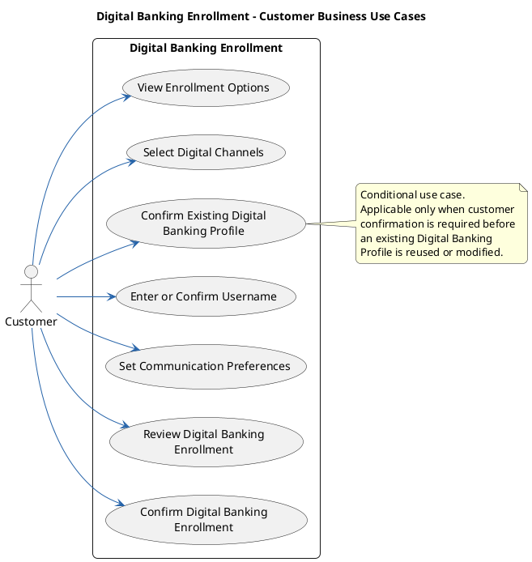
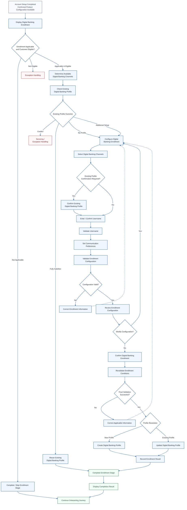
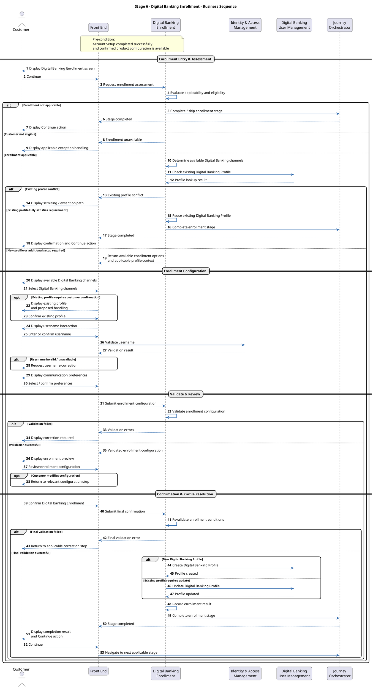

# 6. Digital Banking Enrollment Service

> Customer Onboarding — module 6 of 10. Exported from Development `customer-onboarding` v13.

[← Customer Onboarding](README.md) · [Previous: Account Setup Service](05-account-setup-service.md) · [Next: Card Enrollment Service](07-card-enrollment-service.md)

## Contents

- [6.1 Overview](#61-overview)
- [6.2 Key Concepts and Terminology](#62-key-concepts-and-terminology)
- [6.3 Entry and Completion Conditions](#63-entry-and-completion-conditions)
- [6.4 Business Capabilities and Responsibilities](#64-business-capabilities-and-responsibilities)
- [6.5 Relationships with Other Stages and Domains](#65-relationships-with-other-stages-and-domains)
- [6.6 Digital Banking Enrollment Information](#66-digital-banking-enrollment-information)
- [6.7 Business Use Cases](#67-business-use-cases)
- [6.8 Scope and Stage Boundaries](#68-scope-and-stage-boundaries)
- [6.9 Main Business Flow](#69-main-business-flow)
- [6.10 Business Rules](#610-business-rules)
- [6.11 Exception and Alternate Flows](#611-exception-and-alternate-flows)
- [6.12 Key Business Objects](#612-key-business-objects)
- [6.13 Project Analysis and Decision Checklist](#613-project-analysis-and-decision-checklist)

## 6.1 Overview

Covers: Business Definition · Business Purpose · Capability vs. Physical Service

### Business Definition

Digital Banking Enrollment is the onboarding capability that establishes or confirms a customer's Digital Banking relationship during the CASA onboarding journey.

The capability:

- Receives the Confirmed Product Configuration from the preceding Account Setup stage.
- Determines whether Digital Banking enrollment applies to the customer and selected product configuration.
- Determines which Digital Banking channels are available.
- Identifies whether the customer already has a Digital Banking Profile.
- Determines whether an existing profile can satisfy the enrollment requirement, requires additional setup, or requires exception handling.
- Captures the customer's selected Digital Banking channels when new or additional enrollment is required.
- Captures or confirms the username or login identifier.
- Captures communication preferences applicable to Digital Banking.
- Validates customer eligibility, channel compatibility, username rules, verified contact readiness, mandatory information, and existing-profile rules.
- Presents enrollment information for customer review where customer action is required.
- Captures the customer's confirmation before creating or modifying a Digital Banking Profile.
- Creates a new Digital Banking Profile or applies the approved reuse/update process to an existing profile.
- Records the resulting profile information, enrollment outcome, and relevant audit information.
- Makes the resulting Digital Banking Profile reference available to downstream onboarding stages.

Digital Banking Enrollment begins after the Account Setup stage has produced a Confirmed Product Configuration and the onboarding application remains eligible to continue.

The primary business outcome is that the customer's Digital Banking requirement for the onboarding journey has been resolved through one of the following paths:

1. A new Digital Banking Profile is created.
2. An existing compatible Digital Banking Profile is reused.
3. An existing Digital Banking Profile is updated or extended where additional setup is required.
4. Digital Banking Enrollment is determined to be not applicable to the journey.
5. The stage is paused or failed where an existing-profile conflict or processing issue cannot be resolved automatically.

Digital Banking Enrollment does not create the CASA account or generate the CASA account number.

Where the CASA account does not yet exist, the downstream Account Creation & Service Provisioning stage is responsible for:

- creating the CASA account;
- generating or assigning the account number;
- linking the CASA account to the resolved Digital Banking Profile; and
- completing dependent provisioning and activation.

### Business Purpose

The purpose of Digital Banking Enrollment is to establish a valid, unique, complete, and reusable Digital Banking relationship that is ready for downstream CASA account linking and service provisioning.

| Business Purpose | Why It Matters |
|---|---|
| Establish Digital Banking Access | Creates, reuses, or extends the customer's Digital Banking relationship during onboarding. |
| Capture Digital Banking Setup | Records the required channels, login identifier, and communication preferences. |
| Prevent Duplicate Profiles | Detects an existing Digital Banking relationship before creating another profile. |
| Apply Enrollment Controls | Ensures that the customer, product, channels, contacts, and login identifier comply with applicable rules. |
| Support Existing Customer Journeys | Allows a valid existing profile to satisfy some or all enrollment requirements without unnecessary recreation. |
| Support CASA Account Linking | Provides the Digital Banking Profile reference required for downstream CASA linking and provisioning. |
| Maintain Confirmation and Auditability | Retains evidence of customer confirmation, validation outcome, and profile processing result. |
| Support Journey Progression | Provides a clear stage outcome that allows the onboarding journey to continue, pause, retry, or terminate appropriately. |

### Capability vs. Physical Service

In this knowledge base, Digital Banking Enrollment represents a logical business capability within the onboarding journey.

It does not imply that all responsibilities must be implemented by one deployable microservice.

A target implementation may involve multiple supporting systems or services, such as:

- Digital Banking Configuration;
- Digital Banking User Management / eBank Platform;
- Identity and Access Management;
- Customer / Party Management;
- Application Management;
- Contact Verification;
- Audit services;
- Notification services.

The actual physical service decomposition is project-specific.

## 6.2 Key Concepts and Terminology

Covers: Digital Banking Enrollment · Digital Banking Profile · Digital Banking Channel · Enrollment Applicability · Enrollment Eligibility · Channel Availability · Existing Profile · Communication Preference

### Digital Banking Enrollment

The onboarding process through which the Digital Banking requirement associated with a customer and CASA onboarding application is evaluated and resolved.

It may result in:

- new profile creation;
- reuse of an existing profile;
- update or extension of an existing profile;
- no action because enrollment is not applicable; or
- exception handling.

### Digital Banking Profile

A persistent Digital Banking relationship associated with a customer.

Conceptually, a profile may contain or reference:

- Digital Banking Profile ID;
- Customer ID / Party ID;
- Username or login identifier;
- Enabled Digital Banking channels;
- Profile status;
- Verified contact references;
- Communication preferences;
- Authentication or access references where applicable.

Whether Mobile Banking and Internet Banking are represented as channels under one profile or as separate technical profiles is implementation-specific and must be confirmed for each project.

### Digital Banking Channel

A customer-facing channel through which Digital Banking services can be accessed.

Examples may include:

- Mobile Banking;
- Internet Banking;
- other supported Digital Banking channels.

Available channels may depend on:

- customer type;
- product;
- jurisdiction;
- onboarding channel;
- customer eligibility;
- device or contact readiness;
- bank policy;
- technical availability.

### Enrollment Applicability

Indicates whether Digital Banking Enrollment is relevant to the current onboarding journey or selected product configuration.

Typical conceptual values are:

- MANDATORY;
- OPTIONAL;
- ALREADY_SATISFIED;
- NOT_APPLICABLE.

Exact values are project-specific.

### Enrollment Eligibility

Indicates whether the customer satisfies the business rules required to enroll in the applicable Digital Banking services.

Eligibility is different from applicability.

A service may apply to the selected product, but the customer may not satisfy all eligibility conditions.

### Channel Availability

Indicates which Digital Banking channels can currently be offered based on business and technical conditions.

Availability is different from applicability and eligibility.

For example:

- Digital Banking may be applicable to the product;
- the customer may be eligible;
- but a specific channel may still be unavailable.

### Existing Profile

A Digital Banking Profile already associated with the resolved customer.

The existence of a profile does not automatically mean that Digital Banking Enrollment is fully satisfied.

The existing profile must be evaluated to determine whether it is:

- compatible and reusable;
- active but missing required channels;
- requiring update;
- requiring additional linking;
- suspended, locked, closed, or otherwise unsuitable;
- conflicting or ambiguous.

### Communication Preference

The customer's preferred method for receiving applicable Digital Banking communications.

Examples may include:

- SMS;
- email;
- push notification.

A communication preference does not, by itself, constitute:

- marketing consent;
- privacy consent;
- data-sharing consent; or
- legal acceptance of product terms.

These consent types must be governed by the relevant consent capability where applicable.

## 6.3 Entry and Completion Conditions

| Condition | Description |
|---|---|
| Entry Condition | The preceding Account Setup stage has produced a Confirmed Product Configuration and the onboarding application remains eligible to continue. |
| Customer Context | The customer has been identified and the customer reference required for Digital Banking Profile lookup is available. |
| Product Context | The account type, product/package and applicable service selections are available. |
| Successful Completion – New Profile | A new Digital Banking Profile has been successfully created and the required profile information has been recorded. |
| Successful Completion – Existing Profile | An existing compatible Digital Banking Profile has been identified and the applicable reuse/update process has been successfully completed. |
| Not Applicable | Digital Banking Enrollment is not required for the product or journey and the stage is allowed to be skipped according to product policy. |
| Action Required | An existing-profile conflict or other condition requires manual, servicing, or customer resolution before the journey can continue. |
| Retryable Failure | A temporary processing failure prevents completion but the operation may safely be retried. |
| Final Failure | A non-recoverable condition prevents the stage from completing. |
| Next Stage | After successful or allowed skipped completion, the onboarding journey proceeds to the next applicable onboarding stage. |

The exact stage status values and transition rules are project-specific.

## 6.4 Business Capabilities and Responsibilities

The capabilities below are organised according to the typical Digital Banking Enrollment sequence.

Evaluate Enrollment Applicability
↓
Identify Existing Digital Banking Profile
↓
Determine Available Digital Channels
↓
Configure Enrollment Information
↓
Validate Enrollment Configuration
↓
Review and Confirm Enrollment
↓
Create / Reuse / Update Digital Banking Profile
↓
Record Result and Complete Stage

Actual execution order, customer interaction, and physical system ownership are implementation-specific.

Reference code: BCA-DBE-XX, where BCA = Business Capability / Responsibility and DBE = Digital Banking Enrollment.

### Enrollment Assessment

#### BCA-DBE-01 – Determine Enrollment Applicability

| BCA-DBE-01 – Determine Enrollment Applicability |
|---|
| Determine whether Digital Banking Enrollment is required for the current customer, product, and onboarding journey. |
| Key considerations may include: |
| - confirmed CASA product configuration; |
| - customer type and relationship; |
| - onboarding channel; |
| - jurisdiction; |
| - bundled services; |
| - bank policy. |
| Result: |
| Enrollment is classified as mandatory, optional, already satisfied, unavailable, or not applicable. |

#### BCA-DBE-02 – Identify Existing Digital Banking Profile

| BCA-DBE-02 – Identify Existing Digital Banking Profile |
|---|
| Identify whether the customer already has a Digital Banking Profile and determine whether it can support the current onboarding requirement. |
| The profile should be classified as: |
| - reusable and sufficient; |
| - reusable but requiring additional setup; |
| - update / extension required; |
| - unsuitable; |
| - conflicting. |
| Result: |
| The applicable profile-resolution path is known before any new profile is created. |

#### BCA-DBE-03 – Determine Available Digital Channels

| BCA-DBE-03 – Determine Available Digital Channels |
|---|
| Determine which Digital Banking channels may be offered for the current enrollment context. |
| The decision may consider: |
| - product-channel compatibility; |
| - customer eligibility; |
| - verified contact readiness; |
| - existing profile configuration; |
| - jurisdiction and bank policy; |
| - technical availability. |
| Result: |
| The eligible Digital Banking channels are available for customer selection or system assignment. |

### Enrollment Configuration

#### BCA-DBE-04 – Present Enrollment Options

| BCA-DBE-04 – Present Enrollment Options |
|---|
| Present the information required for the customer to understand and configure Digital Banking Enrollment. |
| This may include: |
| - available Digital Banking channels; |
| - existing-profile context where applicable; |
| - username / login identifier requirements; |
| - verified contact context; |
| - communication preference options. |
| Result: |
| The customer receives the applicable enrollment options for the current journey. |

#### BCA-DBE-05 – Capture Digital Channels

| BCA-DBE-05 – Capture Digital Channels |
|---|
| Capture or assign the Digital Banking channels applicable to the customer. |
| Where product policy makes a channel mandatory, the channel should be treated as required rather than as an unrestricted customer choice. |
| Result: |
| The applicable Digital Banking channels are recorded in the enrollment context. |

#### BCA-DBE-06 – Capture or Confirm Username

| BCA-DBE-06 – Capture or Confirm Username |
|---|
| Capture, generate, reuse, or confirm the username / login identifier according to the target enrollment model. |
| Possible models include: |
| - customer-entered username; |
| - suggested username; |
| - system-generated identifier; |
| - reuse of an existing username. |
| Result: |
| A proposed or existing login identifier is available for validation and profile processing. |

#### BCA-DBE-07 – Capture Communication Preferences

| BCA-DBE-07 – Capture Communication Preferences |
|---|
| Capture the applicable operational communication preferences for Digital Banking. |
| These preferences must remain logically separate from marketing, privacy, data-sharing, or legal consent unless the approved project design explicitly combines them. |
| Result: |
| The applicable Digital Banking communication preferences are recorded. |

### Enrollment Validation and Confirmation

#### BCA-DBE-08 – Validate Enrollment Information

| BCA-DBE-08 – Validate Enrollment Information |
|---|
| Validate the proposed enrollment configuration before execution. |
| Key checks may include: |
| - enrollment eligibility; |
| - channel compatibility; |
| - username format and availability; |
| - verified contact readiness; |
| - existing-profile rules; |
| - mandatory information; |
| - applicable product and policy rules. |
| Result: |
| The enrollment configuration is either valid for review / confirmation or returned for correction. |

#### BCA-DBE-09 – Present Enrollment Preview

| BCA-DBE-09 – Present Enrollment Preview |
|---|
| Present the validated Digital Banking configuration where customer review is required. |
| The preview may include: |
| - selected channels; |
| - username / login identifier; |
| - communication preferences; |
| - masked verified contacts; |
| - existing-profile reuse or update handling. |
| Result: |
| The customer can review the configuration before final confirmation. |

#### BCA-DBE-10 – Capture Customer Confirmation

| BCA-DBE-10 – Capture Customer Confirmation |
|---|
| Capture customer confirmation before creating a new Digital Banking Profile or applying customer-driven changes to an existing profile. |
| Customer confirmation may be omitted where an existing compatible profile already satisfies the requirement and no customer decision or modification is required. |
| Result: |
| The enrollment configuration is authorised for final validation and profile resolution. |

### Digital Profile Resolution

#### BCA-DBE-11 – Create New Digital Banking Profile

| BCA-DBE-11 – Create New Digital Banking Profile |
|---|
| Create a new Digital Banking Profile where no suitable existing profile can satisfy the enrollment requirement. |
| Result: |
| A new Digital Banking Profile reference and status are returned. |

#### BCA-DBE-12 – Reuse Existing Digital Banking Profile

| BCA-DBE-12 – Reuse Existing Digital Banking Profile |
|---|
| Reuse an existing active and compatible profile where it already satisfies the current requirement. |
| Result: |
| The existing profile reference is retained and duplicate profile creation is avoided. |

#### BCA-DBE-13 – Update or Extend Existing Digital Banking Profile

| BCA-DBE-13 – Update or Extend Existing Digital Banking Profile |
|---|
| Apply permitted changes where an existing profile remains valid but additional setup is required. |
| Examples may include: |
| - enabling an additional Digital Banking channel; |
| - updating permitted communication preferences; |
| - applying another approved profile extension. |
| Result: |
| The existing profile is updated to satisfy the approved onboarding requirement. |

#### BCA-DBE-14 – Handle Existing-Profile Conflict

| BCA-DBE-14 – Handle Existing-Profile Conflict |
|---|
| Prevent automatic reuse or duplicate creation where the existing-profile result is ambiguous or unsuitable. |
| Examples include: |
| - multiple matching profiles; |
| - suspended, locked, or closed profile; |
| - unresolved ownership; |
| - username conflict; |
| - profile status that prevents automatic update or reuse. |
| Result: |
| The case is routed to the applicable recovery, servicing, or exception path. |

### Journey Completion

#### BCA-DBE-15 – Record Enrollment Result

| BCA-DBE-15 – Record Enrollment Result |
|---|
| Record the information required to trace the final enrollment outcome. |
| This may include: |
| - Digital Banking Profile reference; |
| - customer reference; |
| - username / login identifier; |
| - enabled channels; |
| - communication preferences; |
| - profile resolution mode; |
| - processing result. |
| Result: |
| The final Digital Banking Enrollment outcome is available for downstream use. |

#### BCA-DBE-16 – Maintain Auditability

| BCA-DBE-16 – Maintain Auditability |
|---|
| Retain sufficient evidence of: |
| - information presented; |
| - customer selections; |
| - customer confirmation; |
| - validation result; |
| - profile creation, reuse, or update; |
| - resulting profile reference; |
| - completion timestamp. |
| Result: |
| The enrollment decision and processing outcome can be traced and reconciled. |

#### BCA-DBE-17 – Complete Enrollment and Support Journey Progression

| BCA-DBE-17 – Complete Enrollment and Support Journey Progression |
|---|
| Report the final stage outcome to Application Management / Journey Orchestration and provide the Digital Banking Profile reference to downstream stages. |
| Result: |
| The Digital Banking Enrollment stage is completed, skipped, paused, or failed according to the applicable outcome, and the onboarding journey can proceed accordingly. |

## 6.5 Relationships with Other Stages and Domains

| Source / Target | Direction | Business Object / Information | Relationship |
|---|---|---|---|
| Customer Information Capture | Inbound | Customer ID, identity information, verified mobile, verified email, residency, preferred language | Supplies customer and contact context. |
| Account Setup | Inbound | Confirmed Product Configuration | Determines product context and Digital Banking applicability. |
| Digital Banking Configuration | Inbound | Supported channels, username rules, eligibility rules, communication options, product-channel compatibility | Supplies configurable enrollment rules. |
| Digital Banking User Management / eBank Platform | Request / Response | Customer reference, profile configuration, profile ID, profile status | Creates, retrieves, reuses, or updates Digital Banking Profiles. |
| Identity and Access Management | Request / Response | Username/login identifier and status | Validates format, uniqueness, availability, reservation, or assignment status. |
| Contact Verification | Inbound / Validation | Verified mobile/email reference | Confirms contact readiness where required. |
| Application Management | Outbound | Stage status, profile reference, resolution mode, processing result | Records progression and stage outcome. |
| Subsequent Control Stages | Outbound | Profile ID, channels, verified contacts | Provides context required for downstream consent/authentication controls where applicable. |
| Account Creation & Service Provisioning | Outbound | Digital Banking Profile reference | Allows the CASA account to be linked to the Digital Banking relationship. |
| Notifications & Communication | Outbound | Processing result, masked login reference, communication context | Supports final onboarding communication. |

## 6.6 Digital Banking Enrollment Information

Covers: Customer-Provided or Customer-Confirmed Information · System-Determined Information

### Customer-Provided or Customer-Confirmed Information

| Information | Description | Purpose |
|---|---|---|
| Digital Banking Channels | Mobile Banking, Internet Banking, or other supported channels | Determines the services to enable where customer selection is permitted. |
| Username / Login Identifier | New, suggested, generated, or existing identifier | Establishes or confirms the customer's login reference. |
| Communication Preferences | Eligible operational SMS, email, push, or other preferences | Records applicable Digital Banking communication preferences. |
| Existing Profile Confirmation | Confirmation of reuse/update where customer confirmation is required | Supports approved existing-profile handling. |
| Enrollment Confirmation | Confirmation of the final configuration | Authorizes creation or customer-driven modification where required. |

### System-Determined Information

| Information | Purpose |
|---|---|
| Enrollment Applicability | Determines whether Digital Banking is mandatory, optional, already satisfied, or not applicable. |
| Enrollment Eligibility | Determines whether the customer satisfies applicable enrollment rules. |
| Existing Profile Status | Determines whether an existing profile can be reused, updated, or requires exception handling. |
| Available Digital Channels | Determines which channels can be offered. |
| Username Availability | Determines whether the identifier is valid, unique, reserved, or already assigned. |
| Contact Readiness | Confirms that required verified contact information is available. |
| Profile Resolution Mode | Indicates NEW, REUSE, UPDATE/EXTEND, NOT_APPLICABLE, or EXCEPTION conceptually. |
| Profile Status | Records the relevant resulting profile state. |
| Stage Outcome | Determines whether the onboarding journey can proceed. |

Exact field names and enumerations are implementation-specific.

## 6.7 Business Use Cases

Covers: Use Case Overview · Use Case Diagram · Use Case Specifications · Use Case Summary

### Use Case Overview

The following use cases represent customer-facing business interactions within Digital Banking Enrollment.

System responsibilities such as:

- enrollment applicability evaluation;
- customer eligibility evaluation;
- existing Digital Banking Profile lookup;
- channel availability determination;
- username validation;
- duplicate profile prevention;
- enrollment revalidation;
- Digital Banking Profile creation, reuse, or update;

are represented in the Business Capabilities and Responsibilities, Main Business Flow, and Business Rules rather than as separate customer-facing use cases.

The use cases in this section describe what the customer may need to do during Digital Banking Enrollment. They do not represent the sequential process flow. The actual processing sequence, conditional branches, and system activities are defined in the Main Business Flow.

### Use Case Diagram

Diagram: image-20260825-151040.png (see the Confluence page)
https://datumhq.atlassian.net/wiki/download/attachments/1753579534/image-20260825-151040.png?version=1&modificationDate=1787670643537&cacheVersion=1&api=v2

Use case diagram - PlantUML code

Note: UC-DBE-03 – Confirm Existing Digital Banking Profile is conditional. If the target onboarding design treats a valid and compatible existing profile as automatically satisfying Digital Banking Enrollment without customer confirmation, this use case should be omitted.

### Use Case Specifications

Reference code: UC-DBE-XX, where UC = Use Case / Responsibility and DBE = Digital Banking Enrollment.

#### UC-DBE-01 – View Digital Banking Enrollment Options › Use Case Information

| UC-DBE-01 – View Digital Banking Enrollment Options › Use Case Information |
|---|
| See the table below. |

#### Use Case Information

| Attribute | Description |
|---|---|
| Use Case ID | UC-DBE-01 |
| Use Case Name | View Digital Banking Enrollment Options |
| Primary Actor | Customer |
| Trigger | Digital Banking Enrollment requires customer interaction. |
| Pre-conditions | Digital Banking Enrollment entry conditions are satisfied. Enrollment applicability has been evaluated. Available channels and existing-profile context have been determined. |
| Post-conditions | Applicable Digital Banking Enrollment options are presented to the customer. |

#### Main Flow

| Main Flow |
|---|
| See the table below. |

| Step | Actor | Activity | Description |
|---|---|---|---|
| 1 | System | Display enrollment screen | Present the Digital Banking Enrollment screen to the customer. |
| 2 | System | Display available channels | Present the Digital Banking channels available to the customer. |
| 3 | System | Display existing-profile context | Where applicable, present appropriate masked information relating to an existing Digital Banking Profile. |
| 4 | System | Display username requirements | Present the applicable username or login identifier requirements. |
| 5 | System | Display communication preferences | Present the applicable Digital Banking communication preference options. |
| 6 | Customer | Review enrollment options | Review the available options and proceed with the applicable Digital Banking configuration. |

#### Alternate / Exception Flow

| Alternate / Exception Flow |
|---|
| See the table below. |

| ID | Condition | Handling |
|---|---|---|
| AF-01 | Digital Banking Enrollment is not applicable. | No customer enrollment selection is required. The stage follows the applicable not-applicable or skipped path. |
| AF-02 | An existing compatible profile already satisfies the requirement. | No new Digital Banking configuration is required. The stage may proceed directly to completion where no customer action is required. |
| AF-03 | Digital Banking is applicable but unavailable. | The journey follows the configured failure, assisted, or exception path according to product policy. |

#### UC-DBE-02 – Select Digital Banking Channels › Use Case Information

| UC-DBE-02 – Select Digital Banking Channels › Use Case Information |
|---|
| See the table below. |

#### Use Case Information

| Attribute | Description |
|---|---|
| Use Case ID | UC-DBE-02 |
| Use Case Name | Select Digital Banking Channels |
| Primary Actor | Customer |
| Trigger | One or more Digital Banking channels are available, and customer selection is permitted or required. |
| Pre-conditions | Digital Banking Enrollment is applicable. Available Digital Banking channels have been determined. The enrollment model allows or requires customer channel selection. |
| Post-conditions | The selected Digital Banking channels are recorded in the enrollment context. |

#### Main Flow

| Main Flow |
|---|
| See the table below. |

| Step | Actor | Activity | Description |
|---|---|---|---|
| 1 | System | Display available channels | Present only the Digital Banking channels available for the customer and current product configuration. |
| 2 | Customer | Review available channels | Review the available Mobile Banking, Internet Banking, or other supported channel options. |
| 3 | Customer | Select channels | Select the Digital Banking channels to enroll in. |
| 4 | System | Record channel selection | Record the selected channels in the Digital Banking Enrollment context. |
| 5 | System | Continue enrollment | Proceed to the next applicable enrollment configuration step. |

#### Alternate / Exception Flow

| Alternate / Exception Flow |
|---|
| See the table below. |

| ID | Condition | Handling |
|---|---|---|
| AF-01 | A channel is mandatory. | Present the channel as required and do not allow the customer to freely deselect it unless product policy permits. |
| AF-02 | Only one predefined channel applies. | The system may preselect or assign the channel without requiring an explicit selection. |
| AF-03 | A selected channel becomes unavailable. | Require the customer to revise the selected configuration before enrollment can continue. |

#### UC-DBE-03 – Confirm Existing Digital Banking Profile › Use Case Information

| UC-DBE-03 – Confirm Existing Digital Banking Profile › Use Case Information |
|---|
| See the table below. |

#### Use Case Information

| Attribute | Description |
|---|---|
| Use Case ID | UC-DBE-03 |
| Use Case Name | Confirm Existing Digital Banking Profile |
| Primary Actor | Customer |
| Applicability | Conditional. Applicable only where customer confirmation is required before an existing Digital Banking Profile is reused or modified. |
| Trigger | An existing compatible Digital Banking Profile has been identified, and customer confirmation is required. |
| Pre-conditions | The customer has been resolved. An existing Digital Banking Profile has been identified. The profile has been evaluated as eligible for reuse or permitted update. |
| Post-conditions | The customer confirms or rejects the proposed use of the existing Digital Banking Profile. |

#### Main Flow

| Main Flow |
|---|
| See the table below. |

| Step | Actor | Activity | Description |
|---|---|---|---|
| 1 | System | Present existing profile | Present sufficient masked information for the customer to recognise the existing Digital Banking Profile. |
| 2 | System | Present proposed handling | Inform the customer whether the profile will be reused or updated as part of onboarding. |
| 3 | Customer | Review existing profile | Review the presented profile information. |
| 4 | Customer | Confirm profile | Confirm use of the existing Digital Banking Profile. |
| 5 | System | Record confirmation | Record the customer's confirmation. |
| 6 | System | Continue existing-profile path | Continue processing using the approved existing-profile path. |

#### Alternate / Exception Flow

| Alternate / Exception Flow |
|---|
| See the table below. |

| ID | Condition | Handling |
|---|---|---|
| AF-01 | Customer does not recognise the profile. | Stop automatic reuse and route to the approved recovery, servicing, or exception process. |
| AF-02 | Customer declines the proposed reuse or update. | Follow the project-defined alternate handling. |
| AF-03 | Profile status changes before completion. | Re-evaluate the existing profile and route to the applicable existing-profile exception path if it is no longer reusable. |

#### Note

| Note |
|---|
| If the target onboarding journey automatically treats a valid and compatible existing Digital Banking Profile as satisfying the enrollment requirement, this use case should be removed. Existing-profile handling should then remain a system decision within the Main Business Flow. |

#### UC-DBE-04 – Enter or Confirm Username › Use Case Information

| UC-DBE-04 – Enter or Confirm Username › Use Case Information |
|---|
| See the table below. |

#### Use Case Information

| Attribute | Description |
|---|---|
| Use Case ID | UC-DBE-04 |
| Use Case Name | Enter or Confirm Username |
| Primary Actor | Customer |
| Trigger | The applicable enrollment path requires a username or login identifier to be entered or confirmed. |
| Pre-conditions | The Digital Banking Enrollment path has been determined. The applicable username model and rules are available. |
| Post-conditions | A valid proposed or existing username/login identifier is recorded in the enrollment context. |

#### Main Flow

| Main Flow |
|---|
| See the table below. |

| Step | Actor | Activity | Description |
|---|---|---|---|
| 1 | System | Display username interaction | Present the appropriate username interaction based on the enrollment model. |
| 2 | Customer | Enter or confirm username | Enter a new username or confirm the applicable existing login identifier. |
| 3 | System | Validate username format | Validate the identifier against applicable format rules. |
| 4 | System | Check username availability | Where a new identifier is requested, verify its uniqueness and availability. |
| 5 | System | Record username | Record the valid username or login identifier in the enrollment context. |
| 6 | System | Continue enrollment | Proceed to the next applicable configuration step. |

#### Alternate / Exception Flow

| Alternate / Exception Flow |
|---|
| See the table below. |

| ID | Condition | Handling |
|---|---|---|
| AF-01 | Username is unavailable. | Inform the customer and request another username. |
| AF-02 | Username does not meet format rules. | Display the applicable validation message and allow the customer to correct the identifier. |
| AF-03 | Existing profile already has a username. | Display or confirm the existing identifier rather than creating a new one. |
| AF-04 | Username becomes unavailable before final execution. | Final validation fails, and the customer must provide another valid username before processing continues. |

#### UC-DBE-05 – Set Communication Preferences › Use Case Information

| UC-DBE-05 – Set Communication Preferences › Use Case Information |
|---|
| See the table below. |

#### Use Case Information

| Attribute | Description |
|---|---|
| Use Case ID | UC-DBE-05 |
| Use Case Name | Set Communication Preferences |
| Primary Actor | Customer |
| Trigger | One or more configurable Digital Banking communication preferences are available. |
| Pre-conditions | Digital Banking Enrollment is active. Applicable communication preference options have been determined. Required customer contact information is available where applicable. |
| Post-conditions | The customer's applicable Digital Banking communication preferences are recorded. |

#### Main Flow

| Main Flow |
|---|
| See the table below. |

| Step | Actor | Activity | Description |
|---|---|---|---|
| 1 | System | Display communication options | Present the Digital Banking communication preferences available to the customer. |
| 2 | Customer | Review communication options | Review the available SMS, email, push, or other supported options. |
| 3 | Customer | Select preferences | Select or confirm the applicable communication preferences. |
| 4 | System | Record preferences | Record the customer's Digital Banking communication preferences. |
| 5 | System | Continue enrollment | Proceed to enrollment validation or review. |

#### Alternate / Exception Flow

| Alternate / Exception Flow |
|---|
| See the table below. |

| ID | Condition | Handling |
|---|---|---|
| AF-01 | No configurable communication preference exists. | No customer selection is required, and the configured default or existing setting is retained. |
| AF-02 | Selected preference requires a verified contact that is unavailable. | Prevent completion of that selection and follow the applicable contact-resolution path. |
| AF-03 | Existing profile preferences are retained. | Keep the existing communication configuration where no change is required, and project policy permits reuse. |

#### Note

| Note |
|---|
| Communication preferences represent operational communication choices only. They should not automatically be interpreted as marketing, privacy, data-sharing, or legal consent. |

#### UC-DBE-06 – Review Digital Banking Enrollment › Use Case Information

| UC-DBE-06 – Review Digital Banking Enrollment › Use Case Information |
|---|
| See the table below. |

#### Use Case Information

| Attribute | Description |
|---|---|
| Use Case ID | UC-DBE-06 |
| Use Case Name | Review Digital Banking Enrollment |
| Primary Actor | Customer |
| Trigger | The proposed Digital Banking Enrollment configuration has passed initial validation and is ready for customer review. |
| Pre-conditions | Required enrollment information has been captured. Initial validation has completed successfully. The proposed configuration is available for review. |
| Post-conditions | The customer reviews the proposed configuration and either proceeds to confirmation or returns to modify the enrollment information. |

#### Main Flow

| Main Flow |
|---|
| See the table below. |

| Step | Actor | Activity | Description |
|---|---|---|---|
| 1 | System | Display enrollment preview | Present the complete proposed Digital Banking Enrollment configuration. |
| 2 | Customer | Review digital channels | Review the selected Digital Banking channels. |
| 3 | Customer | Review username | Review the username or login identifier. |
| 4 | Customer | Review communication preferences | Review the selected communication preferences. |
| 5 | Customer | Review existing-profile handling | Where applicable, review how the existing Digital Banking Profile will be reused or updated. |
| 6 | Customer | Proceed to confirmation | Confirm that the displayed configuration is ready for final confirmation. |

#### Alternate / Exception Flow

| Alternate / Exception Flow |
|---|
| See the table below. |

| ID | Condition | Handling |
|---|---|---|
| AF-01 | Customer wants to modify the configuration. | Return the customer to the relevant enrollment step. The updated information must be validated again before returning to review. |
| AF-02 | Previously validated information is no longer valid. | Return the customer to the appropriate correction step before final confirmation. |

#### UC-DBE-07 – Confirm Digital Banking Enrollment › Use Case Information

| UC-DBE-07 – Confirm Digital Banking Enrollment › Use Case Information |
|---|
| See the table below. |

#### Use Case Information

| Attribute | Description |
|---|---|
| Use Case ID | UC-DBE-07 |
| Use Case Name | Confirm Digital Banking Enrollment |
| Primary Actor | Customer |
| Trigger | The customer has reviewed the proposed Digital Banking Enrollment configuration and chooses to proceed. |
| Pre-conditions | Required enrollment information has been captured. Initial validation has passed. The customer has reviewed the proposed configuration. No unresolved existing-profile conflict prevents processing. |
| Post-conditions | Final customer confirmation is recorded. The confirmed configuration is submitted for final validation and profile processing. |

#### Main Flow

| Main Flow |
|---|
| See the table below. |

| Step | Actor | Activity | Description |
|---|---|---|---|
| 1 | Customer | Confirm enrollment | Confirm the proposed Digital Banking Enrollment configuration. |
| 2 | System | Record confirmation | Record the confirmation and applicable audit information. |
| 3 | System | Revalidate enrollment | Revalidate the enrollment information before any profile creation or update is executed. |
| 4 | System | Confirm profile-resolution conditions | Confirm that applicable username, channel, contact, and existing-profile conditions remain valid. |
| 5 | System | Execute profile resolution | Create a new Digital Banking Profile or apply the approved existing-profile update where required. |
| 6 | System | Record enrollment result | Record the resulting Digital Banking Profile reference, configuration, and processing outcome. |
| 7 | System | Complete enrollment | Complete Digital Banking Enrollment when the applicable profile-resolution operation succeeds. |

#### Alternate / Exception Flow

| Alternate / Exception Flow |
|---|
| See the table below. |

| ID | Condition | Handling |
|---|---|---|
| AF-01 | Final validation fails. | Do not create or update the Digital Banking Profile. Return the customer to the relevant correction step. |
| AF-02 | Username is no longer available. | Return the customer to username entry or selection. |
| AF-03 | Existing-profile conflict is detected. | Stop profile processing and route to the approved exception or servicing path. |
| AF-04 | Profile creation or update fails. | Keep the stage incomplete and follow the applicable retryable or final-failure handling. |
| AF-05 | Customer submits confirmation more than once. | Ensure repeated submissions do not create duplicate Digital Banking Profiles or duplicate profile updates. |

### Use Case Summary

| Use Case ID | Use Case | Primary Actor | Applicability |
|---|---|---|---|
| UC-DBE-01 | View Digital Banking Enrollment Options | Customer | When customer interaction is required |
| UC-DBE-02 | Select Digital Banking Channels | Customer | When channel selection is available |
| UC-DBE-03 | Confirm Existing Digital Banking Profile | Customer | Conditional |
| UC-DBE-04 | Enter or Confirm Username | Customer | When username interaction is required |
| UC-DBE-05 | Set Communication Preferences | Customer | When configurable preferences are available |
| UC-DBE-06 | Review Digital Banking Enrollment | Customer | Before final confirmation where configuration changes are made |
| UC-DBE-07 | Confirm Digital Banking Enrollment | Customer | Before creation or customer-driven modification of the Digital Banking Profile |

## 6.8 Scope and Stage Boundaries

Covers: In Scope · Out of Scope · Key Boundary Principles

### In Scope

| Area | In-Scope Activities |
|---|---|
| Enrollment Assessment | Determine applicability, eligibility, available channels, and existing-profile status. |
| Existing Profile Handling | Determine reuse, update/extension, already-satisfied, or exception paths. |
| Enrollment Capture | Capture selected channels, username/login identifier, communication preferences, and applicable confirmation. |
| Enrollment Validation | Validate customer eligibility, channels, username, contacts, profile rules, and mandatory information. |
| Enrollment Review | Present applicable enrollment configuration for customer review. |
| Digital Profile Creation | Create a new Digital Banking Profile where required. |
| Existing Profile Update | Apply permitted profile changes or extensions where required and supported. |
| Profile Recording | Record/reference profile identifier, username, channels, contacts, preferences, and status. |
| Auditability | Record confirmation, validation, processing mode, and result. |
| Journey Progression | Produce a stage outcome and make the Digital Banking Profile reference available downstream. |

### Out of Scope

| Out-of-Scope Activity | Responsible Stage / Domain |
|---|---|
| Initial customer identity capture or correction | Customer Information Capture |
| Compliance and onboarding risk assessment | Compliance / Risk stage |
| CASA account and product selection | Account Setup |
| Debit card enrollment | Debit Card Enrollment |
| Legal agreement, privacy, product, or other final consent | Consent & Agreement capability |
| Final authentication or fraud decision | Authentication / Fraud capability |
| CASA account creation | Account Creation & Service Provisioning |
| CASA account number generation | Account Creation & Service Provisioning |
| CASA-to-Digital-Banking account linking | Account Creation & Service Provisioning, unless target architecture assigns it elsewhere |
| Final onboarding communication | Notifications & Communication |
| Password reset | Digital Banking Servicing / IAM |
| Username change after onboarding | Digital Banking Servicing / IAM |
| Access recovery | Digital Banking Servicing / IAM |
| Post-onboarding suspension/unblocking | Digital Banking Servicing / IAM |
| General Digital Banking profile maintenance | Digital Banking Servicing |

### Key Boundary Principles

#### Stage Entry Boundary

| Stage Entry Boundary |
|---|
| Digital Banking Enrollment begins only after the required product configuration has been confirmed. |

#### Digital Profile Boundary

| Digital Profile Boundary |
|---|
| The stage resolves the customer's Digital Banking relationship through creation, reuse, or permitted update. |
| It must not be reduced to merely recording a request that will later be processed unless that is explicitly the target architecture. |

#### CASA Account Boundary

| CASA Account Boundary |
|---|
| Digital Banking Profile creation does not itself create the CASA account. |
| The CASA account and Digital Banking Profile are separate business objects. |

#### Existing Profile Boundary

| Existing Profile Boundary |
|---|
| Finding an existing Digital Banking Profile does not automatically mean that the stage is complete. |
| The profile must first be classified as: |
| - reusable and sufficient; |
| - reusable but requiring additional setup; |
| - update/extension required; |
| - unsuitable; |
| - conflicting. |

#### Consent Boundary

| Consent Boundary |
|---|
| Communication preferences captured during Digital Banking Enrollment must remain separate from legal, privacy, marketing, and data-sharing consent unless explicitly designed otherwise. |

## 6.9 Main Business Flow

Covers: Actors and Logical Components · Business Flow Overview · Business Sequence Diagram · Detailed Business Flow

### Actors and Logical Components

| Actor / Component | Role |
|---|---|
| Customer | Reviews and provides the required Digital Banking Enrollment information and confirms the enrollment configuration. |
| Front End | Presents enrollment screens, captures customer input, submits requests, displays results, and controls journey navigation. |
| Digital Banking Enrollment | Evaluates enrollment applicability and eligibility, determines available channels and profile handling, validates the enrollment configuration, and coordinates profile resolution. |
| Identity & Access Management | Validates username or login identifier rules and availability where applicable. |
| Digital Banking User Management | Provides Digital Banking Profile lookup, creation, update, and profile status capabilities. |
| Journey Orchestrator | Maintains the Digital Banking Enrollment stage lifecycle and controls progression to the next applicable onboarding stage. |

Pre-condition: The Digital Banking Enrollment stage starts after Account Setup has completed successfully and the confirmed product configuration is available for the onboarding journey.

### Business Flow Overview

The Digital Banking Enrollment business flow can be summarised as follows:

Diagram: overview business flow.jpeg (see the Confluence page)
https://datumhq.atlassian.net/wiki/download/attachments/1753579534/overview%20business%20flow.jpeg?version=1&modificationDate=1787742230936&cacheVersion=1&api=v2

Business Flow Overview - Mermaid code

To download a Mermaid diagram as an image, follow this guide: https://mermaid.ink/

### Business Sequence Diagram

Diagram: image-20260826-104701.png (see the Confluence page)
https://datumhq.atlassian.net/wiki/download/attachments/1753579534/image-20260826-104701.png?version=1&modificationDate=1787741225192&cacheVersion=1&api=v2

Sequence Diagram - PlantUML code

### Detailed Business Flow

| Step | Activity | Description |
|---|---|---|
| 1 | Display Digital Banking Enrollment screen | The Front End displays the Digital Banking Enrollment screen to the customer after the stage entry conditions are satisfied. |
| 2 | Continue | The customer chooses to proceed with Digital Banking Enrollment. |
| 3 | Request enrollment assessment | The Front End requests the Digital Banking Enrollment capability to assess the applicable enrollment path. |
| 4 | Evaluate applicability and eligibility | Evaluate whether Digital Banking Enrollment is applicable to the current journey and whether the customer satisfies the applicable enrollment conditions. The subsequent flow depends on the assessment result. |
| 5 | Complete / skip enrollment stage | Applicable when enrollment is not applicable. Complete or skip the Digital Banking Enrollment stage according to the applicable product and journey rules. |
| 6 | Stage completed | Applicable when enrollment is not applicable. The Journey Orchestrator confirms completion of the stage. |
| 7 | Display Continue action | Applicable when enrollment is not applicable. The Front End allows the customer to continue without Digital Banking configuration. |
| 8 | Enrollment unavailable | Applicable when the customer is not eligible. Return the applicable enrollment-unavailable outcome to the Front End. |
| 9 | Display applicable exception handling | Applicable when the customer is not eligible. Display the applicable failure, assisted, or alternate journey according to the configured handling. |
| 10 | Determine available Digital Banking channels | Applicable when enrollment is applicable. Determine the Digital Banking channels available for the customer and confirmed product configuration. |
| 11 | Check existing Digital Banking Profile | Search for an existing Digital Banking Profile using the approved customer/profile resolution criteria. |
| 12 | Profile lookup result | Return the existing-profile lookup result and relevant profile status for determining the applicable enrollment path. |
| 13 | Existing profile conflict | Applicable when an existing-profile conflict is identified. Return the conflict outcome and prevent duplicate profile creation. |
| 14 | Display servicing / exception path | Applicable when an existing-profile conflict is identified. Present or route the customer to the applicable servicing, recovery, or exception process. |
| 15 | Reuse existing Digital Banking Profile | Applicable when the existing profile fully satisfies the enrollment requirement. Reuse the existing profile without creating a duplicate Digital Banking Profile. |
| 16 | Complete enrollment stage | Applicable when the existing profile fully satisfies the requirement and no additional customer action or profile change is required. Complete the Digital Banking Enrollment stage. |
| 17 | Stage completed | The Journey Orchestrator confirms completion of the existing-profile reuse path. |
| 18 | Display confirmation and Continue action | Display the successful completion result and allow the customer to continue the onboarding journey. |
| 19 | Return available enrollment options and applicable profile context | Applicable when a new profile or additional setup of an existing profile is required. Return the available channels and applicable enrollment/profile context to the Front End. |
| 20 | Display available Digital Banking channels | Present the Digital Banking channels available for the applicable enrollment path. |
| 21 | Select Digital Banking channels | The customer selects the Digital Banking channels to enroll in where selection is permitted. |
| 22 | Display existing profile and proposed handling | Conditional – applicable only when an existing profile requires customer confirmation. Display sufficient masked profile information and the proposed profile handling. |
| 23 | Confirm existing profile | Conditional – applicable only when Step 22 applies. The customer confirms use of the identified existing Digital Banking Profile. |
| 24 | Display username interaction | Present the applicable username interaction based on the enrollment path, such as entering a new username or confirming an existing login identifier. |
| 25 | Enter or confirm username | The customer enters or confirms the applicable username/login identifier. |
| 26 | Validate username | Validate the username against the applicable format and availability rules. |
| 27 | Validation result | Return the username validation result to the Front End. |
| 28 | Request username correction | Applicable when the username is invalid or unavailable. Inform the customer and request a valid username before enrollment can proceed. |
| 29 | Display communication preferences | Present the applicable Digital Banking communication preference options. |
| 30 | Select / confirm preferences | The customer selects or confirms the applicable communication preferences. |
| 31 | Submit enrollment configuration | Submit the captured Digital Banking Enrollment configuration for validation. |
| 32 | Validate enrollment configuration | Validate the proposed enrollment configuration, including applicable channels, contacts, communication preferences, existing-profile conditions, and mandatory information. |
| 33 | Validation errors | Applicable when enrollment configuration validation fails. Return the applicable validation errors to the Front End. |
| 34 | Display correction required | Applicable when enrollment configuration validation fails. Inform the customer of the information that must be corrected before proceeding. |
| 35 | Validated enrollment configuration | Applicable when enrollment configuration validation succeeds. Return the validated enrollment configuration to the Front End. |
| 36 | Display enrollment preview | Present the validated Digital Banking Enrollment configuration for customer review. |
| 37 | Review enrollment configuration | The customer reviews the proposed channels, username/login identifier, communication preferences, and applicable existing-profile handling. |
| 38 | Return to relevant configuration step | Conditional – applicable when the customer chooses to modify the configuration. Return the customer to the relevant configuration step. Updated information must be validated again before proceeding. |
| 39 | Confirm Digital Banking Enrollment | The customer confirms the reviewed Digital Banking Enrollment configuration. |
| 40 | Submit final confirmation | Submit the customer's final confirmation to the Digital Banking Enrollment capability for processing. |
| 41 | Revalidate enrollment conditions | Revalidate applicable conditions that may have changed since the initial validation before profile creation or update is executed. |
| 42 | Final validation error | Applicable when final revalidation fails. Return the applicable final validation error. No Digital Banking Profile creation or update is performed. |
| 43 | Return to applicable correction step | Applicable when final revalidation fails. Return the customer to the relevant configuration step to correct the identified issue. |
| 44 | Create Digital Banking Profile | Applicable for the new-profile path after successful final validation. Create a new Digital Banking Profile using the confirmed enrollment configuration. |
| 45 | Profile created | Applicable for the new-profile path. Return the successfully created Digital Banking Profile result. |
| 46 | Update Digital Banking Profile | Applicable for the existing-profile update path after successful final validation. Apply the approved changes or extensions to the existing Digital Banking Profile. |
| 47 | Profile updated | Applicable for the existing-profile update path. Return the successfully updated Digital Banking Profile result. |
| 48 | Record enrollment result | Record the resulting Digital Banking Profile reference, resolution mode, confirmed enrollment configuration, processing result, and applicable audit information. |
| 49 | Complete enrollment stage | Complete the Digital Banking Enrollment stage after successful profile resolution. |
| 50 | Stage completed | The Journey Orchestrator confirms successful completion of the Digital Banking Enrollment stage. |
| 51 | Display completion result and Continue action | Display the successful enrollment result and allow the customer to continue the onboarding journey. |
| 52 | Continue | The customer chooses to proceed after Digital Banking Enrollment has completed. |
| 53 | Navigate to next applicable stage | Navigate the onboarding journey to the next applicable stage. |

## 6.10 Business Rules

Covers: BR-DBE-01 – Prevent Duplicate Digital Banking Profiles · BR-DBE-02 – Existing Profile Must Be Evaluated, Not Merely Detected · BR-DBE-03 – Username Must Satisfy Applicable Identity Rules · BR-DBE-04 – Only Eligible Channels May Be Enabled · BR-DBE-05 – Verified Contact Requirements Must Be Satisfied · BR-DBE-06 – Revalidate Before Profile Creation or Update · BR-DBE-07 – Communication Preference Is Not Consent · BR-DBE-08 – Digital Profile and CASA Account Are Separate · BR-DBE-09 – Profile Creation Must Be Idempotent · BR-DBE-10 – Existing Profile Conflict Must Not Be Bypassed · BR-DBE-11 – Mandatory Customer Changes Require Confirmation · BR-DBE-12 – Stage Outcome Must Be Explicit

### BR-DBE-01 – Prevent Duplicate Digital Banking Profiles

A new Digital Banking Profile must not be created where a suitable existing profile for the same customer can be reused.

Rationale:

Duplicate profiles create access, security, servicing, and account-linking ambiguity.

### BR-DBE-02 – Existing Profile Must Be Evaluated, Not Merely Detected

An existing Digital Banking Profile must be classified before determining the enrollment outcome.

The existence of a profile alone is insufficient to conclude that enrollment is complete.

Possible classifications conceptually include:

- reusable;
- update-required;
- conflict;
- unsuitable.

### BR-DBE-03 – Username Must Satisfy Applicable Identity Rules

Where a new login identifier is required, it must satisfy:

- format;
- uniqueness;
- availability;
- reservation/assignment rules where applicable.

The exact uniqueness scope must be confirmed per implementation.

### BR-DBE-04 – Only Eligible Channels May Be Enabled

A channel may only be offered or enabled where it satisfies applicable:

- product;
- customer;
- jurisdiction;
- onboarding;
- policy; and
- technical availability rules.

### BR-DBE-05 – Verified Contact Requirements Must Be Satisfied

Where a verified mobile number or email address is mandatory for Digital Banking enrollment, the required verified contact must exist before completion.

Whether Stage 6 may reverify or correct the contact is project-specific.

### BR-DBE-06 – Revalidate Before Profile Creation or Update

Enrollment information must be revalidated after final customer confirmation and immediately before executing profile creation or modification.

This protects against conditions that may change during the journey, such as username availability.

### BR-DBE-07 – Communication Preference Is Not Consent

Operational communication preference must not automatically be interpreted as:

- marketing consent;
- privacy consent;
- data-sharing consent;
- legal agreement acceptance.

### BR-DBE-08 – Digital Profile and CASA Account Are Separate

Digital Banking Enrollment resolves the Digital Banking Profile.

It does not create the CASA account.

CASA account linking is performed by the designated downstream provisioning capability.

### BR-DBE-09 – Profile Creation Must Be Idempotent

Retrying a profile-creation request must not create multiple Digital Banking Profiles for the same intended enrollment operation.

The implementation should use an appropriate idempotency or business reference mechanism.

The exact technical mechanism is project-specific.

### BR-DBE-10 – Existing Profile Conflict Must Not Be Bypassed

Where Digital Banking Profile ownership or status cannot be safely resolved, the journey must follow the configured exception process.

The system must not create another profile merely to allow onboarding to continue.

### BR-DBE-11 – Mandatory Customer Changes Require Confirmation

Where Stage 6 creates a new profile or applies customer-driven modifications, the relevant configuration must be confirmed by the customer before execution.

Where an existing compatible profile already satisfies the requirement without modification, confirmation may be omitted according to the approved customer journey.

### BR-DBE-12 – Stage Outcome Must Be Explicit

The stage must distinguish successful completion from:

- not applicable;
- retryable failure;
- unresolved conflict;
- final failure.

A generic "flow ended" condition is insufficient for journey orchestration.

## 6.11 Exception and Alternate Flows

This section summarises the main non-standard Digital Banking Enrollment scenarios and their expected business handling.

### Enrollment Not Applicable

Scenario: Digital Banking does not apply to the selected product or journey.

Expected Handling:

- Record NOT_APPLICABLE / equivalent outcome.
- Do not create or modify a Digital Banking Profile.
- Allow journey progression where policy permits.

### Digital Banking Mandatory but Unavailable

Scenario: Digital Banking is mandatory but cannot currently be provided.

Expected Handling:

- Keep the stage incomplete.
- Apply the configured retry, assisted, pause, or failure path.
- Continue only when the requirement is resolved or an approved alternate rule applies.

### Existing Profile Fully Compatible

Scenario: A valid existing profile already satisfies the enrollment requirement.

Expected Handling:

- Reuse the existing profile.
- Record the profile reference.
- Do not create a duplicate profile.
- Complete the stage where no additional action is required.

### Existing Profile Requires Additional Setup

Scenario: The existing profile is valid but requires an additional channel or other permitted update.

Expected Handling:

The target project must define whether to:

- update the existing profile;
- obtain customer confirmation;
- route to servicing; or
- defer the additional setup.

### Existing Profile Conflict

Scenario: The existing profile cannot be safely reused because of status, ownership, or multiple-profile ambiguity.

Examples include:

- LOCKED / SUSPENDED / CLOSED profile;
- multiple matching profiles;
- unresolved ownership;
- username or profile conflict.

Expected Handling:

- Do not arbitrarily reuse a profile.
- Do not create another profile to bypass the issue.
- Route to the approved servicing, recovery, or exception process.

### Username Invalid or Unavailable

Scenario: The proposed username is invalid, unavailable, or becomes unavailable before final processing.

Expected Handling:

- Reject the identifier.
- Do not create or update the profile using the invalid username.
- Return the customer to username correction.
- Revalidate before final processing.

### Required Verified Contact Missing

Scenario: A verified contact required for the selected Digital Banking path is unavailable.

Expected Handling:

- Do not complete the affected enrollment path.
- Route to contact verification or correction according to the project design.
- Resume only when the required contact condition is satisfied.

### Profile Creation or Update Failure

Scenario: Profile creation/update fails, or the result is uncertain because the response is lost.

Expected Handling:

- Keep the stage incomplete.
- Classify the failure as retryable or final.
- Check whether the intended profile already exists before retrying an uncertain request.
- Recover the existing successful result where available.
- Prevent duplicate profile creation.

### Customer Abandons During Enrollment

Scenario: The customer leaves the journey before Digital Banking Enrollment is completed.

Expected Handling:

The target project must define:

- which enrollment data is retained;
- whether username reservation expires;
- whether existing-profile lookup is repeated;
- whether prior confirmation remains valid;
- whether enrollment must be revalidated on resume.

## 6.12 Key Business Objects

This section describes the key business objects used or produced by the Digital Banking Enrollment Service during the onboarding journey. These objects represent business-level information and outcomes and do not define the underlying data model, database structure, or implementation.

### Digital Banking Enrollment

Represents the customer's Digital Banking enrollment request and its processing outcome during onboarding.

Key information includes:

- Selected Digital Banking channels.
- Existing or new profile determination.
- Enrollment status and outcome.

### Digital Banking Profile

Represents the customer's established Digital Banking relationship with the bank, either identified as an existing profile or created through the enrollment process.

Key information includes:

- Customer reference.
- Username or login identifier.
- Enabled Digital Banking channels.
- Profile status.
- Verified contact information.

### Digital Banking Enrollment Result

Represents the final outcome of the Digital Banking Enrollment stage for the onboarding application.

Key information includes:

- Enrollment outcome.
- Digital Banking profile reference, where applicable.
- Existing or newly created profile determination.
- Completion or exception status.

## 6.13 Project Analysis and Decision Checklist

This section provides a practical analysis guide for Business Analysts when applying the Digital Banking Enrollment reference model to a specific project.

The questions are intended as analysis prompts to help the BA identify what needs to be understood, validated, or challenged during requirement analysis. They are not mandatory stakeholder questions and should be adapted based on the project context.

The guide focuses on project-specific decisions, ownership, exception handling, integration, data, and reporting.

### Enrollment Applicability and Eligibility

#### Objective

| Objective |
|---|
| Clarify when Digital Banking Enrollment applies and what conditions determine whether the customer can proceed. |

#### Key Decisions and Questions

| Key Decisions and Questions |
|---|
| - Which CASA products require Digital Banking? |
| - Is enrollment mandatory, optional, already satisfied, or not applicable? |
| - Which customer or product conditions affect eligibility? |
| - Can onboarding continue if Digital Banking is unavailable? |
| - What conditions result in NOT_APPLICABLE, ACTION_REQUIRED, or FAILED? |

### Digital Banking Profile Model

#### Objective

| Objective |
|---|
| Understand how the project represents the customer's Digital Banking relationship. |

#### Key Decisions and Questions

| Key Decisions and Questions |
|---|
| - Is there one Digital Banking Profile per customer? |
| - Can a customer legitimately have multiple profiles? |
| - Are Mobile Banking and Internet Banking channels under one profile or separate technical profiles? |
| - Which system is the source of truth for the profile? |
| - Which customer/profile key is used for lookup? |

### Existing Profile Resolution

#### Objective

| Objective |
|---|
| Define how existing Digital Banking Profiles are classified and handled before creating or modifying a profile. |

#### Key Decisions and Questions

| Key Decisions and Questions |
|---|
| - Which profile statuses are automatically reusable? |
| - What happens for LOCKED, SUSPENDED, CLOSED, DORMANT, or PENDING profiles? |
| - Does an existing compatible profile automatically satisfy the stage? |
| - Is customer confirmation required before reuse? |
| - Can the stage update or extend an existing profile? |
| - What happens if multiple matching profiles are found? |
| - What constitutes an existing-profile conflict? |

### Digital Banking Channels

#### Objective

| Objective |
|---|
| Clarify which channels can be offered and how channel selection or assignment works. |

#### Key Decisions and Questions

| Key Decisions and Questions |
|---|
| - Which Digital Banking channels are supported? |
| - Which channels are mandatory? |
| - Which channels are customer-selectable? |
| - Are any channels automatically enabled? |
| - What determines product-channel compatibility? |
| - Can an existing profile be extended with an additional channel? |

### Username / Login Identifier

#### Objective

| Objective |
|---|
| Clarify how the login identifier is determined, validated, reserved, and associated with the profile. |

#### Key Decisions and Questions

| Key Decisions and Questions |
|---|
| - Is the username customer-selected, suggested, generated, or inherited? |
| - What are the format rules? |
| - What is the uniqueness scope? |
| - Is the username shared across channels? |
| - Which system is the source of truth? |
| - Is reservation required before profile creation? |
| - How long does reservation remain valid? |
| - How is concurrent username selection handled? |
| - What happens if availability changes before final processing? |

### Verified Contacts

#### Objective

| Objective |
|---|
| Confirm which verified contact information is required for Digital Banking Enrollment and who owns verification. |

#### Key Decisions and Questions

| Key Decisions and Questions |
|---|
| - Which verified contacts are mandatory? |
| - Where is verification performed? |
| - Can this stage trigger contact verification? |
| - Can this stage correct contact information? |
| - Must Digital Banking use the same contact captured earlier in onboarding? |
| - What happens if verified contact information changes during the journey? |

### Communication Preferences and Consent

#### Objective

| Objective |
|---|
| Separate operational communication preferences from legal, privacy, marketing, and data-sharing consent. |

#### Key Decisions and Questions

| Key Decisions and Questions |
|---|
| - Which communication preferences are configurable? |
| - Which are operational only? |
| - Which system owns the source of truth? |
| - Which consent types are handled outside this stage? |
| - Are any preferences inherited from an existing profile? |

### Customer Confirmation and Audit

#### Objective

| Objective |
|---|
| Determine which enrollment actions require explicit customer confirmation and what evidence must be retained. |

#### Key Decisions and Questions

| Key Decisions and Questions |
|---|
| - Is confirmation required for new profile creation? |
| - Is confirmation required before reusing an existing profile? |
| - Is confirmation required before updating or extending an existing profile? |
| - What information must be shown before confirmation? |
| - What audit information must be retained? |
| - Which timestamps and identifiers are required for traceability? |

### Profile Creation, Update and Idempotency

#### Objective

| Objective |
|---|
| Clarify how Digital Banking Profiles are created or updated and how duplicate processing is prevented. |

#### Key Decisions and Questions

| Key Decisions and Questions |
|---|
| - Which service creates or updates the profile? |
| - Is processing synchronous or asynchronous? |
| - What request identifies the customer and onboarding application? |
| - What defines successful profile creation or update? |
| - What initial profile status is returned? |
| - What idempotency or business reference prevents duplicate profiles? |
| - How is a profile-created-but-response-lost scenario reconciled? |
| - Can creation or update be safely retried? |

### Profile Lifecycle and Activation

#### Objective

| Objective |
|---|
| Clarify when the Digital Banking Profile becomes active and usable. |

#### Key Decisions and Questions

| Key Decisions and Questions |
|---|
| - What is the initial status of a newly created profile? |
| - Is the profile immediately active? |
| - Is the profile immediately usable after Digital Banking Enrollment, or does activation depend on a downstream condition? |
| - Which stage or system activates the profile? |
| - Which status should be treated as successfully enrolled? |

### Downstream Profile Handoff

#### Objective

| Objective |
|---|
| Clarify what Digital Banking Enrollment must provide after the Digital Banking Profile has been resolved so downstream onboarding stages can consume the result without re-performing enrollment logic. |

#### Key Decisions and Questions

| Key Decisions and Questions |
|---|
| - What Digital Banking Profile reference must be passed downstream? |
| - What profile resolution mode must be provided: NEW, REUSE, UPDATE, or equivalent? |
| - What channel or profile-status information must accompany the profile reference? |
| - At what point is the Digital Banking Profile considered ready for downstream use? |
| - Which downstream consumers require the Digital Banking Enrollment result? |

### Journey Lifecycle and Recovery

#### Objective

| Objective |
|---|
| Define how Digital Banking Enrollment affects the onboarding lifecycle and how interrupted or failed processing is resumed. |

#### Key Decisions and Questions

| Key Decisions and Questions |
|---|
| - What are the exact stage status values? |
| - Which failures are retryable? |
| - Which conditions require ACTION_REQUIRED or manual servicing? |
| - How does resume work after customer drop-off? |
| - Which data is retained between sessions? |
| - Is existing-profile lookup repeated on resume? |
| - Is final enrollment revalidation required? |
| - How are repeated submissions prevented? |

### Integration, Data and Reporting

#### Objective

| Objective |
|---|
| Ensure that Digital Banking Enrollment can be integrated, reconciled, analysed, and reported consistently across systems. |

#### Key Decisions and Questions

| Key Decisions and Questions |
|---|
| - Which APIs or events support profile lookup, creation, update, and username validation? |
| - What correlation or business keys are propagated across systems? |
| - Which system records the authoritative enrollment result? |
| - Which key links the onboarding application to the Digital Banking Profile? |
| - How are NEW, REUSE, UPDATE, NOT_APPLICABLE, and EXCEPTION paths distinguished? |
| - Which timestamps represent: |
| - enrollment initiation; |
| - customer confirmation; |
| - profile creation / update; |
| - stage completion? |
| - Which status should reporting use to identify successful Digital Banking Enrollment? |
| - Is sufficient information available to reconcile the onboarding request against the resulting Digital Banking Profile? |

---

[← Customer Onboarding](README.md) · [Previous: Account Setup Service](05-account-setup-service.md) · [Next: Card Enrollment Service](07-card-enrollment-service.md)
