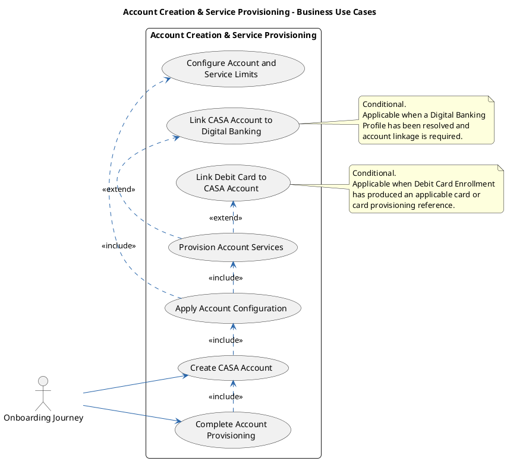
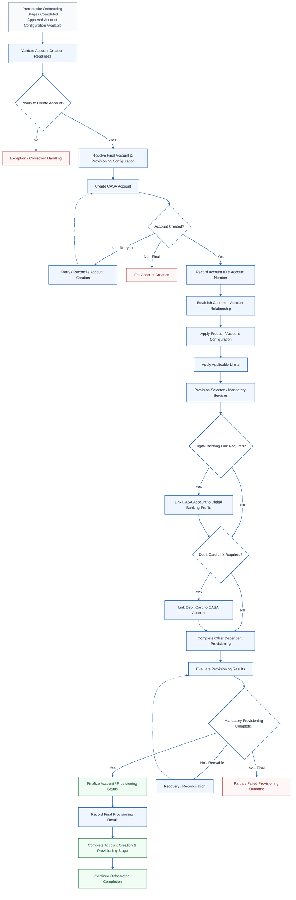
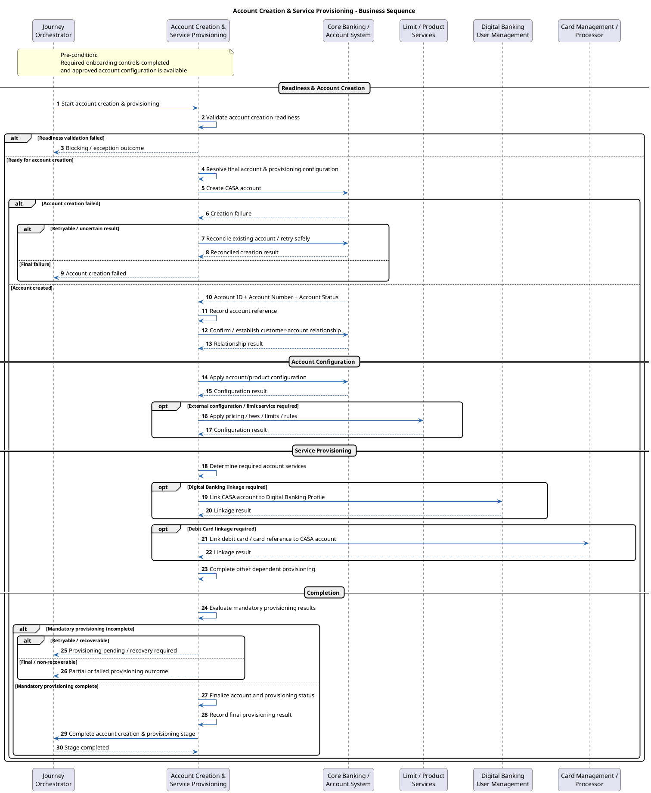

# 9. Account Creation & Service Provisioning

> Customer Onboarding — module 9 of 10. Exported from Development `customer-onboarding` v13.

[← Customer Onboarding](README.md) · [Previous: Consent & Agreement Service](08-consent-agreement-service.md) · [Next: External System Integration](10-external-system-integration.md)

## Contents

- [9.1 Overview](#91-overview)
- [9.2 Key Concepts and Terminology](#92-key-concepts-and-terminology)
- [9.3 Entry and Completion Conditions](#93-entry-and-completion-conditions)
- [9.4 Business Capabilities and Responsibilities](#94-business-capabilities-and-responsibilities)
- [9.5 Relationships with Other Stages and Domains](#95-relationships-with-other-stages-and-domains)
- [9.6 Account Creation & Provisioning Information](#96-account-creation--provisioning-information)
- [9.7 Business Use Cases](#97-business-use-cases)
- [9.8 Scope and Stage Boundaries](#98-scope-and-stage-boundaries)
- [9.9 Main Business Flow](#99-main-business-flow)
- [9.10 Business Rules](#910-business-rules)
- [9.11 Exception and Alternate Flows](#911-exception-and-alternate-flows)
- [9.12 Key Business Objects and Outcomes](#912-key-business-objects-and-outcomes)
- [9.13 Project Analysis and Decision Checklist](#913-project-analysis-and-decision-checklist)

## 9.1 Overview

Covers: Business Definition · Business Purpose · Capability vs. Physical Service · Provisioning Principle

### Business Definition

Account Creation & Service Provisioning is the onboarding capability that converts an approved CASA onboarding configuration into an actual customer account and completes the account-level provisioning required before the onboarding journey can be considered successfully fulfilled.

The capability:

- Receives the approved onboarding application and confirmed product configuration from preceding onboarding stages.
- Confirms that mandatory pre-account-creation controls have been completed successfully.
- Resolves the final account and provisioning configuration to be applied.
- Creates the CASA account in the designated account system of record.
- Generates, assigns, or obtains the CASA account number and account reference.
- Establishes the relationship between the created CASA account and the resolved customer / CIF / party.
- Applies the confirmed product and account configuration.
- Applies applicable pricing, fees, interest settings, restrictions, and account rules where these are part of account provisioning.
- Applies approved account-level and service-level limits.
- Provisions selected or mandatory services that depend on successful account creation.
- Links the created CASA account to the resolved Digital Banking Profile where Digital Banking has been established.
- Links the applicable debit card or card provisioning reference to the newly created current account where debit card enrollment has already been completed and this responsibility is assigned to the provisioning stage.
- Determines the resulting account and provisioning status.
- Records the account creation and provisioning outcome and relevant audit information.
- Makes the created CASA account information available to the onboarding orchestrator and downstream completion or communication stages.

Account Creation & Service Provisioning begins only after the onboarding journey has sufficient approved and confirmed information to create the account.

The primary business outcome is that the approved CASA product has been instantiated as an actual banking account and all mandatory provisioning required for onboarding completion has either:

1. completed successfully;
2. completed successfully with explicitly permitted deferred provisioning;
3. entered a retryable or recoverable state; or
4. failed with a clear outcome that prevents onboarding completion.

This capability does not determine which CASA product the customer wants. Product and service selection should already have been resolved by the relevant upstream stages.

It also does not perform customer-driven debit card enrollment or card product selection. Where a preceding Debit Card Enrollment stage has already established the applicable card request or card reference, this stage completes the required card-to-account linkage after the CASA account exists, where that linkage is part of the approved onboarding provisioning model.

A key principle is that account creation and provisioning are related but not identical outcomes. The CASA account may already exist while one or more mandatory dependent provisioning activities are still incomplete. Therefore, successful account creation must not automatically be interpreted as successful completion of the entire provisioning stage.

### Business Purpose

| Business Purpose | Why It Matters |
|---|---|
| Create the CASA Account | Converts the approved onboarding application into an actual bank account. |
| Establish the Customer-Account Relationship | Ensures the account is associated with the correct customer / CIF / party and ownership context. |
| Apply Approved Product Configuration | Ensures the created account reflects the product, currency, relationship, and account options confirmed during onboarding. |
| Apply Account Rules and Limits | Ensures applicable limits, restrictions, pricing, fees, and other account controls are effective before use. |
| Provision Dependent Services | Enables or completes services that require a successfully created CASA account. |
| Link Digital Banking Access | Makes the created CASA account available through the applicable Digital Banking relationship where required. |
| Link Debit Card to the Current Account | Completes the relationship between a previously enrolled/provisioned debit card and the newly created current account where applicable. |
| Prevent Duplicate or Inconsistent Provisioning | Ensures retries do not create duplicate accounts or duplicate dependent service relationships. |
| Maintain Auditability | Retains evidence of what was created, configured, linked, and completed. |
| Support Onboarding Completion | Provides the account and provisioning result required to complete the onboarding journey and communicate the outcome to the customer. |

### Capability vs. Physical Service

In this knowledge base, Account Creation & Service Provisioning represents a logical business capability within the onboarding journey.

It does not imply that all responsibilities must be implemented by one deployable service.

A target implementation may involve multiple systems or services, such as:

- Core Banking / Account System of Record;
- Customer / Party Management;
- Product Configuration;
- Pricing and Fee Management;
- Limit Management;
- Digital Banking User Management;
- Card Management / Card Processing;
- Notification services;
- Application Management / Journey Orchestration;
- Audit and Event Management.

The actual physical service decomposition, API ownership, sequencing, and system of record are project-specific.

### Provisioning Principle

Account Creation & Service Provisioning should be understood as an execution stage rather than a customer-selection stage.

Earlier onboarding capabilities determine, capture, validate, or approve what should be created. This stage makes those confirmed decisions effective against the actual account and supporting banking platforms.

Conceptually:

Confirmed Upstream Decisions
|
v
Validate Provisioning Readiness
|
v
Create Actual CASA Account
|
v
Apply Approved Account Configuration
|
v
Apply Limits and Provision Required Services
|
v
Establish Dependent Relationships
(Digital Banking / Debit Card / Other Services)
|
v
Evaluate Mandatory Provisioning Outcome
|
v
Finalize Account and Complete Stage

This leads to the following boundary principle:

| Earlier Onboarding Stages | Account Creation & Service Provisioning |
|---|---|
| Determine / select / capture / approve | Create / apply / provision / link / finalize |
| Confirm product and service requirements | Instantiate the approved CASA account |
| Resolve Digital Banking Profile | Link the created CASA account to the resolved profile |
| Resolve Debit Card Enrollment | Link the applicable debit card/card reference to the created CASA account |
| Determine approved or default limits | Apply the effective limits to the applicable account/service |
| Capture required customer decisions | Execute the approved provisioning outcome |

The exact technical platform used to execute each operation is implementation-specific.

## 9.2 Key Concepts and Terminology

Covers: Account Creation · CASA Account · Account Number · Account Provisioning · Service Provisioning · Account Limit · Account Status · Customer-Account Relationship · Dependent Service Linking · Provisioning Result

### Account Creation

The business process through which an approved account configuration is instantiated as an actual banking account.

Account creation typically results in:

- an account identifier;
- an account number;
- an account status;
- a customer-account relationship;
- a product/account configuration stored in the relevant system of record.

### CASA Account

A Current Account or Savings Account established for the customer under an approved CASA product configuration.

Conceptually, a CASA account may contain or reference:

- Account ID;
- Account number;
- Customer / CIF / Party reference;
- Product or product variant;
- Currency;
- Ownership / relationship type;
- Account status;
- Branch / booking entity where applicable;
- Pricing / fee configuration;
- Interest configuration where applicable;
- Restrictions;
- Limits;
- Linked services.

The exact account data model is implementation-specific.

### Account Number

The customer-facing or bank-recognised identifier assigned to the created account.

The account number may be:

- generated by Core Banking;
- allocated from a numbering range;
- pre-reserved before account creation;
- assigned during successful creation.

The exact numbering model is project-specific.

### Account Provisioning

The process of applying the configuration and relationships required to make the newly created account operational according to the approved onboarding outcome.

Account provisioning may include:

- product configuration;
- pricing and fee rules;
- limits;
- restrictions;
- Digital Banking linkage;
- debit card linkage;
- statements;
- notifications;
- other dependent services.

Account Creation answers whether the actual CASA account exists.

Account Provisioning answers whether the approved configuration, controls, services, and required relationships have been made effective for that account.

An account may therefore be successfully created while provisioning remains partially complete.

### Service Provisioning

The process of enabling or establishing an approved service for the created account.

A service may have been selected, determined, or enrolled in an earlier onboarding stage, while the actual provisioning can only be completed after the account exists.

Examples may include:

- Digital Banking account access;
- debit card account linkage;
- e-statement service;
- transaction capabilities;
- notification services;
- other account-related services.

### Account Limit

A business control defining the permitted value, frequency, amount, or scope of an activity associated with the customer, account, channel, or service.

Examples may include:

- daily transfer limit;
- transaction limit;
- withdrawal limit;
- channel limit;
- product-specific limit.

The source of the approved limit and the system that enforces it are project-specific.

### Account Status

Represents the current business state of the created CASA account.

Conceptual states may include:

- CREATED;
- ACTIVE;
- PENDING_ACTIVATION;
- RESTRICTED;
- PENDING_PROVISIONING;
- BLOCKED;
- CLOSED.

Exact account statuses must be confirmed for each target implementation.

### Customer-Account Relationship

The business relationship associating the created account with the correct customer / CIF / party and ownership context.

The relationship may define:

- primary owner;
- joint owner;
- authorised party;
- relationship type;
- legal entity linkage.

For standard retail onboarding, the relationship is commonly a single customer owning the newly created CASA account, but the model must not be assumed where other relationship types exist.

### Dependent Service Linking

The establishment of relationships between the newly created account and onboarding services that were already resolved earlier in the journey.

Examples include:

- CASA Account ↔ Digital Banking Profile;
- CASA Account ↔ Debit Card / Card Reference;
- CASA Account ↔ Statement Service;
- CASA Account ↔ Notification Service.

### Provisioning Result

The consolidated outcome of account creation and all mandatory provisioning activities required by the onboarding journey.

A provisioning result should distinguish:

- successful account creation;
- successful mandatory provisioning;
- optional or deferred provisioning;
- retryable failure;
- partial failure;
- final failure.

## 9.3 Entry and Completion Conditions

| Condition | Description |
|---|---|
| Entry Condition | The onboarding application has reached the point at which account creation is permitted and the approved product configuration is available. |
| Customer Context | The customer / CIF / party reference required for account creation is available and resolved. |
| Product Context | The approved CASA product, account type, currency, relationship type, and applicable service selections are available. |
| Control Readiness | Mandatory compliance, consent, authentication, fraud, and other pre-account-creation controls required by the target journey have completed successfully. |
| Digital Banking Context | Where Digital Banking was enrolled or reused, the applicable Digital Banking Profile reference is available for downstream linking. |
| Debit Card Context | Where Debit Card Enrollment applies and precedes this stage, the applicable card enrollment result, card reference, or provisioning reference is available for downstream account linking when required. |
| Successful Completion – Account | A CASA account has been created successfully and its account ID / account number has been recorded. |
| Successful Completion – Mandatory Provisioning | All provisioning required to consider the onboarding outcome complete has succeeded, or an explicitly approved deferred-provisioning rule applies. |
| Retryable Failure | A temporary failure prevents full completion but the operation can be safely retried without creating duplicate accounts or relationships. |
| Partial Failure | The CASA account exists but one or more dependent provisioning activities remain incomplete and require recovery or reconciliation. |
| Final Failure | A non-recoverable condition prevents account creation or required provisioning from completing. |
| Next Stage | After successful completion, the onboarding journey proceeds to final completion, notification, or the next applicable stage. |

The exact stage status values and transition rules are project-specific.

## 9.4 Business Capabilities and Responsibilities

The capabilities below are organised according to the typical Account Creation & Service Provisioning sequence.

Validate Provisioning Readiness
↓
Resolve Final Provisioning Configuration
↓
Create CASA Account
↓
Obtain Account Number
↓
Establish Customer–Account Relationship
↓
Apply Account Configuration
↓
Configure Applicable Limits
↓
Provision Required Services
↓
Link Digital Banking / Debit Card
↓
Evaluate Provisioning Result
↓
Finalize Account & Complete Stage

Actual execution order and physical system ownership are implementation-specific.

Reference code: BCA-ACP-XX, where BCA = Business Capability / Responsibility and ACP = Account Creation & Provisioning.

### Provisioning Readiness

#### BCA-ACP-01 – Validate Account Creation Readiness

| BCA-ACP-01 – Validate Account Creation Readiness |
|---|
| Confirm that the onboarding application is ready for CASA account creation and that no unresolved condition prevents provisioning. |
| Key checks include: |
| - customer / CIF / party reference is available; |
| - confirmed CASA product configuration is available; |
| - mandatory upstream onboarding stages are completed; |
| - required customer, account, consent, and control information is available; |
| - no blocking compliance, risk, authentication, or journey condition remains; |
| - the request has not already resulted in a successfully created account. |
| Result: |
| - account creation is allowed to proceed; or |
| - the stage is stopped and routed to the applicable retry, recovery, or exception path. |

#### BCA-ACP-02 – Resolve Final Provisioning Configuration

| BCA-ACP-02 – Resolve Final Provisioning Configuration |
|---|
| Determine the effective configuration that must be applied to the account and dependent services. |
| The configuration may include: |
| - CASA product / product variant; |
| - account type; |
| - currency; |
| - customer ownership or relationship type; |
| - pricing or fee configuration; |
| - applicable limits; |
| - selected or mandatory services; |
| - Digital Banking Profile reference; |
| - Debit Card / Card Enrollment reference; |
| - other onboarding service references required for provisioning. |
| Result: |
| A complete provisioning configuration is available for account creation and downstream service setup. |

### CASA Account Creation

#### BCA-ACP-03 – Create CASA Account

| BCA-ACP-03 – Create CASA Account |
|---|
| Create the approved CASA account in the designated Account System of Record using the confirmed customer and product configuration. |
| The account creation request typically includes: |
| - customer / CIF / party reference; |
| - product and account type; |
| - currency; |
| - ownership / relationship information; |
| - applicable account attributes; |
| - onboarding application or business reference used for traceability and duplicate prevention. |
| Result: |
| The Account System of Record returns the created CASA account reference and account creation status. |

#### BCA-ACP-04 – Obtain CASA Account Number

| BCA-ACP-04 – Obtain CASA Account Number |
|---|
| Obtain the official account number assigned to the newly created CASA account. |
| Example: |
| Create CASA Account ↓ Core Banking creates account ↓ Returns: - Account ID: ACC-12345 - Account Number: 0123456789 |
| The returned identifiers are used for subsequent account configuration, service provisioning, linking, and onboarding completion. |
| Result: |
| - CASA Account ID / internal account reference; |
| - Official Account Number. |

#### BCA-ACP-05 – Establish Customer–Account Relationship

| BCA-ACP-05 – Establish Customer–Account Relationship |
|---|
| Associate the created CASA account with the intended customer and applicable banking relationship. |
| The relationship may be established using: |
| - Customer ID; |
| - CIF; |
| - Party / Legal Entity ID; |
| - account holder reference; |
| - ownership or relationship type. |
| Where joint or multi-party accounts are supported, the applicable ownership relationships must also be established. |
| Result: |
| The CASA account is linked to the correct customer relationship and can be resolved from both customer and account contexts. |

### Account Configuration

#### BCA-ACP-06 – Apply Account Configuration

| BCA-ACP-06 – Apply Account Configuration |
|---|
| Apply the confirmed product and account configuration to the created CASA account. |
| Configuration may include: |
| - product / product variant; |
| - account type; |
| - currency; |
| - branch or booking entity where applicable; |
| - pricing / fee plan; |
| - interest configuration where applicable; |
| - ownership configuration; |
| - account restrictions; |
| - other product-specific account attributes. |
| Only values already approved, confirmed, or determined by the applicable upstream rules should be applied. |
| Result: |
| The created CASA account reflects the approved onboarding configuration. |

#### BCA-ACP-07 – Configure Applicable Limits

| BCA-ACP-07 – Configure Applicable Limits |
|---|
| Apply the effective limits applicable to the CASA account and provisioned services. |
| Limits may include: |
| - transaction limits; |
| - transfer limits; |
| - channel limits; |
| - account-level limits; |
| - service-specific limits; |
| - product-default limits where customer selection is not applicable. |
| The stage applies the approved or effective limit values; it does not re-negotiate or re-select the limits with the customer. |
| Result: |
| The applicable limits are configured in the relevant system of record and associated with the created account or service. |

### Service and Relationship Provisioning

#### BCA-ACP-08 – Provision Required Services

| BCA-ACP-08 – Provision Required Services |
|---|
| Provision the services confirmed during onboarding that depend on the existence of the CASA account. |
| Examples may include: |
| - transaction capability; |
| - statement / e-statement service; |
| - account notifications; |
| - product-bundled services; |
| - other account-level services required by the approved onboarding configuration. |
| Provisioning may involve Core Banking or separate service platforms depending on the target architecture. |
| Result: |
| Each applicable service has a provisioning result such as: |
| - provisioned / enabled; |
| - already satisfied; |
| - pending; |
| - failed; |
| - not applicable. |

#### BCA-ACP-09 – Link CASA Account to Digital Banking Profile

| BCA-ACP-09 – Link CASA Account to Digital Banking Profile |
|---|
| Where Digital Banking Enrollment has produced a reusable or newly created Digital Banking Profile, link the CASA account to that profile. |
| The linkage uses: |
| - Digital Banking Profile ID; |
| - CASA Account ID / Account Number; |
| - customer reference; |
| - applicable channel or account-access context. |
| The stage does not create or re-evaluate the Digital Banking Profile; it uses the profile result produced by the Digital Banking Enrollment stage. |
| Result: |
| The newly created CASA account is associated with the correct Digital Banking Profile and can be made available through the applicable Digital Banking channels. |

#### BCA-ACP-10 – Link Debit Card to CASA Account

| BCA-ACP-10 – Link Debit Card to CASA Account |
|---|
| Where Debit Card Enrollment has been completed, establish the relationship between the applicable debit card or card-enrollment reference and the newly created CASA account. |
| The linkage may use: |
| - Card ID / Card Reference; |
| - Card Enrollment / Card Application reference; |
| - CASA Account ID / Account Number; |
| - customer reference; |
| - primary funding-account designation where applicable. |
| Debit Card Enrollment remains responsible for card selection, enrollment, and card-specific configuration. This capability completes the account relationship after the CASA account exists. |
| Result: |
| The applicable debit card is linked to the intended CASA account for subsequent card usage or downstream card provisioning. |

### Provisioning Completion

#### BCA-ACP-11 – Evaluate Provisioning Result

| BCA-ACP-11 – Evaluate Provisioning Result |
|---|
| Evaluate the combined results of account creation and all required provisioning activities. |
| The evaluation should consider: |
| - CASA account creation result; |
| - account configuration result; |
| - limit configuration result; |
| - service provisioning results; |
| - Digital Banking linkage result; |
| - Debit Card linkage result; |
| - other mandatory dependent provisioning results. |
| The stage must distinguish between: |
| - fully successful provisioning; |
| - account created with incomplete provisioning; |
| - retryable provisioning failure; |
| - recovery / exception required; |
| - final failure. |
| Result: |
| A final provisioning outcome is determined and the next journey action is known. |

#### BCA-ACP-12 – Finalize Account and Complete Stage

| BCA-ACP-12 – Finalize Account and Complete Stage |
|---|
| Finalize the account and onboarding provisioning state after all mandatory conditions have been satisfied. |
| Finalization may include: |
| - confirm the effective account status; |
| - record the Account ID and Account Number; |
| - record applied configuration and limits; |
| - record provisioned services; |
| - record Digital Banking and Debit Card relationships; |
| - record provisioning timestamps and processing outcome; |
| - make the account result available to the Journey Orchestrator and downstream stages. |
| Result: |
| The Account Creation & Service Provisioning stage is marked as completed and the onboarding journey can proceed to final completion or notification. |

## 9.5 Relationships with Other Stages and Domains

| Source / Target | Direction | Business Object / Information | Relationship |
|---|---|---|---|
| Customer Information Capture / Customer Master | Inbound | Customer ID, CIF / Party ID, identity and relationship information | Supplies the resolved customer context required for account ownership. |
| Account Setup | Inbound | Confirmed Product Configuration | Supplies the approved CASA product, account type, currency, options, and selected services. |
| Compliance / Risk | Inbound | Approved / cleared onboarding outcome | Confirms that account creation is permitted from a compliance perspective. |
| Consent & Agreement | Inbound | Required acceptance / consent completion | Confirms that legally required customer acceptance has been obtained where applicable. |
| Authentication / Fraud | Inbound | Successful control outcome | Confirms required pre-account-creation security controls where applicable. |
| Digital Banking Enrollment | Inbound | Digital Banking Profile reference and resolved channel context | Supplies the Digital Banking relationship to which the created CASA account may be linked. |
| Debit Card Enrollment | Inbound | Card enrollment result, Card ID / Card Reference / Card Provisioning Reference | Supplies the card context required for account linking after CASA creation where applicable. |
| Core Banking / Account System of Record | Request / Response | Account creation request, Account ID, Account number, Account status | Creates and persists the CASA account. |
| Product / Pricing / Fee Management | Inbound / Request | Product rules, pricing, fees, interest configuration | Supplies or applies product-level configuration. |
| Limit Management | Request / Response | Approved limit configuration and provisioning result | Applies account/service limits where managed outside the account system. |
| Digital Banking User Management | Request / Response | Profile ID, Account ID, account linkage result | Establishes CASA access through Digital Banking where applicable. |
| Card Management / Processor | Request / Response | Card reference, Account reference, linkage result | Establishes the debit card-to-account relationship where applicable. |
| Application Management / Journey Orchestrator | Outbound | Stage status, Account ID, Account number, provisioning result | Records journey progression and final provisioning outcome. |
| Notifications & Communication | Outbound | Account number/reference, product, completion status, communication context | Supports customer notification after successful onboarding. |

The relationships above should be interpreted from a business-capability perspective. The stage may coordinate several physical systems, but the business responsibility is to ensure that the approved account and mandatory dependent provisioning reach a consistent and traceable outcome.

## 9.6 Account Creation & Provisioning Information

This section describes the key business information consumed, determined, and produced during Account Creation & Service Provisioning.

It focuses on the information required to create the CASA account, apply the approved configuration, complete dependent provisioning, and provide the final account and provisioning result to the onboarding journey.

The information is grouped into:

- confirmed information received from upstream onboarding stages;
- information determined or generated during account creation and provisioning; and
- final provisioning information produced for journey completion and downstream use.

### Confirmed Upstream Information

This section describes the confirmed business information received from preceding onboarding stages and used as input for account creation and provisioning.

The information represents decisions or results already determined, selected, validated, or approved upstream and should not normally be re-selected during this stage.

| Information | Description | Purpose |
|---|---|---|
| Customer / CIF / Party Reference | Resolved customer identifier used for account ownership | Ensures the account is created for the correct customer. |
| Confirmed Product | Approved CASA product or product variant | Determines the account product to instantiate. |
| Account Type | Current, savings, or other supported account type | Determines the account model. |
| Currency | Approved account currency | Configures the account currency. |
| Ownership / Relationship Type | Customer-account relationship model | Establishes the applicable ownership relationship. |
| Selected Services | Services confirmed during upstream onboarding | Determines which services require provisioning. |
| Approved Limits | Customer-selected, bank-determined, or default limits that have already been approved | Determines effective account/service controls. |
| Digital Banking Profile Reference | Existing or newly created Digital Banking relationship | Enables CASA-to-Digital-Banking linking. |
| Debit Card / Card Provisioning Reference | Card context produced by the preceding card stage | Enables debit card-to-account linking after account creation. |
| Onboarding Application Reference | Business reference for the onboarding journey | Supports traceability and idempotency. |

### System-Determined Information

This section describes the business information determined, generated, or resolved during Account Creation & Service Provisioning.

It includes information required to identify the created account, track provisioning progress, and determine whether all mandatory provisioning activities have completed successfully.

| Information | Purpose |
|---|---|
| Account Creation Readiness | Determines whether the account may be created. |
| Effective Product Configuration | Resolves product defaults and approved overrides. |
| Effective Pricing / Fee Plan | Determines applicable commercial configuration. |
| Effective Limit Configuration | Resolves the limits that must be provisioned. |
| Account Number | Identifies the created CASA account. |
| Account ID / Core Account Reference | Provides the persistent account system reference. |
| Account Status | Determines whether the created account is active, restricted, pending, or otherwise classified. |
| Service Provisioning Status | Records the outcome of each required service provisioning action. |
| Digital Banking Link Status | Records whether the CASA account has been linked to the Digital Banking Profile. |
| Debit Card Link Status | Records whether the debit card has been linked to the intended CASA account where applicable. |
| Stage Outcome | Determines whether onboarding can complete or must enter recovery / exception handling. |

### Provisioning Result Information

This section describes the final business information produced by the stage after account creation and provisioning activities have been evaluated.

The result is used to record the completed account configuration, support downstream onboarding activities, and determine whether the onboarding journey can proceed.

| Information | Purpose |
|---|---|
| Account ID | Persistent system reference for the created account. |
| Account Number | Customer-facing or bank-recognised account identifier. |
| Account Status | Final account state at stage completion. |
| Product Configuration Result | Confirms the applied account/product configuration. |
| Limit Provisioning Result | Confirms applicable limit configuration. |
| Service Provisioning Results | Records successful, deferred, failed, or retryable service provisioning outcomes. |
| Digital Banking Link Result | Confirms CASA-to-profile relationship where applicable. |
| Debit Card Link Result | Confirms card-to-account relationship where applicable. |
| Provisioning Outcome | Consolidated success / partial / retryable / failed outcome. |
| Completion Timestamp | Records when the stage reached its applicable final state. |

Exact field names and enumerations are implementation-specific.

## 9.7 Business Use Cases

Covers: Use Case Overview · Use Case Diagram · Use Case Specifications · Use Case Summary

### Use Case Overview

Account Creation & Service Provisioning is primarily a system-driven business stage.

Unlike customer-interaction stages such as Account Setup or Digital Banking Enrollment, the customer normally does not manually perform account creation, core banking updates, service provisioning, or account-linking operations.

Therefore, the use cases in this section represent the major business operations performed on behalf of the already-confirmed onboarding application.

The primary initiating actor is represented as the Onboarding Journey. This is a logical business actor and does not imply that a specific orchestration product must be used.

The use cases are:

1. Create CASA Account.
2. Apply Account Configuration.
3. Configure Account and Service Limits.
4. Provision Account Services.
5. Link CASA Account to Digital Banking.
6. Link Debit Card to CASA Account.
7. Complete Account Provisioning.

### Use Case Diagram

Diagram: image-20260831-104753.png (see the Confluence page)
https://datumhq.atlassian.net/wiki/download/attachments/1789919233/image-20260831-104753.png?version=1&modificationDate=1788173277134&cacheVersion=1&api=v2

Use case diagram - PlantUML code

### Use Case Specifications

Reference code: UC-ACP-XX, where UC = Use Case and ACP = Account Creation & Provisioning.

#### UC-ACP-01 – Create CASA Account › Use Case Information

| UC-ACP-01 – Create CASA Account › Use Case Information |
|---|
| See the table below. |

#### Use Case Information

| Attribute | Description |
|---|---|
| Use Case ID | UC-ACP-01 |
| Use Case Name | Create CASA Account |
| Primary Actor | Onboarding Journey |
| Trigger | The onboarding application reaches the approved account-creation stage. |
| Pre-conditions | Account creation readiness has been confirmed. Customer / CIF / Party reference is available. Confirmed Product Configuration is available. No unresolved blocking condition prevents account creation. |
| Post-conditions | A CASA account is created successfully with an Account ID / Account Number, or a clear retryable/failure outcome is recorded. |

#### Main Flow

| Main Flow |
|---|
| See the table below. |

| Step | Actor | Activity | Description |
|---|---|---|---|
| 1 | Onboarding Journey | Request account creation | Submit the approved account-creation request. |
| 2 | Account Creation & Provisioning | Validate readiness | Confirm that the account may be created. |
| 3 | Account Creation & Provisioning | Resolve effective configuration | Determine the final account configuration to apply. |
| 4 | Account Creation & Provisioning | Create CASA account | Create the CASA account in the designated account system of record. |
| 5 | Account System | Assign account reference | Return the created Account ID and Account Number. |
| 6 | Account Creation & Provisioning | Record account result | Record the created account reference against the onboarding application. |
| 7 | Account Creation & Provisioning | Continue provisioning | Proceed with dependent account configuration and service provisioning. |

#### Alternate / Exception Flow

| Alternate / Exception Flow |
|---|
| See the table below. |

| ID | Condition | Handling |
|---|---|---|
| AF-01 | Account creation readiness fails. | Do not create the account. Return the applicable blocking condition. |
| AF-02 | Duplicate/repeated request is received. | Reconcile using the onboarding/business reference and return the existing successful account result where appropriate. |
| AF-03 | Account system returns a retryable technical error. | Keep the stage incomplete and allow safe retry. |
| AF-04 | Account may have been created, but the response was lost. | Resolve whether an account already exists before retrying account creation. |

#### UC-ACP-02 – Apply Account Configuration › Use Case Information

| UC-ACP-02 – Apply Account Configuration › Use Case Information |
|---|
| See the table below. |

#### Use Case Information

| Attribute | Description |
|---|---|
| Use Case ID | UC-ACP-02 |
| Use Case Name | Apply Account Configuration |
| Primary Actor | Onboarding Journey |
| Trigger | A CASA account has been created or the account-creation operation applies the configuration as part of the same transaction. |
| Pre-conditions | Confirmed account/product configuration is available. |
| Post-conditions | The approved product/account configuration is effective for the created CASA account. |

#### Main Flow

| Main Flow |
|---|
| See the table below. |

| Step | Actor | Activity | Description |
|---|---|---|---|
| 1 | Account Creation & Provisioning | Resolve product configuration | Determine the effective product and account settings. |
| 2 | Account Creation & Provisioning | Apply account attributes | Apply currency, product, ownership, booking, and other applicable account attributes. |
| 3 | Account Creation & Provisioning | Apply commercial configuration | Apply pricing, fees, interest, or defaults where applicable. |
| 4 | Account Creation & Provisioning | Apply account rules | Apply applicable restrictions and product-specific account controls. |
| 5 | Account Creation & Provisioning | Record configuration result | Record successful account configuration or applicable failure. |

#### Alternate / Exception Flow

| Alternate / Exception Flow |
|---|
| See the table below. |

| ID | Condition | Handling |
|---|---|---|
| AF-01 | Requested configuration is no longer valid. | Prevent final completion and route to the applicable correction / exception process. |
| AF-02 | Configuration is supplied automatically by product defaults. | Record or reference the effective defaults rather than duplicating configuration. |
| AF-03 | Account exists but configuration update fails. | Treat as partial provisioning and initiate recovery / reconciliation. |

#### UC-ACP-03 – Configure Account and Service Limits › Use Case Information

| UC-ACP-03 – Configure Account and Service Limits › Use Case Information |
|---|
| See the table below. |

#### Use Case Information

| Attribute | Description |
|---|---|
| Use Case ID | UC-ACP-03 |
| Use Case Name | Configure Account and Service Limits |
| Primary Actor | Onboarding Journey |
| Trigger | One or more limits must be applied to the created account or provisioned service. |
| Pre-conditions | CASA account exists. Effective approved/default limit configuration is available. |
| Post-conditions | Applicable limits are effective or an explicit provisioning exception is recorded. |

#### Main Flow

| Main Flow |
|---|
| See the table below. |

| Step | Actor | Activity | Description |
|---|---|---|---|
| 1 | Account Creation & Provisioning | Determine effective limits | Resolve the approved/default limits to apply. |
| 2 | Account Creation & Provisioning | Validate limit compatibility | Confirm the limits are permitted for the customer, account, product, and service context. |
| 3 | Account Creation & Provisioning | Apply limits | Provision the limits through the applicable account/limit system. |
| 4 | Limit / Account System | Return limit result | Confirm successful configuration or return a failure. |
| 5 | Account Creation & Provisioning | Record limit result | Record the effective limits and provisioning outcome. |

#### Alternate / Exception Flow

| Alternate / Exception Flow |
|---|
| See the table below. |

| ID | Condition | Handling |
|---|---|---|
| AF-01 | No explicit limit configuration is required. | Product/system defaults apply. |
| AF-02 | Approved limit exceeds permitted product/customer rules. | Do not silently reduce unless bank policy explicitly defines that behaviour; route to configured exception handling. |
| AF-03 | Limit provisioning fails after account creation. | Treat as partial provisioning and follow recovery / reconciliation rules. |

#### UC-ACP-04 – Provision Account Services › Use Case Information

| UC-ACP-04 – Provision Account Services › Use Case Information |
|---|
| See the table below. |

#### Use Case Information

| Attribute | Description |
|---|---|
| Use Case ID | UC-ACP-04 |
| Use Case Name | Provision Account Services |
| Primary Actor | Onboarding Journey |
| Trigger | One or more approved or mandatory services depend on the created CASA account. |
| Pre-conditions | CASA account exists. Applicable service configuration is available. |
| Post-conditions | Required services are provisioned, deferred according to approved rules, or recorded as failed/retryable. |

#### Main Flow

| Main Flow |
|---|
| See the table below. |

| Step | Actor | Activity | Description |
|---|---|---|---|
| 1 | Account Creation & Provisioning | Determine required services | Identify mandatory and selected services requiring provisioning. |
| 2 | Account Creation & Provisioning | Provision services | Submit the required provisioning actions. |
| 3 | Supporting Systems | Return provisioning results | Return service-specific success/failure results. |
| 4 | Account Creation & Provisioning | Record service outcomes | Record the outcome for each relevant service. |
| 5 | Account Creation & Provisioning | Continue dependent linking | Perform account-dependent Digital Banking, debit card, or other linkage where applicable. |

#### Alternate / Exception Flow

| Alternate / Exception Flow |
|---|
| See the table below. |

| ID | Condition | Handling |
|---|---|---|
| AF-01 | Service is optional and may be deferred. | Record DEFERRED / equivalent status and allow completion only if policy permits. |
| AF-02 | Mandatory service provisioning fails. | Keep the stage incomplete and initiate the configured retry/recovery path. |
| AF-03 | Service was already provisioned. | Reuse/reconcile the existing service state and avoid duplicate provisioning. |

#### UC-ACP-05 – Link CASA Account to Digital Banking › Use Case Information

| UC-ACP-05 – Link CASA Account to Digital Banking › Use Case Information |
|---|
| See the table below. |

#### Use Case Information

| Attribute | Description |
|---|---|
| Use Case ID | UC-ACP-05 |
| Use Case Name | Link CASA Account to Digital Banking |
| Primary Actor | Onboarding Journey |
| Applicability | Conditional. Applicable where a Digital Banking Profile exists and the newly created account must be linked to it. |
| Trigger | CASA account creation succeeds and a Digital Banking Profile reference is available. |
| Pre-conditions | CASA account exists. Valid Digital Banking Profile reference exists. |
| Post-conditions | The CASA account is associated with the applicable Digital Banking Profile or a clear linkage exception is recorded. |

#### Main Flow

| Main Flow |
|---|
| See the table below. |

| Step | Actor | Activity | Description |
|---|---|---|---|
| 1 | Account Creation & Provisioning | Resolve Digital Banking Profile | Obtain the applicable profile reference from onboarding context. |
| 2 | Account Creation & Provisioning | Request account-profile linkage | Submit the relationship between CASA account and Digital Banking Profile. |
| 3 | Digital Banking System | Establish relationship | Add the account to the appropriate Digital Banking relationship. |
| 4 | Digital Banking System | Return linkage result | Confirm successful linkage. |
| 5 | Account Creation & Provisioning | Record linkage | Record the resulting Digital Banking account relationship. |

#### Alternate / Exception Flow

| Alternate / Exception Flow |
|---|
| See the table below. |

| ID | Condition | Handling |
|---|---|---|
| AF-01 | Digital Banking is not applicable. | Skip the linking use case. |
| AF-02 | Profile reference is missing unexpectedly. | Do not create a duplicate profile; route to the configured reconciliation/exception process. |
| AF-03 | Link already exists. | Treat the operation idempotently and confirm the intended relationship. |
| AF-04 | Link fails. | Apply the project-defined rule for mandatory versus recoverable/deferred Digital Banking linkage. |

#### UC-ACP-06 – Link Debit Card to CASA Account › Use Case Information

| UC-ACP-06 – Link Debit Card to CASA Account › Use Case Information |
|---|
| See the table below. |

#### Use Case Information

| Attribute | Description |
|---|---|
| Use Case ID | UC-ACP-06 |
| Use Case Name | Link Debit Card to CASA Account |
| Primary Actor | Onboarding Journey |
| Applicability | Conditional. Applicable where Debit Card Enrollment has produced an applicable debit card or card provisioning reference. |
| Trigger | CASA account creation succeeds and the card context required for account linking is available. |
| Pre-conditions | Debit Card Enrollment has completed its applicable scope. CASA account exists. Card / card provisioning reference exists. |
| Post-conditions | The debit card is associated with the intended current account or a clear linkage exception is recorded. |

#### Main Flow

| Main Flow |
|---|
| See the table below. |

| Step | Actor | Activity | Description |
|---|---|---|---|
| 1 | Account Creation & Provisioning | Resolve card reference | Obtain the card / card provisioning reference from the preceding card stage. |
| 2 | Account Creation & Provisioning | Resolve intended CASA account | Confirm the account created for the same onboarding application and customer. |
| 3 | Account Creation & Provisioning | Request card-account linkage | Submit the intended card-to-account relationship. |
| 4 | Card Management / Processor | Establish relationship | Associate the debit card with the CASA account according to the applicable funding/settlement model. |
| 5 | Card Management / Processor | Return linkage result | Confirm successful linkage. |
| 6 | Account Creation & Provisioning | Record card-account linkage | Record the resulting relationship and provisioning status. |

#### Alternate / Exception Flow

| Alternate / Exception Flow |
|---|
| See the table below. |

| ID | Condition | Handling |
|---|---|---|
| AF-01 | Customer did not enroll for a debit card. | Skip the card-linking use case. |
| AF-02 | Card enrollment result is pending. | Follow the project-defined deferred or recovery path. |
| AF-03 | Card reference does not belong to the intended customer/application. | Do not link the card. Route to exception handling. |
| AF-04 | Card is already linked to the intended account. | Treat the operation idempotently. |
| AF-05 | Linking fails after account creation. | Record partial provisioning and follow the applicable recovery / reconciliation process. |

#### UC-ACP-07 – Complete Account Provisioning › Use Case Information

| UC-ACP-07 – Complete Account Provisioning › Use Case Information |
|---|
| See the table below. |

#### Use Case Information

| Attribute | Description |
|---|---|
| Use Case ID | UC-ACP-07 |
| Use Case Name | Complete Account Provisioning |
| Primary Actor | Onboarding Journey |
| Trigger | Account creation and applicable provisioning activities have produced their results. |
| Pre-conditions | CASA account creation has succeeded. Mandatory provisioning results are available. |
| Post-conditions | A consolidated provisioning outcome is recorded and the onboarding journey is allowed to complete, retry, or enter exception handling according to policy. |

#### Main Flow

| Main Flow |
|---|
| See the table below. |

| Step | Actor | Activity | Description |
|---|---|---|---|
| 1 | Account Creation & Provisioning | Collect provisioning results | Collect account, configuration, limit, service, and linkage outcomes. |
| 2 | Account Creation & Provisioning | Evaluate completion criteria | Determine whether all mandatory completion conditions are satisfied. |
| 3 | Account Creation & Provisioning | Determine final account status | Resolve the resulting account state. |
| 4 | Account Creation & Provisioning | Record provisioning result | Store the consolidated account and provisioning outcome. |
| 5 | Account Creation & Provisioning | Complete stage | Report successful completion to the onboarding journey where completion criteria are satisfied. |
| 6 | Onboarding Journey | Continue onboarding completion | Continue to final communication or the next applicable stage. |

#### Alternate / Exception Flow

| Alternate / Exception Flow |
|---|
| See the table below. |

| ID | Condition | Handling |
|---|---|---|
| AF-01 | Mandatory provisioning is incomplete. | Do not mark the stage successfully complete unless explicit deferred-provisioning policy permits it. |
| AF-02 | Only optional provisioning remains pending. | Complete or defer according to product/journey policy. |
| AF-03 | Account exists but mandatory service linking failed. | Record partial provisioning and initiate recovery/reconciliation. |
| AF-04 | Repeated completion request is received. | Return the existing final result without duplicating account or service operations. |

### Use Case Summary

| Use Case ID | Use Case | Primary Actor | Applicability |
|---|---|---|---|
| UC-ACP-01 | Create CASA Account | Onboarding Journey | Mandatory where a new CASA account is being opened |
| UC-ACP-02 | Apply Account Configuration | Onboarding Journey | Mandatory / product-dependent |
| UC-ACP-03 | Configure Account and Service Limits | Onboarding Journey | Where explicit/default limits require provisioning |
| UC-ACP-04 | Provision Account Services | Onboarding Journey | Where services depend on created account |
| UC-ACP-05 | Link CASA Account to Digital Banking | Onboarding Journey | Conditional |
| UC-ACP-06 | Link Debit Card to CASA Account | Onboarding Journey | Conditional |
| UC-ACP-07 | Complete Account Provisioning | Onboarding Journey | Mandatory |

## 9.8 Scope and Stage Boundaries

Covers: In Scope · Out of Scope · Key Boundary Principles

### In Scope

| Area | In-Scope Activities |
|---|---|
| Provisioning Readiness | Confirm account creation may proceed and required inputs are available. |
| CASA Account Creation | Create the CASA account and obtain Account ID / Account Number. |
| Customer-Account Relationship | Associate the account with the correct customer / CIF / party. |
| Account Configuration | Apply confirmed product/account attributes and applicable product rules. |
| Pricing / Fee / Interest Configuration | Apply or reference applicable account commercial configuration where part of provisioning. |
| Limit Provisioning | Apply approved or default account/service limits. |
| Service Provisioning | Provision approved or mandatory account-dependent services. |
| Digital Banking Linking | Link the new CASA account to the resolved Digital Banking Profile where applicable. |
| Debit Card Linking | Link the applicable debit card/card reference to the new current account where Debit Card Enrollment has already been completed. |
| Other Dependent Relationships | Complete approved account-dependent relationships that require an existing account. |
| Account Finalization | Determine the resulting account and provisioning status. |
| Auditability | Record account creation, provisioning actions, results, failures, and retries. |
| Journey Completion | Return the account and provisioning outcome to the onboarding journey. |

### Out of Scope

| Out-of-Scope Activity | Responsible Stage / Domain |
|---|---|
| Initial customer identity capture or correction | Customer Information Capture |
| Customer/CIF creation where handled by a dedicated customer master stage | Customer / Party Management |
| CASA product discovery and selection | Account Setup |
| Customer selection of optional account services | Account Setup / applicable product configuration stage |
| Digital Banking channel selection and profile creation/reuse | Digital Banking Enrollment |
| Debit card product selection | Debit Card Enrollment |
| Customer card preferences and delivery/pick-up choice | Debit Card Enrollment |
| Card issuance lifecycle and card manufacturing | Card Management / Card Provisioning |
| PAN generation where owned by Card Management / Processor | Card Management / Processor |
| Card activation by customer | Card Activation / Servicing |
| Legal agreement, privacy, marketing, or product consent capture | Consent & Agreement capability |
| Compliance and risk assessment | Compliance / Risk |
| Final fraud/authentication decision where handled upstream | Authentication / Fraud |
| Post-onboarding account maintenance | Account Servicing |
| Post-onboarding limit change | Account / Digital Banking Servicing |
| Post-onboarding card replacement or servicing | Card Servicing |
| General Digital Banking servicing | Digital Banking Servicing |
| Final customer notification | Notifications & Communication |

### Key Boundary Principles

This section defines the responsibility boundaries of Account Creation & Service Provisioning within the onboarding journey.

The capability is responsible for executing approved onboarding decisions against the actual CASA account and dependent services. It should not repeat customer selection, approval, or enrollment activities that have already been completed by upstream stages.

#### Product Selection Boundary

| Product Selection Boundary |
|---|
| Account Creation & Service Provisioning uses the confirmed CASA product configuration provided by the preceding onboarding stages. |
| This stage is responsible for: |
| - creating the account based on the approved product configuration; |
| - applying the confirmed account attributes and applicable product rules. |
| This stage is not responsible for: |
| - product discovery; |
| - presenting CASA product options; |
| - customer product selection; |
| - changing the selected product unless an explicit exception or correction process requires it. |

#### Account Creation Boundary

| Account Creation Boundary |
|---|
| This stage is responsible for converting the approved onboarding decision into an actual CASA account. |
| Its responsibility includes: |
| - initiating or coordinating account creation with the designated account system of record; |
| - obtaining the Account ID and Account Number; |
| - recording the created account against the onboarding application; |
| - establishing the required customer-account relationship. |
| An approved onboarding application or confirmed product configuration does not, by itself, mean that a bank account already exists. |

#### Core Banking Boundary

| Core Banking Boundary |
|---|
| Account Creation & Service Provisioning is a business capability, while Core Banking is one of the physical systems that may execute part of that capability. |
| The business requirement is to ensure that: |
| - the CASA account is created in the designated account system of record; |
| - the required account configuration is made effective; |
| - provisioning results are recorded in the appropriate systems of record. |
| Some configuration may be handled directly in Core Banking, while other elements such as limits, Digital Banking relationships, or card relationships may be managed by specialised platforms. |
| The exact system ownership and integration design are project-specific. |

#### Limit Boundary

| Limit Boundary |
|---|
| The decision on which limit should apply may be made earlier in the onboarding journey. |
| Account Creation & Service Provisioning is responsible for applying the approved or permitted default limit to the actual account or service. |
| This stage should not re-perform: |
| - customer limit selection; |
| - business approval of the requested limit; |
| - eligibility assessment for a new limit, |
| unless explicitly required by the target design. |
| In principle: |
| Select / Determine / Approve Limit ↓ Upstream Stage  Apply Effective Limit ↓ Account Creation & Service Provisioning |

#### Digital Banking Boundary

| Digital Banking Boundary |
|---|
| Digital Banking Enrollment is responsible for resolving the customer's Digital Banking relationship, including creating, reusing, or confirming the applicable Digital Banking Profile. |
| Account Creation & Service Provisioning is responsible only for the account-dependent linkage after the CASA account has been created. |
| Where required, this stage: |
| - receives the resolved Digital Banking Profile reference; |
| - links the newly created CASA account to that profile; |
| - records the linkage result. |
| If the linkage fails, the stage should retry or reconcile the relationship according to the project-defined recovery rules. |
| It must not create another Digital Banking Profile merely to resolve an account-linking failure. |

#### Debit Card Boundary

| Debit Card Boundary |
|---|
| Debit Card Enrollment is responsible for the customer-driven card decision and enrollment process. |
| This may include: |
| - debit card selection; |
| - applicable card configuration; |
| - delivery or collection preference; |
| - other card-related customer choices. |
| Where Debit Card Enrollment occurs before CASA account creation, the final card-to-account relationship may not be established until the account exists. |
| In that model: |
| Debit Card Enrollment ↓ Produces card / card provisioning context ↓ Account Creation & Service Provisioning ↓ Creates CASA account ↓ Links card to the created CASA account |
| Account Creation & Service Provisioning is therefore responsible only for the account-dependent card linkage where applicable. |
| It does not take ownership of: |
| - debit card product selection; |
| - customer card enrollment; |
| - PAN generation; |
| - card manufacturing; |
| - card delivery; |
| - card activation. |

#### Partial Provisioning Boundary

| Partial Provisioning Boundary |
|---|
| Successful account creation does not automatically mean that the entire Account Creation & Service Provisioning stage has completed successfully. |
| The stage must distinguish between: |
| - the CASA account being successfully created; and |
| - all mandatory provisioning required to complete onboarding. |
| For example, the account may already exist while: |
| - a mandatory limit is not yet effective; |
| - Digital Banking linkage has failed; |
| - debit card linkage is incomplete; |
| - another mandatory account service remains pending. |
| The stage may only complete successfully when: |
| 1. all mandatory provisioning has completed successfully; or |
| 2. an explicitly approved business rule allows the remaining provisioning to be deferred. |
| Otherwise, the stage should remain in a partial, retryable, recovery, or failed state according to the applicable business rules. |

## 9.9 Main Business Flow

Covers: Actors and Logical Components · Business Flow Overview · Business Sequence Diagram · Detailed Business Flow

### Actors and Logical Components

| Actor / Component | Role |
|---|---|
| Onboarding Journey / Journey Orchestrator | Initiates the stage after prerequisite onboarding conditions are satisfied and controls journey progression. |
| Account Creation & Service Provisioning | Validates readiness, coordinates account creation, applies account/service configuration, completes dependent linking, records outcomes, and determines stage completion. |
| Core Banking / Account System | Creates and persists the CASA account, assigns the account reference/account number, and maintains applicable account state/configuration. |
| Limit / Product Services | Supplies or applies product, fee, pricing, and limit configuration where managed outside Core Banking. |
| Digital Banking User Management | Establishes the relationship between the created CASA account and the resolved Digital Banking Profile. |
| Card Management / Processor | Establishes the debit card-to-account relationship where applicable. |
| Application Management | Stores journey state, provisioning references, results, and completion status where separate from the orchestrator. |

Pre-condition: The onboarding journey has completed the mandatory controls required before account creation and the confirmed account/product configuration is available.

### Business Flow Overview

The Account Creation & Service Provisioning business flow can be summarised as follows:

Diagram: image-20260903-092733.png (see the Confluence page)
https://datumhq.atlassian.net/wiki/download/attachments/1789919233/image-20260903-092733.png?version=1&modificationDate=1788427657511&cacheVersion=1&api=v2

Business Flow Overview - Mermaid code

To download a Mermaid diagram as an image, follow this guide: https://mermaid.ink/

### Business Sequence Diagram

Diagram: image-20260903-093002.png (see the Confluence page)
https://datumhq.atlassian.net/wiki/download/attachments/1789919233/image-20260903-093002.png?version=1&modificationDate=1788427805760&cacheVersion=1&api=v2

Sequence Diagram - PlantUML code

### Detailed Business Flow

| Step | Activity | Description |
|---|---|---|
| 1 | Start account creation and provisioning | The Journey Orchestrator starts the stage after prerequisite onboarding conditions have been satisfied. |
| 2 | Validate account creation readiness | Confirm that the customer, product, required controls, and mandatory input information are ready for account creation. |
| 3 | Return blocking / exception outcome | Applicable when readiness validation fails. Do not create the account; return the blocking condition to the journey. |
| 4 | Resolve final account and provisioning configuration | Determine the effective product, account, service, limit, Digital Banking, card, and other provisioning context. |
| 5 | Create CASA account | Submit the approved account creation request to the account system of record. |
| 6 | Return creation failure | Applicable when account creation fails. Return the account-creation failure result. |
| 7 | Reconcile existing account / retry safely | Applicable for retryable or uncertain account creation. Determine whether the account already exists before issuing a new create operation. |
| 8 | Return reconciled creation result | Return the existing successful result or the safe retry result. |
| 9 | Return final account creation failure | Applicable for non-recoverable failure. Record failure and prevent successful stage completion. |
| 10 | Return Account ID, Account Number and status | Applicable when account creation succeeds. Return the persistent account references and initial account status. |
| 11 | Record account reference | Record the created account against the onboarding application and provisioning context. |
| 12 | Establish customer-account relationship | Confirm that the created account is associated with the intended customer / CIF / party and relationship type. |
| 13 | Return relationship result | Confirm the customer-account relationship result. |
| 14 | Apply account/product configuration | Apply the confirmed product and account attributes required by the approved CASA configuration. |
| 15 | Return account configuration result | Record or return the effective account configuration result. |
| 16 | Apply pricing / fees / limits / rules | Conditional where managed through separate services. Apply the effective commercial, limit, and product rule configuration. |
| 17 | Return configuration result | Record the result of external configuration/limit provisioning. |
| 18 | Determine required account services | Identify services and account-dependent relationships that must be provisioned. |
| 19 | Link CASA account to Digital Banking Profile | Conditional. Establish the relationship between the created CASA account and the resolved Digital Banking Profile. |
| 20 | Return Digital Banking linkage result | Record whether the account-profile relationship was established successfully. |
| 21 | Link debit card / card reference to CASA account | Conditional. Where Debit Card Enrollment produced an applicable card context, establish the card-to-current-account relationship. |
| 22 | Return card linkage result | Record whether the card-account relationship was established successfully. |
| 23 | Complete other dependent provisioning | Apply any additional approved account-dependent services or relationships. |
| 24 | Evaluate mandatory provisioning results | Determine whether all provisioning required for successful onboarding completion has completed. |
| 25 | Return provisioning pending / recovery required | Applicable when mandatory provisioning is incomplete but recoverable. Keep the stage incomplete and initiate recovery/reconciliation. |
| 26 | Return partial or failed provisioning outcome | Applicable when mandatory provisioning cannot be completed. Record the partial/final failure state. |
| 27 | Finalize account and provisioning status | Applicable when completion criteria are satisfied. Determine the resulting account and provisioning state. |
| 28 | Record final provisioning result | Record the account ID, account number, configuration, service, limit, and linkage outcomes. |
| 29 | Complete account creation and provisioning stage | Report successful completion to the Journey Orchestrator. |
| 30 | Stage completed | The Journey Orchestrator records successful completion and permits downstream onboarding completion. |

## 9.10 Business Rules

Covers: BR-ACP-01 – Account Creation Requires Approved Onboarding Context · BR-ACP-02 – Account Creation Must Use Confirmed Customer and Product Information · BR-ACP-03 – Account Creation Must Be Idempotent · BR-ACP-04 – Account Reference Must Match the Intended Customer and Application · BR-ACP-05 – Only Approved Configuration, Limits and Services May Be Applied · BR-ACP-06 – Dependent Relationships Must Use the Resolved References · BR-ACP-07 – Provisioning Operations Must Be Idempotent · BR-ACP-08 – Account Creation and Provisioning Are Separate Outcomes · BR-ACP-09 – Final Provisioning Outcome Must Be Explicit and Traceable

### BR-ACP-01 – Account Creation Requires Approved Onboarding Context

A CASA account must only be created when all mandatory onboarding conditions required before account creation have been satisfied.

This includes the required customer, product, approval, control, and onboarding context.

### BR-ACP-02 – Account Creation Must Use Confirmed Customer and Product Information

The CASA account must be created using the confirmed:

- Customer / CIF / Party reference;
- CASA product configuration;
- account type;
- currency;
- ownership / relationship information.

Conflicting or unresolved customer or product information must prevent automatic completion.

### BR-ACP-03 – Account Creation Must Be Idempotent

Repeated processing of the same onboarding account-creation request must not create duplicate CASA accounts.

Where the outcome of a previous request is uncertain, the existing account result must be reconciled before another account-creation attempt is made.

### BR-ACP-04 – Account Reference Must Match the Intended Customer and Application

The Account ID and Account Number used for provisioning must belong to the account created for the intended customer and onboarding application.

An unrelated or ambiguous account reference must not be used to continue provisioning.

### BR-ACP-05 – Only Approved Configuration, Limits and Services May Be Applied

Account configuration, limits, and services applied during provisioning must originate from:

- confirmed onboarding decisions;
- approved bank decisions; or
- permitted product/system defaults.

The provisioning stage must not introduce unapproved configuration or substitute arbitrary values.

### BR-ACP-06 – Dependent Relationships Must Use the Resolved References

Where dependent onboarding relationships are required, this stage must use the references already resolved by the applicable upstream stages.

This includes, where applicable:

- Digital Banking Profile reference;
- Debit Card / Card Provisioning reference;
- other approved service references.

Provisioning failure must not create duplicate profiles, cards, or service relationships.

### BR-ACP-07 – Provisioning Operations Must Be Idempotent

Repeated provisioning requests must not create duplicate relationships or inconsistent account configuration.

This applies to activities such as:

- limit provisioning;
- service provisioning;
- Digital Banking linking;
- debit card linking;
- other dependent service relationships.

### BR-ACP-08 – Account Creation and Provisioning Are Separate Outcomes

Successful CASA account creation does not automatically mean that the entire provisioning stage has completed successfully.

The stage must evaluate whether all mandatory:

- account configuration;
- limits;
- services;
- dependent relationships

have completed successfully.

The stage may complete with pending provisioning only where an explicitly approved deferred-provisioning rule allows it.

### BR-ACP-09 – Final Provisioning Outcome Must Be Explicit and Traceable

The stage must record a clear final or intermediate provisioning outcome and maintain traceability to the:

- onboarding application;
- customer;
- created CASA account;
- effective product configuration;
- applicable provisioning results.

The outcome must clearly distinguish successful completion from blocked, partial, retryable, recoverable, or failed processing.

## 9.11 Exception and Alternate Flows

This section describes the main exception and alternate scenarios that may occur during Account Creation & Service Provisioning.

For each scenario, the section explains:

- what situation has occurred;
- an example of how it may happen;
- the expected business handling.

The objective is to ensure that the CASA account, provisioning result, and onboarding journey remain consistent when the standard successful flow cannot be completed.

### Account Creation Readiness Failed

#### Scenario

| Scenario |
|---|
| A mandatory prerequisite required before CASA account creation is incomplete, invalid, or unresolved. |

#### Example

| Example |
|---|
| The onboarding journey reaches the account-creation stage, but: |
| - the Customer / CIF reference is not available; |
| - the confirmed CASA product configuration is incomplete; or |
| - a mandatory onboarding control has not completed successfully. |

#### Expected Handling

| Expected Handling |
|---|
| - Do not create the CASA account. |
| - Record the blocking condition. |
| - Route the journey to the applicable correction, recovery, or failure path. |
| - Resume account creation only when the required conditions have been satisfied. |

### Duplicate or Repeated Account Creation Request

#### Scenario

| Scenario |
|---|
| The same account-creation request is received or processed more than once. |

#### Example

| Example |
|---|
| The onboarding journey submits a create-account request and the account is created successfully. |
| The same request is later submitted again because of retry or repeated processing. |
| Onboarding Request \| v Create CASA Account → SUCCESS \| v Same Request Received Again |
| Without duplicate protection, a second CASA account could be created for the same onboarding application. |

#### Expected Handling

| Expected Handling |
|---|
| - Identify whether the original request has already been processed. |
| - Reuse or return the existing CASA account result where applicable. |
| - Do not create another account for the same intended request. |

### Account Creation Outcome Is Uncertain

#### Scenario

| Scenario |
|---|
| The account-creation request was submitted, but the onboarding journey does not know whether the account was actually created. |

#### Example

| Example |
|---|
| Account Creation & Provisioning \| \| Create Account v Core Banking \| \| Account Created Successfully v Response Lost / Timeout |
| Core Banking may already contain the CASA account, but the onboarding journey still sees the request as unsuccessful or pending. |
| Retrying the create request immediately could therefore create a duplicate account. |

#### Expected Handling

| Expected Handling |
|---|
| - Check whether the intended CASA account already exists. |
| - Recover the existing Account ID and Account Number where available. |
| - Continue provisioning using the existing account where creation succeeded. |
| - Retry account creation only when it is confirmed that no account was created. |

### Account Creation Failed

#### Scenario

| Scenario |
|---|
| The account system confirms that the CASA account could not be created. |

#### Example

| Example |
|---|
| The account-creation request is submitted, but the account system rejects or fails the operation. |
| Create CASA Account \| v Account System \| v FAILED |
| No valid CASA account exists for downstream provisioning. |

#### Expected Handling

| Expected Handling |
|---|
| - Classify the failure as retryable or final. |
| - Keep the Account Creation & Service Provisioning stage incomplete. |
| - Retry where the failure is recoverable and safe to retry. |
| - Route final failures to the applicable exception or failure process. |
| - Do not start account-dependent provisioning until a valid CASA account exists. |

### Account Created but Required Configuration or Limits Failed

#### Scenario

| Scenario |
|---|
| The CASA account has been created successfully, but one or more mandatory account configuration or limit provisioning activities fail. |

#### Example

| Example |
|---|
| Create CASA Account SUCCESS Apply Product Configuration SUCCESS Apply Transaction Limit FAILED |
| The customer now has a real CASA account, but the account is not fully configured according to the approved onboarding outcome. |

#### Expected Handling

| Expected Handling |
|---|
| - Retain the created Account ID and Account Number. |
| - Record which configuration or limit failed. |
| - Retry or recover the failed provisioning activity where applicable. |
| - Do not create another account. |
| - Do not complete the stage while mandatory configuration remains incomplete. |

### Dependent Service Provisioning Failed

#### Scenario

| Scenario |
|---|
| The CASA account exists, but an account-dependent service cannot be provisioned successfully. |

#### Example

| Example |
|---|
| The product requires an e-statement service and notification service. |
| CASA Account SUCCESS E-Statement Provisioning SUCCESS Notification Provisioning FAILED |
| The impact depends on whether the failed service is mandatory or optional. |

#### Expected Handling

| Expected Handling |
|---|
| - Determine whether the failed service is mandatory or optional. |
| - Retry or recover mandatory service provisioning where applicable. |
| - Allow an optional service to be deferred only where business policy permits. |
| - Prevent successful stage completion while mandatory service provisioning remains incomplete. |

### Digital Banking Link Failure

#### Scenario

| Scenario |
|---|
| The CASA account has been created successfully, but it cannot be linked to the Digital Banking Profile resolved during Digital Banking Enrollment. |

#### Example

| Example |
|---|
| Digital Banking Profile \| X Link Failed \| New CASA Account |
| The Digital Banking Profile already exists. The problem is the account-profile relationship, not the Digital Banking Profile itself. |

#### Expected Handling

| Expected Handling |
|---|
| - Confirm that the correct Digital Banking Profile and CASA account references are being used. |
| - Check whether the relationship may already exist. |
| - Retry or recover the linkage where applicable. |
| - Defer the linkage only where the business policy allows. |
| - Do not create another Digital Banking Profile to bypass the linkage failure. |
| - Prevent stage completion where Digital Banking linkage is mandatory. |

### Debit Card Link Failure

#### Scenario

| Scenario |
|---|
| The CASA account has been created, but the debit card or card provisioning reference from the preceding card stage cannot be linked to the intended account. |

#### Example

| Example |
|---|
| Debit Card / Card Reference \| X Link Failed \| New CASA Account |
| The debit card enrollment may already be complete, but the final relationship to the newly created account has not been established. |

#### Expected Handling

| Expected Handling |
|---|
| - Verify that the card and CASA account belong to the intended customer and onboarding application. |
| - Check whether the relationship already exists. |
| - Retry or recover the linkage where applicable. |
| - Defer the linkage only where business policy permits. |
| - Do not create another card because the account linkage failed. |
| - Prevent stage completion where card-account linkage is mandatory. |

### Digital Banking or Debit Card Not Applicable

#### Scenario

| Scenario |
|---|
| Digital Banking or Debit Card Enrollment is not required for the current onboarding journey. |
| This is an alternate flow rather than an error condition. |

#### Example

| Example |
|---|
| A customer opens a CASA account without requesting a debit card. |
| CASA Account Creation REQUIRED Digital Banking Link REQUIRED Debit Card Link NOT APPLICABLE |
| The absence of a debit card relationship is therefore expected and should not be treated as a failure. |

#### Expected Handling

| Expected Handling |
|---|
| - Skip the corresponding linking or provisioning activity. |
| - Continue with the remaining applicable provisioning. |
| - Record the service as not applicable where required. |
| - Do not treat a non-applicable service as failed provisioning. |

### Dependent Provisioning Result Pending

#### Scenario

| Scenario |
|---|
| The CASA account has been created, but information or a result required for a dependent provisioning activity is not yet available. |
| The activity has not necessarily failed; it is still pending. |

#### Example

| Example |
|---|
| CASA Account Creation SUCCESS Card Provisioning Reference PENDING Card-to-Account Link NOT YET POSSIBLE |
| The account exists, but card linkage cannot proceed until the card provisioning reference becomes available. |

#### Expected Handling

| Expected Handling |
|---|
| - Keep the affected provisioning activity in a pending state. |
| - Keep the overall stage incomplete where the pending activity is mandatory. |
| - Allow deferred processing only where the onboarding model explicitly permits it. |
| - Resume provisioning when the required information or result becomes available. |

### Partial Provisioning

#### Scenario

| Scenario |
|---|
| The CASA account has been created and some provisioning activities have succeeded, while one or more other activities remain pending or failed. |

#### Example

| Example |
|---|
| CASA Account Creation SUCCESS Account Configuration SUCCESS Limit Provisioning SUCCESS Digital Banking Link SUCCESS Debit Card Link FAILED |
| The account exists and most provisioning has completed, but the overall onboarding result depends on whether the failed debit card linkage is mandatory. |

#### Expected Handling

| Expected Handling |
|---|
| - Identify all incomplete provisioning activities. |
| - Determine whether each activity is mandatory or optional. |
| - Determine whether onboarding is allowed to complete. |
| - Retry or recover mandatory incomplete activities where applicable. |
| - Apply deferred provisioning only where explicitly permitted. |
| - Keep the stage in a partial or pending state until the applicable completion criteria are satisfied. |

### Customer or Relationship Reference Mismatch

#### Scenario

| Scenario |
|---|
| A customer, CIF, account, Digital Banking Profile, card, or other service reference does not match the approved onboarding context. |

#### Example

| Example |
|---|
| Onboarding Customer Customer A CASA Account Customer A Digital Banking Profile Customer B |
| Automatically linking these records would associate Customer A's account with Customer B's Digital Banking Profile. |

#### Expected Handling

| Expected Handling |
|---|
| - Do not establish the affected relationship. |
| - Record the mismatch. |
| - Prevent automatic stage completion. |
| - Route the case to the applicable correction or exception process. |
| - Continue only after the intended references have been confirmed. |

### Account Exists but Onboarding State Is Incomplete

#### Scenario

| Scenario |
|---|
| The CASA account exists in the account system, but the onboarding application does not contain the corresponding successful account-creation result. |

#### Example

| Example |
|---|
| Core Banking CASA Account = CREATED  Onboarding Journey Account Creation = PENDING |
| This may occur when account creation succeeds but the result is not successfully recorded or synchronized back to the onboarding journey. |

#### Expected Handling

| Expected Handling |
|---|
| - Identify and reconcile the existing CASA account. |
| - Recover and record the Account ID / Account Number in the onboarding context. |
| - Do not create another account. |
| - Resume any remaining provisioning activities. |
| - Update the journey state to reflect the actual account result. |

### Customer Leaves the Journey During Provisioning

#### Scenario

| Scenario |
|---|
| The customer closes the application, loses connectivity, or otherwise leaves the onboarding journey after account creation or provisioning has already started. |

#### Example

| Example |
|---|
| Customer closes application \| v Backend processing continues \| +--> CASA Account Creation SUCCESS +--> Service Provisioning IN PROGRESS |
| Because this stage is primarily system-driven, the customer's departure from the user channel does not necessarily mean that backend provisioning should stop. |

#### Expected Handling

| Expected Handling |
|---|
| The target onboarding model must define: |
| - whether in-progress account creation or provisioning continues; |
| - how an already-created CASA account is handled; |
| - whether remaining dependent provisioning continues; |
| - how the provisioning result is recorded; |
| - how the journey is resumed or reconciled if the customer returns. |

## 9.12 Key Business Objects and Outcomes

This section identifies the key business objects and outcomes that should be traceable across the Account Creation & Service Provisioning lifecycle.

These objects provide a business-level reference for integration, reconciliation, data mapping, analytics, and reporting where required. They do not define the physical database model, API payload, or reporting schema.

### Account Provisioning Request

#### Purpose

| Purpose |
|---|
| Represents the approved business context used to create and provision the CASA account. |

#### Business Question

| Business Question |
|---|
| What account and provisioning outcome was approved upstream? |

#### Key Information

| Key Information |
|---|
| - Onboarding Application reference; |
| - Customer / CIF / Party reference; |
| - Confirmed Product Configuration; |
| - Account type and currency; |
| - Ownership / relationship type; |
| - Applicable services; |
| - Approved or default limits; |
| - Digital Banking Profile reference where applicable; |
| - Debit Card / Card Provisioning reference where applicable. |

#### Example

| Example |
|---|
| Onboarding Application APP-001 Customer / CIF CIF-12345678 Product Current Account Currency VND Transfer Limit 100,000,000 VND / day Digital Banking Applicable Debit Card Applicable |
| This object provides the expected input against which the actual account and provisioning results can be reconciled. |

### CASA Account

#### Purpose

| Purpose |
|---|
| Represents the actual bank account created from the approved onboarding request. |

#### Business Question

| Business Question |
|---|
| What CASA account was actually created? |

#### Key Information

| Key Information |
|---|
| - Account ID; |
| - Account Number; |
| - Customer / CIF / Party reference; |
| - Product / product variant; |
| - Currency; |
| - Ownership / relationship type; |
| - Account status. |

#### Example

| Example |
|---|
| Account ID ACC-987654 Account Number 1234567890 Customer / CIF CIF-12345678 Product Current Account Currency VND Account Status ACTIVE |
| This object provides the primary business reference for identifying the created account and linking it to downstream provisioning, servicing, analytics, and reporting. |

### Account Limit Configuration

#### Purpose

| Purpose |
|---|
| Represents the effective limits applied to the created CASA account or related services. |

#### Business Question

| Business Question |
|---|
| What limits were expected to become effective, and were they successfully provisioned? |

#### Key Information

| Key Information |
|---|
| - Limit type; |
| - Limit value; |
| - Currency where applicable; |
| - Scope; |
| - Period or frequency; |
| - Source of the approved/default limit; |
| - Provisioning status. |

#### Example

| Example |
|---|
| Limit Type Transfer Limit Limit Value 100,000,000 VND Period Daily Source Approved Onboarding Limit Provisioning Status SUCCESS |
| This object supports comparison between the approved limit and the limit that was actually made effective. |

### Account Service Provisioning

#### Purpose

| Purpose |
|---|
| Represents the account-dependent services and relationships that must be provisioned after the CASA account exists. |

#### Business Question

| Business Question |
|---|
| Which services or relationships were provisioned for the account, and what is their current status? |

#### Key Information

| Key Information |
|---|
| - Service type; |
| - Related profile / card / service reference; |
| - CASA Account reference; |
| - Relationship type where applicable; |
| - Provisioning status; |
| - Service or relationship status; |
| - Effective timestamp. |
| Examples of applicable services or relationships include: |
| - CASA Account ↔ Digital Banking Profile; |
| - CASA Account ↔ Debit Card; |
| - Statement / e-statement service; |
| - Notification service; |
| - other product-dependent services. |

#### Example

| Example |
|---|
| Digital Banking Link COMPLETED Debit Card Link FAILED E-Statement Service COMPLETED Notification Service PENDING |
| The object should distinguish whether each applicable provisioning activity is completed, pending, deferred, or failed. |

### Account Provisioning Result

#### Purpose

| Purpose |
|---|
| Represents the consolidated business outcome of the Account Creation & Service Provisioning stage. |

#### Business Question

| Business Question |
|---|
| What was the final outcome of account creation and provisioning? |

#### Key Information

| Key Information |
|---|
| - Account creation outcome; |
| - Account ID and Account Number; |
| - Account status; |
| - Account configuration result; |
| - Limit provisioning result; |
| - Service and linkage results; |
| - Overall provisioning outcome; |
| - Pending, deferred, recovery, or failure status where applicable; |
| - Completion timestamp. |

#### Example

| Example |
|---|
| Account Creation SUCCESS Account Configuration SUCCESS Limit Provisioning SUCCESS Digital Banking Link SUCCESS Debit Card Link FAILED  Overall Provisioning PARTIAL |
| In this example, the CASA account already exists, but the overall provisioning stage is not fully complete because one dependent provisioning activity remains unsuccessful. |
| The result is used to determine whether the onboarding journey may complete, remain pending, continue through recovery, remain partially provisioned, or fail. |

## 9.13 Project Analysis and Decision Checklist

This section provides a practical analysis guide for Business Analysts when applying the Account Creation & Service Provisioning reference model to a specific project.

The questions are intended as analysis prompts to help the BA identify what needs to be understood, validated, or challenged during requirement analysis. They are not mandatory stakeholder questions and should be adapted based on the project context.

The guide highlights the key areas where the BA should:

- understand the current business and system behaviour;
- identify missing or unclear requirements;
- confirm project-specific decisions and ownership;
- validate completion, exception, and recovery rules;
- ensure sufficient traceability for implementation, testing, reconciliation, data, and reporting where applicable.

### Stage Entry and Readiness

#### Objective

| Objective |
|---|
| Confirm when Account Creation & Service Provisioning is allowed to start and what conditions must be satisfied before account creation. |

#### Key Decisions and Questions

| Key Decisions and Questions |
|---|
| - Which upstream stages must complete before account creation? |
| - Which stage owns the final approval to create the account? |
| - What customer, product, and onboarding information must be available? |
| - Which mandatory controls must be completed? |
| - Which conditions block account creation? |
| - Can the stage be safely retried if processing is interrupted? |

### Customer / CIF / Party Relationship

#### Objective

| Objective |
|---|
| Ensure that the CASA account is created for the correct customer and that the required ownership relationship is unambiguous. |

#### Key Decisions and Questions

| Key Decisions and Questions |
|---|
| - Which customer identifier is required by the account system? |
| - Is CIF / Party reference available before this stage? |
| - Who creates or resolves CIF if it does not exist? |
| - How is the customer-account relationship represented? |
| - How is the onboarding application linked to the customer / CIF / party? |
| - Are joint or multi-party accounts in scope? |

### CASA Account Creation

#### Objective

| Objective |
|---|
| Clarify how the actual CASA account is created, how success is identified, and how duplicate or uncertain account-creation outcomes are controlled. |

#### Key Decisions and Questions

| Key Decisions and Questions |
|---|
| - Which system is the source of truth for the CASA account? |
| - Which API, event, or operation creates the account? |
| - Is account creation synchronous or asynchronous? |
| - What information is mandatory for account creation? |
| - When are the Account ID and Account Number generated? |
| - What defines successful account creation? |
| - What initial account status is returned? |
| - What business or idempotency reference prevents duplicate accounts? |
| - How is an account-created-but-response-lost scenario reconciled? |
| - Can account creation be retried safely? |

### Product and Account Configuration

#### Objective

| Objective |
|---|
| Determine which approved product and account settings must become effective and where those settings are managed. |

#### Key Decisions and Questions

| Key Decisions and Questions |
|---|
| - Which account attributes are supplied by onboarding? |
| - Which attributes are inherited from product defaults? |
| - Where are product variant, currency, branch, booking entity, and ownership determined? |
| - Where are pricing, fees, interest, and restrictions managed? |
| - Which configuration is applied during account creation? |
| - Which configuration is applied after account creation? |
| - How is configuration failure handled after the account exists? |

### Account Status and Usability

#### Objective

| Objective |
|---|
| Clarify when the account should be considered created, active, and usable by the customer. |

#### Key Decisions and Questions

| Key Decisions and Questions |
|---|
| - What is the initial account status after creation? |
| - What status represents a successfully opened CASA account? |
| - What status means the customer can transact? |
| - Does account activation depend on mandatory provisioning completion? |
| - Can the account remain restricted while provisioning is incomplete? |
| - Which system is the authoritative source for account status? |
| - Which event or timestamp represents successful account opening? |

### Limits

#### Objective

| Objective |
|---|
| Clarify which limits must be applied, who determines them, and how limit provisioning affects account usability and onboarding completion. |

#### Key Decisions and Questions

| Key Decisions and Questions |
|---|
| - Which limits are applicable during onboarding? |
| - Which are account-level, customer-level, channel-level, or card-level? |
| - Who selects, determines, or approves each limit? |
| - Which defaults are permitted? |
| - Which system is the source of truth for each limit? |
| - When is the effective limit applied? |
| - How is successful limit provisioning confirmed? |
| - Does mandatory limit provisioning failure block account activation or onboarding completion? |

### Service Provisioning

#### Objective

| Objective |
|---|
| Identify the account-dependent services that must be provisioned and determine how each service affects stage completion. |

#### Key Decisions and Questions

| Key Decisions and Questions |
|---|
| - Which services require an existing Account ID or Account Number? |
| - Which services are mandatory versus optional? |
| - Which services may be deferred? |
| - Which services are synchronous or asynchronous? |
| - Which system owns each service? |
| - What reference is passed to each service? |
| - What status represents successful provisioning? |
| - How are pending or failed services reflected in the overall provisioning outcome? |

### Digital Banking Linking

#### Objective

| Objective |
|---|
| Clarify how the newly created CASA account is linked to the Digital Banking relationship already resolved earlier in onboarding. |

#### Key Decisions and Questions

| Key Decisions and Questions |
|---|
| - Is the Digital Banking Profile resolved before account creation? |
| - What profile reference is available? |
| - Which identifier links the CASA account to the profile? |
| - Which system establishes and owns the relationship? |
| - Does the account automatically appear in Mobile / Internet Banking? |
| - Can the linkage be deferred? |
| - Does linkage failure block onboarding completion? |
| - How is an existing successful relationship detected? |
| - Can linkage be safely retried? |

### Debit Card Linking

#### Objective

| Objective |
|---|
| Clarify what card context is available and how the final card-to-account relationship is established after CASA account creation. |

#### Key Decisions and Questions

| Key Decisions and Questions |
|---|
| - What does Debit Card Enrollment produce: Card ID, Card Reference, Card Application ID, or Card Provisioning Reference? |
| - Is the card already created or only requested/configured? |
| - Which card identifier is available for linking? |
| - Which account identifier is required? |
| - Which system owns the card-account relationship? |
| - Is the new account always the primary funding account? |
| - Can one card link to multiple accounts or vice versa? |
| - Does linkage failure block onboarding completion? |
| - How is an existing successful relationship detected? |
| - Can the relationship be retried without creating another card? |

### Partial Provisioning and Recovery

#### Objective

| Objective |
|---|
| Define how the stage behaves when the CASA account exists but one or more required provisioning activities remain incomplete, failed, or uncertain. |

#### Key Decisions and Questions

| Key Decisions and Questions |
|---|
| - Which incomplete activities block onboarding completion? |
| - Which activities may be deferred? |
| - How are retryable and final failures distinguished? |
| - Is automatic retry supported? |
| - When is reconciliation required before retry? |
| - Is compensation or automatic account closure supported? |
| - When is manual recovery required? |
| - Who owns reconciliation and recovery? |
| - How is provisioning resumed after recovery? |
| - How is the corrected state synchronized back to the onboarding journey? |

### Journey Lifecycle and Completion

#### Objective

| Objective |
|---|
| Clarify how the provisioning stage affects the overall onboarding lifecycle and when the journey may be considered complete. |

#### Key Decisions and Questions

| Key Decisions and Questions |
|---|
| - What are the stage status values? |
| - What conditions result in COMPLETED, PENDING, PARTIAL, RETRYABLE_FAILURE, FAILED, or ACTION_REQUIRED? |
| - What defines successful stage completion? |
| - Can provisioning continue after the customer leaves the application? |
| - How does the journey resume? |
| - How are repeated stage submissions handled? |
| - At what point is the overall onboarding journey considered complete? |
| - What information is passed to downstream completion or communication stages? |

### Integration, Data and Traceability

#### Objective

| Objective |
|---|
| Ensure that account creation and provisioning can be coordinated across systems and traced for reconciliation, Data Lake integration, analytics, and reporting. |

#### Key Decisions and Questions

| Key Decisions and Questions |
|---|
| - Which APIs or events are used for account creation, configuration, limits, and service linking? |
| - What correlation or business keys are propagated across systems? |
| - Which system records the authoritative provisioning result? |
| - Which key links the onboarding application to the CASA account? |
| - Which key links the account to the Customer / CIF / Party? |
| - Which key links the account to Digital Banking and Debit Card relationships? |
| - How are SUCCESS, PENDING, PARTIAL, DEFERRED, RETRYABLE, and FAILED outcomes recorded? |
| - Which timestamps represent: |
| - account creation request; |
| - account creation success; |
| - account number assignment; |
| - account activation; |
| - limit provisioning; |
| - Digital Banking linkage; |
| - Debit Card linkage; |
| - final provisioning completion? |
| - Which status should reporting use to identify a successfully opened CASA account? |
| - Which status should reporting use to identify successful end-to-end provisioning? |
| - Is sufficient information available to reconcile the approved onboarding input against the actual provisioning result? |

---

[← Customer Onboarding](README.md) · [Previous: Consent & Agreement Service](08-consent-agreement-service.md) · [Next: External System Integration](10-external-system-integration.md)
